# CuratorMD V2

[](https://github.com/eagles-edu/curatormd-v2/actions/workflows/ci.yml)
[](https://www.python.org/)
[](https://sqlite.org/)
[](https://modelcontextprotocol.io/)
[](https://code.visualstudio.com/)
[](https://nodejs.org/)

CuratorMD V2 is a **local alpha** for tracking work as scoped goals, success
criteria, compact facts, evidence, and owner-reviewed SDE proposals. This
repository contains the reusable Python backend and reference integrations. It
is not a published service or a production-ready deployment.

> [!IMPORTANT]
> A successful test, local install, or MCP handshake does not prove that a
> Hermes identity is authenticated, an event source is active, or an operational
> recovery gate has passed. Keep capture and destructive cleanup within an
> explicitly reviewed local project binding.

## Contents

- [What it provides](#what-it-provides)
- [Technology](#technology)
- [Architecture and flow](#architecture-and-flow)
- [Repository boundaries](#repository-boundaries)
- [Quick start](#quick-start)
- [Operational guide](#operational-guide)
- [Development and CI](#development-and-ci)
- [Current support limits](#current-support-limits)
- [Further reading](#further-reading)

## What it provides

- A SQLite-backed ledger for goals, criteria, compact facts, review decisions,
  event receipts, and audit records.
- A bounded MCP SDK v2 stdio server and project-scoped API facade. The host
  supplies identity and authorization; the backend does not authenticate a
  remote user by itself.
- Fail-closed evidence checks. A criterion stays open until current passing
  evidence is accepted for that criterion.
- Separate SDE proposals for an owner's decision. Curator does not choose what
  to memorialize, its importance, or its disposition.
- Exact-inventory cleanup with durable receipts, retryable `purge_pending`
  state, and retention-hold checks. Cleanup never follows from task completion
  alone.
- A VS Code status/dashboard extension, bounded goal reports, and an optional
  consumer-owned Markdown projection.
- Explicit, one-shot commands for local event routing, maintenance, backup, and
  restore. They do not install their own continuous scheduler.

## Technology

| Area | Technology |
| --- | --- |
| Backend and CLI | Python 3.12+, strict Pyright typing |
| Durable local ledger | SQLite |
| Tool interface | Model Context Protocol Python SDK v2, Pydantic |
| Editor integration | VS Code extension written in JavaScript |
| Editor tests | Node.js built-in test runner |
| Configuration and contracts | TOML, JSON, Markdown |
| Build and dependency lock | `uv`, `pyproject.toml`, `uv.lock` |
| CI | GitHub Actions; Python 3.12, 3.13, and 3.14 test matrix |

## Architecture and flow

```mermaid
flowchart LR
    Person["Task owner"] --> Client["Codex / Hermes / VS Code"]
    Client --> Host["Local MCP stdio host<br/>one profile and project binding"]
    Host --> Guard["Identity, grant and input checks"]
    Guard --> Core["Curator V2 API and domain services"]
    Core --> Ledger[("Private SQLite ledger")]
    Ledger --> Views["Bounded reports, status and queues"]
    Views --> Editor["VS Code dashboard and review document"]
    Core --> Projection["Optional project plugin projection"]
    Projection --> Markdown["Consumer-owned Markdown"]

    Ledger --> Proposal["Pending SDE proposal"]
    Person --> Review["Attended review action"]
    Proposal --> Review
    Review --> Decision["Decision receipt"]
    Decision --> Persist["Canonical projection"]
    Persist --> Cleanup["Exact-inventory cleanup receipt"]
    Cleanup --> Purge["Retryable purge worker"]

    Core --> Ops["One-shot storage, router and maintenance CLIs"]
    Ops --> Ledger
```



The diagram describes the local reference architecture, not a claim that every
host integration is live. The MCP launcher binds a configured profile label to
one project; that label is not an authentication credential. Exact durable
project grants still apply, and production Hermes identity and continuous event
routing remain outside the guarantees of this repository.

## Repository boundaries

- **This repository:** shared V2 backend, contracts, tools, and reference
  adapters.
- **Each consumer repository:** its own `.curatormd-v2.toml`, project plugin,
  staging directory, source checklist, and canonical Markdown targets.
- **Hermes Core:** runtime identity, global event routing, and Host Steward.
  Host Steward is not owned by CuratorMD.
- **V1:** separate runtime and state. This repository does not import V1
  artifacts, prompts, inboxes, or persistence records.

Do not copy consumer source, configuration, runtime state, or canonical records
into this backend repository. GPTMD and other repositories integrate as
consumers; they are not part of this codebase.

## Quick start

Requirements: Python 3.12 or newer and [`uv`](https://docs.astral.sh/uv/).

```sh
git clone https://github.com/eagles-edu/curatormd-v2.git
cd curatormd-v2
uv sync --locked --group test
```

For a local consumer, copy
[`docs/examples/curatormd-v2.toml`](docs/examples/curatormd-v2.toml) into that
consumer as `.curatormd-v2.toml`. Replace the example project ID and paths with
real repository-local values, keep the file owner-only, and configure the
consumer's checklist, staging root, evidence adapters, and persistence targets.
Never put the private host evidence configuration in a consumer repository.

Start with a read-only, project-bound stdio server:

```sh
curatormd-v2-mcp \
  --project-root /absolute/path/to/consumer \
  --database /absolute/private/path/to/curator.sqlite3 \
  --profile-id local-development
```

The launcher does not create grants. Grant only the needed actions through the
attended `curatormd-v2-access` flow. Add `--allow-write` or `--allow-review`
only when matching exact project grants already exist. These flags are upper
bounds on the launcher's tools, not authorization by themselves. See the
[consumer operations guide](docs/consumer-operations-v1.md) before connecting a
Hermes profile.

## Operational guide

### Activate Codex CLI hooks

Native Codex CLI hooks must be installed and trusted separately from the
Curator V2 plugin. From the intended workspace, follow the
[Codex plugin installation guide](integrations/codex-plugin/README.md#local-installation),
confirm `codex-intake` is available with `codex mcp list`, then start `codex`
and open `/hooks`. Review and trust the current Curator V2
`UserPromptSubmit`, `PreToolUse`, `PostToolUse`, and `Stop` handlers. Start a
fresh thread in that workspace to use the trusted definitions. Installing or
updating hooks alone does not trust their current definitions.

### Run a bounded router pass

The router handles one batch for explicitly named consumer projects. It does
not start a background worker or infer which projects may be processed.

```sh
curatormd-v2-router \
  --database /absolute/private/path/to/curator.sqlite3 \
  --project-root /absolute/path/to/consumer \
  --batch-limit 100 \
  --route-events
```

Repeat `--project-root` for each approved binding. Events for other projects
remain untouched. Output contains bounded aggregate counts; it does not include
event payloads.

### Review proposals and recover stale evidence

The VS Code extension provides attended Accept, Reject, Withdraw, and **Refresh
evidence** actions in the generated review document. These actions call the
project-bound MCP server from VS Code; they do not open a terminal. Accept is
fail-closed when passing evidence is missing or stale. **Refresh evidence**
reopens the source task and withdraws the stale proposal while preserving its
facts and receipts; after fresh proof and task completion, assess a new proposal
for owner review.

The local `curatormd-v2-review` command remains a separate attended CLI. Review
actions are owner decisions; this README does not authorize a disposition or
cleanup. A cleanup receipt must bind the complete inventory shown to the owner,
and canonical persistence must complete before deletion begins.

### Run one maintenance pass

Each maintenance run first creates and verifies the daily local database backup,
then processes only due purge targets that already have a reviewed, durable
authorization receipt. It does not approve decisions or bypass backoff.

```sh
curatormd-v2-maintenance \
  --project-root /absolute/path/to/consumer \
  --database /absolute/private/path/to/curator.sqlite3 \
  --batch-limit 100 \
  --execute-due-purges
```

The explicit execution flag is required. Exit code `1` reports work that
remains pending; exit code `2` reports startup or execution failure. An
operator-controlled timer may call this one-shot command, but this package does
not install a production scheduler or alert service.

### Back up and restore to a new path

Backups are non-overwriting and integrity-checked. Restore requires a new
destination and never replaces the active database in place.

```sh
curatormd-v2-storage backup \
  --database /absolute/private/path/to/curator.sqlite3 \
  --destination /absolute/private/path/to/backups/snapshot.sqlite3

curatormd-v2-storage restore \
  --backup /absolute/private/path/to/backups/snapshot.sqlite3 \
  --destination /absolute/private/path/to/recovery/restored.sqlite3 \
  --restore-to-new-path
```

Inspect and verify a restored database before any owner-approved path switch.
Keep existing snapshots until the recovery decision is complete. See
[`docs/storage-recovery-v2.md`](docs/storage-recovery-v2.md) for the bounded
recovery procedure and its remaining limits.

### Health and recovery signals

- `unknown` health means required observations are absent or stale; it does not
  mean healthy.
- Pending SDE review is a separate queue, not by itself a health failure.
- `purge_pending` means an authorized cleanup has not completed. Inspect the
  receipt, retention hold, and retry status; do not delete files manually.
- A zero event count is only a snapshot. It does not prove that a producer is
  connected or that no event was missed.
- Staging warnings are advisory. Per-artifact and per-goal safety limits remain
  separate, and the warning never authorizes pruning.

For local profile installation, review, expiry inspection, one-shot routing,
package changes, or disablement, use
[`docs/consumer-operations-v1.md`](docs/consumer-operations-v1.md). It is
operator guidance for a local alpha, not a production runbook.

The VS Code dashboard's **Alpha healing toolbox** provides one-click health
and queue rechecks, a direct route to pending review actions, and safe next
steps for stale evidence, paused feeds, pending cleanup, and storage conflicts.
Open it from the Command Palette with **CuratorMD V2: Open Alpha Healing
Toolbox**, or click the Curator V2 status-bar item; the toolbox is expanded by
default in the dashboard.
See the [extension operations guide](integrations/vscode-status/README.md#alpha-healing-toolbox).

## Development and CI

Run the Python suite:

```sh
uv run --locked --group test python -m unittest discover -s tests -v
```

Run the blocking static and security checks:

```sh
uv sync --locked --group test --group quality
uv run --locked --group quality pyright
uv run --locked --group quality pylint --errors-only src/curatormd_v2 tests
uv run --locked --group quality bandit -q -r src/curatormd_v2
uv audit --locked --preview-features audit-command
```

The VS Code extension tests use Node.js:

```sh
node --check integrations/vscode-status/extension.js
node --test integrations/vscode-status/extension.test.js
```

GitHub Actions builds and exercises an installed wheel, checks backup/restore
in an isolated smoke directory, runs the Python suite on Python 3.12, 3.13, and
3.14, and runs strict type, lint-error, security, and dependency-audit checks.
See [`docs/ci-v2.md`](docs/ci-v2.md) for CI policy and
[`docs/curator-v2-plan.md`](docs/curator-v2-plan.md) for the implementation
contract.

## Current support limits

This codebase implements a local backend/library, a project-bound MCP stdio
server, a VS Code extension, and reusable consumer adapters. It does not by
itself provide:

- authenticated production Hermes identities or a deployed host authorization
  service;
- automatically active global event routing or production scheduling/alerts;
- universal trusted evidence sources or proof that every runtime data sink is
  private;
- production SDE reviewer identity or automated approval;
- complete retention, backup rotation, live-expiry, rollback, or deployment
  acceptance evidence.

These are explicit alpha/release gates. Passing local tests or showing a
component in the diagram does not close them.

## Further reading

- [Local alpha scope and current gates](docs/alpha-v2.md)
- [Implementation plan and lifecycle contract](docs/curator-v2-plan.md)
- [Codex execution and approval SOP](docs/codex-execution-and-approval-sop.md)
- [Consumer operations and recovery](docs/consumer-operations-v1.md)
- [Storage recovery procedure](docs/storage-recovery-v2.md)
- [MCP tools and trust binding](docs/mcp-tools-v1.md)
- [Evidence adapter contract](docs/evidence-adapters-v1.md)
- [Event contract](docs/event-contract-v1.md)
- [API authorization boundary](docs/api-v1.md)
- [Reference project plugin contract](docs/project-plugin-v1.md)
- [CI policy](docs/ci-v2.md)
