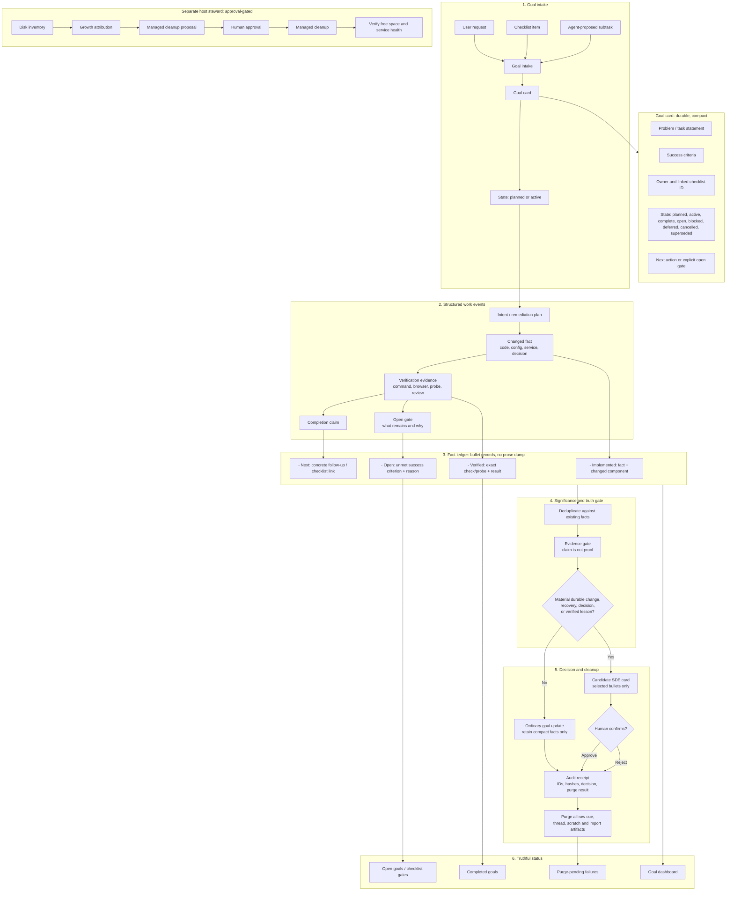

# Curator V2: goal-ledger intelligence, not transcript curation

## Summary

Curator V2 is a standalone rewrite. It does not import V1 runtime code, state,
or raw artifacts. References to `*-v1` contracts and schemas in this repository
mean the first version of a V2-owned interface; they do not imply V1 runtime
compatibility. The separate V1 cutover section is an owner-operated rollout
gate, not a V2 implementation dependency.

The missing primary object is a **goal**, created from a user request, a checklist item, or an explicit agent subtask. V2 continuously records compact, evidence-backed lifecycle facts against that goal. A real SDE is a derived durable outcome—not the unit of capture.



## Core behavior

- At task start, V2 records: **problem**, **success criteria**, linked checklist item, and initial state.
- Parent goals may contain bounded child tasks with independent success
  criteria, evidence, dependency links, status, and next action. A parent stays
  open until every child is complete or explicitly retired and every declared
  dependency is complete.
- During work, agents emit compact typed facts rather than preserving full chats: intent, change, verification, open gate, completion, and cleanup.
- At task finish, V2 records one of:
  - **Completed:** every success criterion has direct evidence.
  - **Open/deferred:** completed facts, remaining criteria, blocker, and next action.
  - **Blocked:** exact failed dependency plus recovery path.
  - **Cancelled/superseded:** explicit reason; superseded work links to an
    active same-project replacement. Neither outcome asserts that criteria
    passed.
- Reopening a completed goal starts a new evidence epoch: prior facts remain
  immutable and visible, but pre-reopen verification does not satisfy current
  success criteria. Reopen requires a reason and concrete next action; completed
  parent/dependent goals must be reopened in dependency order. Criteria changes,
  cancellation, and supersession require separate explicit lifecycle events.
- A significance gate derives an SDE only when evidence supports a durable implementation, decision, recovery, or lesson. Routine progress remains a goal update.
- Every durable record is short bullets, separating observed facts from planned or unverified claims.
- After approval or rejection, V2 retains the compact goal facts and an audit receipt, then removes all transient artifacts. Failed deletion is visible as `purge_pending`, never hidden behind green health.

## Token and disk discipline

- No raw transcript store, cue queue, scratch archive, or paragraph synthesis pipeline.
- One bounded goal card plus deduplicated fact bullets; new events merge into the existing goal rather than creating duplicate records.
- Evidence references carry hashes, path/command identifiers, and outcomes—not command output or chat history.
- Status reports show: active goals, completed goals, explicit open gates, SDE candidates, and failed purges.
- The separate Host Steward reports disk growth and proposes managed cleanup; it performs no deletion without approval.

## Interfaces and tests

- `goal.start`, `goal.fact`, `goal.finish`, `goal.defer`, `goal.status`,
  `goal.reopen`, `goal.criteria_amended`
- `sde.assess`, `sde.confirm`, `artifact.purge_status`
- `steward.inventory`, `steward.propose_cleanup`, `steward.execute_cleanup`

Tests must prove that:

- a checklist task preserves its original success criteria through completion;
- an incomplete task stays open with a concrete next action;
- unsupported agent claims cannot close a goal;
- ordinary updates do not become SDEs;
- confirmed/rejected SDEs purge transient artifacts while preserving bullet facts and receipts;
- an interrupted purge is retried and visibly reported;
- no host cleanup happens without explicit approval.

## Cutover

Freeze V1 read-only, preserve existing canonical Markdown, inventory its runtime artifacts, create purge receipts, then remove obsolete V1 sources in an auditable pass. Do not import V1’s raw transcripts into V2.

## Delivery checklist

This is the implementation and rollout checklist for the proposed V2 landscape.
Checkboxes describe verified repository state, not architectural intent:

- `[x]` Implemented in this repository and covered by the current unit tests.
- `[ ]` Open: proposed, not implemented, or not yet verified end to end.
- `[!]` Decision or external dependency required before the item can close.

An item closes only when its listed observable evidence exists. Unit tests prove
the behavior of this library slice; they do not prove a running backend,
consumer plugin, Hermes integration, or production deployment.

### 0. Product contract and bounded ownership

- [x] Define a goal as the primary record, with problem, success criteria,
      status, owner/checklist references, and next action.
- [x] Keep the global backend in this repository; keep repository-specific
      plugin and config in each consuming repository.
- [x] Keep Hermes runtime, event router, gateway, profiles, and Host Steward
      outside CuratorMD ownership. Host Steward belongs to the Hermes Core account.
- [x] Define raw chats, transcripts, imports, cues, and scratch as temporary
      evidence only, never canonical knowledge.
- [x] Define a strict, versioned, project-context lifecycle event envelope with bounded UTF-8 serialization and typed goal/fact payloads.
- [x] Publish versioned event, goal, fact, SDE, receipt, error, and plugin
      data-shape contracts with compatibility and migration rules; validate
      runtime events and records against the machine-readable schema bundle.
- [ ] Record supported data-retention, privacy, threat-model, and operator
      requirements from the actual deployment owners.
- [x] Record boundary-changing decisions in architecture decision records.
      [`ADR 0001`](adr/0001-managed-markdown-projection-integrity.md) documents
      the managed Markdown checksum, legacy behavior, and why it does not settle
      the deployment system-of-record policy; future boundary changes still
      require their own ADR.

### 1. Goal intake and lifecycle

- [x] Start a goal with a compact problem statement, one or more named success
      criteria, and optional owner/checklist references.
- [x] Constrain goal and criterion fields so they stay bounded and readable.
- [x] Preserve the initial criteria on the goal record through lifecycle
      transitions.
- [x] Record typed intent, change, verification, open-gate, completion-claim,
      outcome, cancellation, and supersession facts as single compact bullets.
- [x] Keep a goal open when a completion claim lacks passing evidence for any
      criterion; record the unmet criteria and a concrete next action.
- [x] Permit completion only when every criterion has independently verified
      passing evidence.
- [x] Represent blocked and deferred outcomes with a reason and recovery or
      next-action path.
- [x] Make goal/fact transitions transactional and make duplicate facts
      idempotent.
- [x] Test criteria preservation, incomplete goals, evidence-gated completion,
      compact facts, duplicate facts, status filtering, and rollback on failure.
- [x] Add bounded source IDs and optional monotonic source sequences to the
      versioned event envelope; atomically advance per-project/source cursors with
      goal/fact changes and keep sequence gaps retryable without applying facts.
- [x] Serialize fact append against completion across SQLite connections and
      reject a fact if the goal is complete at the transaction's write boundary;
      cover with a deterministic two-connection regression test.
- [x] Reopen a completed goal with a reason and next action, preserve its prior
      facts, require completed parent/dependent goals to reopen in dependency
      order, and prevent pre-reopen evidence from satisfying the new work epoch.
- [x] Amend a non-complete goal's criteria only through an explicit
      revision-checked event; preserve append-only criteria history and require
      fresh evidence after amendment. Completed goals must be reopened first;
      history is bounded to 16 versions per goal.
- [x] Define cancellation/supersession as append-only terminal outcomes, require
      an active same-project replacement for supersession, reject retirement while
      children/dependents remain unfinished, and serialize competing terminal
      transitions so the first wins and later transitions conflict. Reopen,
      dependency, evidence, and parent-completion consequences are specified in
      `docs/event-contract-v1.md` and covered by lifecycle/event/concurrency tests.
- [x] Add `lifecycle_revision` to goal status; atomically advance it for
      status/criteria transitions and require MCP clients to submit their
      observed revision for finish/defer/block/reopen/amend operations. Stale
      writes leave facts and state unchanged; legacy raw events without a
      revision are interpreted as revision 1 and fail closed after transition;
      migrated goal rows receive a revision-2 fence because prior transition
      counts cannot be reconstructed.
      Tests cover stale defer/block and criteria writes, event failure receipts,
      and verified multi-connection terminal races.
- [x] Exercise every public lifecycle action against every persisted goal
      status. Dedicated activation/reopen/retirement operations own their state
      changes; rejected actions preserve status, revision, and facts. The
      generic transition primitive cannot set those dedicated target states or
      finish a planned goal.
- [x] Generate mixed lifecycle action sequences across planned, active, open,
      blocked, deferred, complete, cancelled, and superseded states; verify
      revision progression, criteria revisions, evidence-epoch resets, and
      rejection atomicity after each action.
- [x] Generate parent/child/dependency action sequences; prove finish requests
      preserve explicit open gates until related work resolves, parent/dependent
      retirement is rejected while work remains unfinished, and rejected actions
      leave every linked goal and fact list unchanged.
- [x] Exhaust all reopen orders for a nested parent/child tree with a completed
      prerequisite; enforce parent-first and dependent-before-dependency reopen
      order while preserving prior facts and requiring fresh criterion evidence.
- [x] Implement reference-plugin adapters for explicit user requests, bound
      checklist rows, and accepted child subtasks; every route requires caller-
      supplied success criteria, checklist intake preserves an exact source
      line/revision, and child intake preserves its parent link. Tests prove
      criteria are unchanged and missing criteria are rejected. Hermes-authored
      intake and a real consumer workflow remain separate open integration gates.
- [x] Capture an optional bounded next action at goal intake through the
      versioned event, MCP, and repository-plugin paths; report a missing action
      explicitly and include the concrete step in TODO/report output. Legacy
      payloads remain valid. Event round-trip/schema, project-plugin persistence,
      report, and MCP regressions cover the local contract; this does not prove
      a live consumer emits the action.
- [ ] Demonstrate the lifecycle through a real consumer workflow, from request
      capture to a truthful planned/active/completed/open/blocked/deferred/
      cancelled/superseded status view.

### 2. Evidence and fact ledger

- [x] Store evidence references (kind, locator, SHA-256, outcome), not raw
      command output, chat content, or transcript bodies.
- [x] Require evidence references on verification facts and link each
      verification fact to a success criterion.
- [x] Default to reject-all evidence verification when no trusted adapter is
      configured.
- [x] Separate completion claims from verification facts in the domain model.
- [x] Define trusted evidence adapters and their authentication, freshness,
      scope, and revocation rules in
      [`evidence-adapters-v1.md`](evidence-adapters-v1.md). Local typed receipt
      adapters enforce the documented bindings and source ceilings; tests use
      synthetic host receipts and do not prove source authentication.
- [x] Persist compact host-provided verification attestations beside immutable
      verification facts, include them in fact digests and capacity accounting,
      and revalidate source revision, adapter, and subject on each criterion
      check. Legacy facts receive no invented provenance and remain unverified.
- [ ] Integrate repository runners, service probes, browser sessions, and
      authenticated human-confirmation sources with deployment-owned credentials,
      trust roots, revocation checks, and end-to-end probes; a generic resolver
      protocol plus synthetic tests does not close this gate.
- [ ] Complete the source-specific integrations for repository diffs/tests,
      service probes, browser proof, and authenticated human observations, each
      bound to deployment trust roots and end-to-end source evidence.
- [x] Bound immutable fact history to 512 facts/512 KiB per goal and 10,000
      facts/16 MiB per project; reject over-limit appends atomically without
      pruning, expose capacity gates in goal/project status, and test count/byte
      exhaustion plus idempotent retries at the ceiling.
- [x] Implement reviewer-approved fact-cap recovery: propose only eligible
      routine facts; preserve their exact source bullets and immutable IDs in a
      compressed, project-scoped archive with hashes for both canonical source
      records and compressed bytes; require an authenticated reviewer decision
      before removing any fact from the active ledger. Never compact verification,
      outcome, open-gate, lifecycle/criteria, decision, SDE-supported, or otherwise
      evidence-bearing facts. **User-selected policy:** retain the compressed,
      hash-verified source-bullet archive and compact only eligible routine facts
      after reviewer approval. **Exit evidence:** tamper detection, interrupted
      archive/ledger recovery, approval attribution, idempotent replay, archived
      fact retrieval, authenticated receipt reads, byte/count reporting, and
      capacity-resume tests pass; failed archive verification or persistence
      leaves active facts and the capacity gate unchanged.
- [x] Bound the global event inbox to 250,000 receipts and 128 MiB of retained
      logical row bytes across all projects; reserve room for failure metadata,
      reject new IDs before writes at the ceiling, preserve idempotent replays,
      never auto-prune, and expose aggregate-only capacity/gate status.
- [ ] Define an approved retention/compaction and recovery workflow for a full
      event inbox, plus budgets for every other permanent data class; prove safe
      recovery before enabling broad automatic capture.
- [x] Enforce explicit domain ceilings for criteria, dependencies, evidence
      references, SDE supporting facts, and per-receipt artifact paths, including
      direct callers that bypass serialized-event limits; cover limit and
      duplicate-manifest rejection with tests. Project-level fact ceilings are
      covered separately; backend-wide fact budgets and event-receipt retention
      remain open.
- [x] Add strict schema validation and reject-only high-confidence secret/PII
      pattern checks before lifecycle/domain writes; never auto-redact evidence.
      Regressions prove rejected event content is not written to the inbox or
      goal ledger. See `docs/content-safety-v1.md`.
- [ ] Threat-model scanner false negatives/positives, formats and jurisdictions
      beyond the current high-confidence patterns; expand based on deployment
      policy without claiming a clean scan is privacy certification.
- [x] Write a preliminary threat register for the local implementation boundary,
      explicitly separating implemented controls from deployment assumptions and
      residual risks; see [`threat-model-v1.md`](threat-model-v1.md). Owner review,
      deployment-specific policy, and validation remain open.
- [x] Provide project-scoped `goal_bullet_projection` output with separate
      recorded, evidence-verified, unverified-claim, and current-open-gate
      categories; stale gate facts remain labeled as history. Test open and
      complete states through service and MCP.
- [x] Provide a bounded, authenticated `goal_report` read with problem,
      criterion evidence, paged fact bullets, TODOs, dependencies, review, and
      canonical-write/purge state. Keep evidence locators/hashes in
      `goal_status`; verify open/unverified truth, paging limits, MCP exposure,
      and that evidence checks do not run under a SQLite write transaction.
      Child, pending-SDE, and receipt details are also paged (32/16/16 per
      report) with exact SQL aggregate totals; the report never hydrates their
      full histories to render a bounded page. Tests reject the former unpaged
      service calls and verify child totals and offsets. The report also shows
      the exact captured checklist item and a separate bounded list of current
      open gates, distinct from historical gate facts and TODO actions.
- [x] Keep `goal_status` and its bullet projection bounded as well: facts are
      capped per goal, criteria history is capped by lifecycle policy, and SDE
      candidates/purge-pending receipts are returned in 32/16-record pages with
      exact totals, candidate state counts, and next offsets through
      service/API/MCP/plugin. More backlog is an explicit open gate, not silent
      omission.
- [x] Provide an authenticated `goal_list_page` that returns only compact goal
      cards, total matches, and the next offset; apply status filters before
      paging. Keep the legacy full-snapshot list available only up to 100 goals
      and fail with a capacity error above that bound, so overview reads do not
      materialize unbounded fact/review history. Tests cover filter/order,
      pagination, authorization, and the compatibility guard.
- [x] Verify deduplication across retries and semantically duplicate adapter
      events without collapsing distinct evidence or decisions; see event,
      lifecycle, property/fuzz, and immutable-review replay tests.

### 3. Significance and human SDE review

- [x] Distinguish routine progress from implementation, decision, recovery,
      or verified-lesson materiality.
- [x] Refuse a routine SDE candidate and require selected supporting facts.
- [x] Require a selected passing verification fact before creating an SDE
      candidate; keep candidate facts within the assessed goal.
- [x] Deduplicate repeated assessments over the same supporting facts.
- [x] Keep SDE candidates pending explicit human approval or rejection.
- [x] Require a fail-closed host review-authorizer before decisions; store the
      author's opaque authenticated subject and optional single-line rationale in
      the immutable receipt. The default has no reviewer and rejects decisions.
- [x] Document qualification examples and non-examples for each materiality
      category, including how expected impact differs from measured outcomes;
      see `docs/sde-review-policy-v1.md`.
- [x] Provide a bounded, project-scoped in-process review queue and candidate
      detail containing the goal and selected supporting facts/evidence.
- [x] Expose project-scope-authorized SDE review queue, detail, packet, and
      decision operations through the API/MCP surface. Decision calls also
      require a separately injected fail-closed reviewer authorizer; API/MCP
      tests cover permission denial, both dispositions, immutable receipts,
      rationale, timestamp, and conflicting retries.
- [ ] Bind review decisions to verified Hermes Core user/project permissions
      and exercise authenticated reviewer identity end to end. The current
      local profile ID is an operator assertion, and synthetic test authorizers
      do not satisfy this production identity gate; a reviewer UI also remains
      unimplemented.
- [x] Make an SDE decision and its artifact manifest immutable after the first
      durable receipt; repeated requests with changed decision or targets conflict.
- [x] Record bounded, idempotent corrections as linked append-only follow-up
      records rather than rewriting prior decisions; require reviewer
      authorization and persist reviewer identity, rationale, and timestamp.
      Review detail and canonical Markdown expose the correction; project usage
      counts its records/UTF-8 bytes. Covered by store, API, MCP, and projection
      tests. The original decision receipt remains unchanged.
- [x] Verify every generated SDE review packet uses a single-line rationale
      linked to selected compact fact bullets and evidence references; multiline
      session recaps are rejected by the domain model and regression-tested.
- [x] Keep pending and rejected SDE candidate narratives out of canonical
  Markdown; only approved candidates project, while every human decision stays
  represented by compact facts and its immutable audit receipt.
- [x] Add reviewer-quality feedback and evaluation metrics without claiming
      autonomous learning or improvement absent measured evidence. Schema v12
      stores one append-only, host-authorized label per reviewer/candidate after
      a durable disposition; identical retries are idempotent and conflicting
      second submissions fail. Project summaries and Prometheus counts exclude
      identities and rationales, and storage usage accounts for the feedback
      bytes. Labels are human QA observations, not ground truth or model-training
      signals. Local API/MCP, persistence, schema, and migration tests cover the
      flow; production review authorization and feedback-retention policy remain
      open.

### 4. Receipt, artifact inventory, and purge transaction

- [x] Commit a review receipt, decision, fact digest, and artifact references
      before any purge attempt.
- [x] Gate purge on a project plugin's successful canonical Markdown write;
      record the allowlisted target and projection hash immutably before releasing
      cleanup, and leave the receipt pending if the write fails.
- [x] Require the adapter to mark the full artifact inventory complete before
      deleting any artifact, including an explicitly confirmed empty inventory.
- [x] Restrict purge to exact regular files below the configured staging root;
      reject path escapes, directories, symlinks, unsafe platforms, and hash
      mismatches.
- [x] Make missing-file retries idempotent and persist per-artifact purge
      outcomes and attempts.
- [x] Keep incomplete inventories and failed deletions visible as
      `purge_pending`; preserve canonical facts and receipts across store reopen.
- [x] Test approval and rejection, incomplete and partial inventories, empty
      complete inventory, hash mismatch, path escape, symlink/directory, retry,
      crash-after-delete recovery, replayed decisions, and durable receipts.
      Additional progress (2026-10-20): the MCP SDE lifecycle acceptance test
      now includes both a held and an unheld transient artifact. After canonical
      persistence, the unheld file is purged in the same operation while the
      held file remains pending; a unique transient-content canary is absent
      from canonical Markdown. This is local end-to-end test evidence, not a
      live consumer or production purge scheduler.
- [ ] Implement inventory discovery in each staging adapter and prove it
      accounts for every temporary artifact class (raw chat, cue, import, scratch,
      generated intermediate, and duplicate). Progress (2026-10-18): the
      reference-plugin scanner regression inventories representative files for
      all six classes under its configured staging root, including same-content
      files at distinct paths. This does not prove real producers route every
      artifact into that root; producer adapters and out-of-root coverage remain
      open.
- [x] Implement reference-plugin discovery for every regular file inside the
      selected goal directory beneath the configured staging root, with bounded
      streaming SHA-256, an explicit incomplete state on skipped/changed/over-
      limit entries, and a fresh exact manifest comparison before a reviewer-
      declared complete inventory can release purge. The packet carries the
      goal scope, and tests prove another goal's artifacts cannot enter its
      manifest; producer routing and out-of-root coverage remain open.
- [ ] Define retention exceptions and legal/operational holds; ensure held
      artifacts cannot be accidentally purged. Local v9 storage now accepts
      reviewer-selected `legal` and `operational` holds, exposes `held` state,
      excludes held targets from explicit and scheduled retries, and keeps the
      receipt pending. Local v10 adds exact authorized release with durable
      actor/time/rationale audit and resumes purge only after release commits.
      There is no implicit expiry or release. Owner retention policy and
      staging-adapter hold discovery remain open.
- [x] Implement persisted per-artifact capped exponential backoff, a bounded
      scheduler-facing due-retry pass, and status visibility for each retry
      deadline; preserve the authenticated explicit retry as an immediate
      operator override. Test delayed selection, due execution, and recovery.
- [ ] Operate purge retries under a production scheduler with dead-letter
      alerting and reconciliation for process/database failure between each
      transaction boundary. Progress (2026-10-19): added the
      `curatormd-v2-maintenance` one-shot entrypoint. It requires explicit
      `--execute-due-purges`, binds one repository-owned config/project, caps a
      pass at 1,000 receipts, and delegates only to the due/backoff-aware purge
      service while holding the project's staging lock. It reports aggregate
      complete/pending counts and exits nonzero on pending work or sanitized
      runtime failure; no review decision, hold release, or backoff override is
      available. CLI tests cover opt-in, batch binding, pending alert status,
      sanitized errors, and store closure; a plugin test proves lock ownership.
      A disposable end-to-end test injects a purge failure, closes/reopens the
      SQLite store through the CLI, and proves the exact previously reviewed
      artifact is removed only after its retry deadline. The rebuilt wheel was
      also refreshed in GPTMD's ignored venv; the installed maintenance command
      loaded GPTMD's actual project config and returned zero due work with a
      disposable database. The full 282-test suite, Pyright, errors-only
      Pylint, Bandit, and `git diff --check` pass. This remains a local scheduler
      job unit; the 24 purge/maintenance tests also pass under GPTMD's Python
      3.12 environment. This is not an installed production timer,
      dead-letter delivery, or crash/reconciliation drill; those gates remain
      open. Operator usage and
      trust constraints are in
      [`consumer-operations-v1.md`](consumer-operations-v1.md#run-one-due-purge-retry-pass).
- [x] Expose project-scoped per-receipt and per-artifact status, creation age,
      attempt count/timestamp/age, last error, and read-only safe recovery action
      through the service/API/MCP status path; persist each attempt before file
      deletion so crash-after-delete remains observable. Schema v3 migrates
      existing targets with receipt creation time; migration, failure, pending,
      completed, and interrupted-deletion tests cover the local slice.
- [ ] Aggregate purge and other required-work states into truthful operational
      health; green must remain impossible while required work is pending,
      overdue, or unaccounted for. This requires the production scheduler and
      health/alert integration, not just the project-scoped status tool.
- [ ] Complete a failure-injection test matrix against the production storage
      and staging adapters, not only local temporary files.

### 5. Global backend, persistence, and operations

- [x] Provide a SQLite-backed application-service/store slice with private
      database-file permissions and atomic transitions.
- [x] Expose in-process goal start/fact/finish/defer/block/status/list and
      SDE assess/confirm/purge-status operations.
- [x] Expose an authenticated, project-scoped paginated goal-card list that
      reports total/next offset, supports lifecycle filters, and avoids loading
      fact/review histories for overview reads. Keep the legacy full-snapshot
      list bounded to 100 matching goals and return a capacity error above that
      ceiling; request `goal_report` or `goal_status` for details. Tests cover
      pagination, filtering, authorization, and fail-closed legacy behavior.
- [x] Expose the same compact pagination for child-task listings and bound the
      legacy full-snapshot child view to 100 siblings. Parent ownership,
      lifecycle filtering, authorization, and compact-card results are tested;
      internal completion checks still inspect every child independently.
- [x] Validate version-1 lifecycle event envelopes, reject unknown/duplicate
      fields and payloads over 16 KiB; persist idempotent inbox receipts and
      discard payload text after explicit processed-state transition, without
      treating project IDs as authentication.
- [x] Apply supported goal/fact lifecycle events and their processed receipts
      in one SQLite transaction through a service bound to one project ID; failed
      events roll back ledger mutations and remain retryable with safe error codes.
- [x] Add a transport-neutral fail-closed API facade with project/action
      authorization hooks, bounded version-1 event JSON ingress, request-limiter
      interface, goal/review/status/purge operations, and cross-project denial
      tests.
- [x] Implement actual MCP SDK v2 tools over stdio with host-bound caller,
      project, and producer identity; cover list/schema and goal lifecycle using
      in-memory client and real subprocess stdio tests. Progress (2026-10-19):
      the installed `curatormd-v2-mcp` console launcher also passed an isolated
      temporary-consumer round trip: an explicitly write-granted profile started
      and read back a typed planned goal with its configured project ID, problem,
      and success criterion intact. The MCP schema exposes neither project nor
      caller identity arguments. The stdio client context shut down cleanly;
      this is local launcher evidence, not live Hermes identity or deployment
      verification.
- [ ] Connect the MCP factory to verified Hermes identities/profile selection;
      use a shared production rate limiter and verify its permissions through
      the real Hermes transport. Progress (2026-10-19): the local stdio factory
      now injects a bounded SQLite token bucket shared by workers using the same
      database (120 requests per subject/project per 60 seconds; at most 10,000
      tracked buckets). Migration v13 and cross-connection/concurrency tests
      cover quota enforcement, restart persistence, full-refill-only idle-bucket
      cleanup, clock rollback, and fail-closed registry bounds. Verified Hermes
      identity, production quota policy/configuration, distributed limiting, and
      real Hermes transport remain open.
      Progress (2026-10-20): the local profile-bound launcher now rejects every
      MCP tool call unless Hermes-injected profile and session metadata are
      present and the profile exactly matches the operator-pinned launcher
      identity. In-memory and real stdio regression tests cover missing,
      mismatched, and valid context; all 298 Curator tests, strict Pyright,
      errors-only Pylint, and Bandit pass. This is fail-closed local
      host-context binding, not cryptographic authentication or proof of a live
      Hermes transport; those and production
      limiter policy remain open.
      Progress (2026-10-20): the launcher now also requires an active durable
      project registration matching the canonical repository-root fingerprint,
      exact config-file hash, and backend API version, and reads exact grants
      from SQLite on every request. A separate attended `curatormd-v2-access`
      command can provision and audit local grants outside MCP; its operator
      identity is only the local OS UID. Progress (2026-10-20): 300 full-suite
      tests pass on Python 3.13.15, strict Pyright, errors-only Pylint, Bandit,
      lock audit, and diff check pass, including attended registration, exact
      grants, launcher enforcement, and noninteractive/wrong-confirmation
      denial. Verified Hermes identity, authenticated administrator identity,
      and live Hermes transport remain open; profile metadata is not
      cryptographic authentication.
- [x] Implement a local bounded durable router pass with a fixed trusted
      project/service map, transactional idempotent processing, attempt-counted
      retries, capped persisted exponential retry due times, source-sequence
      ordering, poison-event quarantine with retained payload, audited human-
      authorized retry, and aggregate queue-age metrics; cover
      failure/retry/order/auth/migration behavior with unit/API/MCP tests.
- [x] Add local cross-process worker coordination using atomic SQLite event
      claims with expiring owner leases, expired-claim recovery, owner-fenced
      processing/failure commits, and aggregate active/expired claim counts;
      cover competing connections, reclaim, stale-owner rejection, and schema
      migration with tests. This does not prove a deployed worker topology.
- [ ] Operate the router under a production scheduler with production alert
      delivery, restart/load/failure-injection probes, and deployment-observed
      lag; local SQLite leases and due-time backoff do not satisfy this gate.
- [x] Implement an explicitly invoked, project-scoped Markdown projection with
      target revalidation, per-goal idempotent blocks, atomic replacement, bounded
      UTF-8 reads/writes, and preservation of unrelated document content.
- [x] Add deterministic reconciliation between the structured ledger and the
      Markdown projection, including safe recovery when either side is updated
      before a crash. Progress (2026-10-18): a read-only per-goal comparison now
      reports `synced`, `missing`, `divergent`, or `malformed` with block hashes
      and does not mutate either store. The comparison is now surfaced through
      project-authorized API and MCP `goal_reconcile`; API/MCP tests cover missing,
      synced, and divergent states and prove caller denial and no rewrite on
      manual document edits. Tests cover ledger-first updates followed by an
      explicit projection retry across a reopened SQLite store, plus an
      interruption after Markdown replacement but before the canonical receipt
      update; after reopening SQLite, retry commits the receipt and only then
      releases the empty-inventory purge gate. This is recovery across a store
      connection restart, not process-kill or power-loss testing.
      Project-level `project_reconcile` now pages at most 100 SQLite goals,
      scans the configured target once (maximum 8 MiB), identifies orphan and
      malformed marker hashes plus unrecognized-marker counts, and marks
      inventories over 5,000 markers incomplete. Tests prove pagination, orphan
      detection, scan-bound reporting,
      project authorization, and no mutation. Manually edited/malformed conflicts
      are not auto-resolved. Additional progress (2026-10-19): generated goal
      blocks now carry an unkeyed SHA-256 content checksum. New projections
      update stale checksummed blocks, but checksum-mismatched edits fail closed;
      exact legacy blocks may be upgraded only when they match the current
      SQLite projection, and stale unsealed legacy blocks are preserved. Tests
      cover manual-edit rejection, legacy upgrade/refusal, reconciliation, and
      purge ordering. This is accidental-edit detection, not authentication or
      an authoritative-store decision. Production recovery and system-of-record
      policy remain open.
- [ ] Define the system of record and recovery behavior when SQLite, canonical
      Markdown, and a consuming repository disagree.
- [ ] Add backups, restore drills, schema migrations, integrity checks, and
      supported upgrade/rollback procedures. Local non-overwriting SQLite
      backup/restore helpers and integrity tests now exist; production drills,
      migration/rollback drills for deployment data, and supported upgrade/
      rollback policy remain open. Local migration paths through v16 are
      covered; the v0-to-v1 step has an injected-rollback fixture, v1-to-v2
      preserves existing inbox receipts,
      v2-to-v3 backfills purge-target age, and v3-to-v4 adds persisted retry
      scheduling without delaying legacy failed events; v4-to-v5 adds expiring
      worker claims without losing persisted retry deadlines; v5-to-v6 adds
      purge retry deadlines while keeping legacy failed artifacts immediately due;
      v6-to-v7 stores initial goal status/source event IDs and deliberately leaves
      older provenance unknown rather than inferred; v7-to-v8 adds verification
      attestation storage with empty legacy defaults, preserving facts without
      treating old verification as currently trusted; v8-to-v9 adds a nullable
      artifact hold kind, leaving legacy targets unheld; v9-to-v10 adds hold
      placement/release audit fields and includes only explicitly released
      held targets in purge selection.
      Sequential migration functions are isolated in
      `src/curatormd_v2/schema_migrations.py`; `CuratorStore` retains the
      surrounding transaction boundary and unversioned-schema bootstrap.
      Additional progress (2026-10-20): added a destination-race failure test
      for non-overwriting backup installation. It creates the competing file
      after destination validation but before the hard-link install, then
      verifies the concurrent file is preserved and the verified temporary
      snapshot is removed. The focused test and full 303-test suite pass;
      strict Pyright, errors-only Pylint, Bandit, locked dependency audit, and
      `git diff --check` pass. This is local filesystem evidence, not a
      production backup or restore drill. Version 16 redacts legacy purge
      exception details while preserving retry state, with injected rollback
      coverage.
- [ ] Publish operational dashboards and alerts for event intake, goal state,
      evidence rejection, review backlog, inventory completeness, purge backlog,
      storage growth, and adapter errors.
      A local authorized `project_metrics` / `project_prometheus_metrics`
      exporter now renders bounded, content-free Prometheus exposition for
      health, queues, goals, dependencies, project-attributed logical storage,
      bounded staging measurements, and current failed/quarantined receipts by
      fixed evidence-rejected, evidence-adapter-error, and other categories.
      Categories derive from sanitized exception type codes; raw exception
      text, event payloads, and evidence references are never metric labels.
      Event-ingress regressions distinguish unsupported proof from an operational
      resolver exception and prove neither failure accepts verification facts.
      This is a snapshot function, not deployed scrape infrastructure or
      alerting. Host scrape endpoint, dashboards, alert rules/delivery, and
      operator budgets remain open.
- [x] Define local truthful health semantics: green requires every required
      host dependency explicitly healthy, a complete empty staging inventory,
      available event/fact capacity, and zero event/review/purge backlog or
      expired claims; degraded/unknown states expose exact bounded gate codes.
      The authenticated API and MCP `project_health` read aggregate these local
      observations without event/artifact content; missing/failed probes remain
      unknown, while known failures/backlogs remain degraded. Exact review/purge
      counts use SQL aggregates, not bounded queue samples. Host readiness must
      include timezone-aware observation timestamps no older than 60 seconds;
      stale, malformed, missing, or over-five-second-future observations remain
      unknown. Local database aggregates share one SQLite read snapshot while
      staging is scanned separately through its bounded no-follow traversal.
      Tests cover auth,
      unknown probes, probe exceptions, backlog, staged artifacts, healthy
      preconditions, timestamp freshness/skew, malformed probes, and MCP output.
      Production probes, schedulers, alerting, and dashboard wiring remain open.
- [x] Expose content-free project activity separately from operational health:
      retained event receipts by processing state, last received/processed
      times, goal/fact totals, and pending/approved/rejected SDE counts. The
      project-authorized API/MCP read reveals no event or record identifiers or
      content. `events_observed` reports retained inbox history only; it is not
      a producer connection or capture-completeness guarantee. Tests distinguish
      an empty project with unknown and healthy host readiness from a project
      with observed events but zero SDEs, and verify pending-SDE counts through
      the API/MCP.
- [x] Report project-attributed logical record counts/UTF-8 bytes by data class
      and lifecycle event class/status, plus separately labeled global SQLite
      database/WAL file sizes and a bounded, content-free scan of each configured
      project staging tree; expose only through project-authorized API/MCP reads
      and test processed-payload discard, denied access, scan bounds, symlink
      rejection, and SDE correction accounting.
- [x] Provide non-overwriting SQLite online backup and restore-to-new-file
      helpers with integrity checks, private file permissions, symlink rejection,
      and corruption/round-trip tests; see [`storage-recovery-v1.md`](storage-recovery-v1.md).
- [x] Version the local SQLite schema; migrate unversioned legacy databases to
      v13 atomically, preserve records, prove v0 rollback on injected failure,
      migrate v1 router metadata without losing receipts, backfill v2 purge
      target timestamps, add v3 retry scheduling, and refuse unsupported future
      versions; see
      [`schema-migrations-v1.md`](schema-migrations-v1.md).
- [ ] Measure staging/temp bytes and model/token use per project, then define
      budgets, retention thresholds, and alerts. Fact-history limits exist, but
      staging bytes and file counts are now locally measurable by fixed
      temporary-artifact class through the authorized API/MCP and metrics; files
      outside the goal/class layout are grouped as `other`, with completeness
      reported separately. Progress (2026-10-19): the per-project plugin config
      can opt into byte and file-count staging budgets; budgeted writes fail
      closed on incomplete inventory, surface the configured limits in the
      authorized storage read, and never delete artifacts. The bounded scan is
      an observation, not a retention policy or delete authorization. Backend-
      wide budgets, retention thresholds, age policy, and alerts remain open.
      Provider/model token usage is not collected by Curator. It belongs to
      Hermes Core's local project-usage accounting; Host Steward remains a
      separate root-account host-disk concern and must not own project token
      records. Hermes source now records reported Codex app-server token counts
      locally only when a durable project binding exists, excludes counts from
      hook/Curator event payloads, and distinguishes missing usage from zero.
      This covers Codex app-server turns only; cross-provider aggregation and
      usage budgets remain open. Progress (2026-10-20): the Hermes Core fork now
      includes an opt-in, read-only `project_usage` profile plugin pinned to one
      configured project ID. It reports Codex-only totals and provider/model
      groups, distinguishes unknown usage from zero, and does not expose
      goal/session/event IDs or create a missing ledger. Its focused tests and
      Hermes lint/health checks pass; enabling and verifying it in a real
      project profile remains open. Event-receipt retention, backend-wide
      budget policy, retention thresholds, alert delivery, and age-based
      cleanup approval remain open before broad capture.
- [ ] Verify restart recovery, duplicate delivery, delayed ordering, load,
      database locking, backup restore, and multi-project isolation. Local unit
      coverage now explicitly closes/reopens SQLite with a sequence-gap event
      pending, applies the missing predecessor and queued event in order, then
      replays the same stable event ID without a duplicate fact. Separate tests
      cover retries/quarantine, cross-connection claim fencing, backup restore,
      and two repository plugins sharing one store without sharing goals. The
      full deployment-like load/restart/locking/disk-growth matrix remains open.
      Additional progress (2026-10-19): a subprocess regression now kills a
      worker with `SIGKILL` immediately after it durably claims an event, waits
      for the one-second lease to expire, then routes the event from a second
      process and verifies the goal mutation/receipt exactly once. This proves
      local crash-lease recovery. The same test then takes a consistent SQLite
      snapshot, restores it to a new file, and verifies both the processed
      receipt and goal state survived. Production worker topology, load, and
      power-loss durability remain unverified. Hermes Core's project-usage
      ledger also has a local close/reopen/replay regression: persisted
      provider/model counts survive reopening, and replaying the same
      turn-end event leaves counts unchanged. Cross-process Hermes delivery,
      full end-to-end integration, and production restart/load behavior remain
      open.

### 6. Per-project plugin and repository boundary

- [x] Define the version-1 config contract and a minimal reference plugin
      adapter in a module separate from the global application service.
- [x] Parse a repository-owned `.curatormd-v2.toml` with strict schema, bounded
      size, project identity, read scope, checklist bindings, registered evidence
      adapter names, staging root, and Markdown persistence targets.
- [x] Bind the reference plugin to a configured project ID; validate checklist
      and read paths against repository scope, re-check staging at bind time, and
      expose only project-scoped goal/event operations.
- [x] Test two separate repository configs sharing a backend while retaining
      isolated goal listings, plus traversal, symlink, unknown-field, adapter,
      target, size-limit, and project-binding rejection.
- [x] Add a bounded staging usage observer that reports only regular-file count
      and sizes, does not open artifact contents or follow symlinks, and marks
      skipped/over-limit scans incomplete; this is not complete purge inventory
      discovery and cannot authorize cleanup.
- [x] Add reviewer-authorized staging manifest discovery with streaming hashes;
      verify the complete manifest at approval/inventory finalization and leave
      receipt pending when a file is skipped, changed, or absent from the user's
      submitted list. Cooperating plugin writers, review/finalization, and purge
      operations now serialize through an exclusive staging-directory lock; a
      concurrent streaming-writer regression proves a review scan sees the
      atomically published file, not a partial. Direct filesystem writers bypass
      this advisory lock; external producer coordination remains open.
- [x] Install a plugin package and its config in an actual consumer repository;
      the template is not an installed integration. Progress (2026-10-19):
      GPTMD now has a repository-owned `.curatormd-v2.toml` binding project ID
      `gptmd`, the Curator V2 checklist, selected read-only roots, ephemeral
      staging, and only `persistence/HISTORY.md` plus
      `persistence/LESSONS-LEARNED.md` as canonical targets. `ProjectConfig.load`
      and `ProjectPlugin.bind` passed against the real GPTMD checkout using a
      disposable SQLite database. A real stdio subprocess then created a
      planned goal from an exact configured GPTMD checklist line, preserved
      its file revision/source line, activated it, recorded a compact change
      fact, and kept an unsupported finish request open; a separate read-only
      probe created no goal or event. All database state was disposable and no
      canonical Markdown was written. Hermes profile activation, trusted
      identity, evidence adapters, canonical persistence, and cross-project
      runtime isolation remain separate unverified release/runtime gates.
      Additional progress (2026-10-19): the published producer event shape was
      rebound to the exact checklist item and SHA-256 read through GPTMD's
      repository-owned config, then accepted and replayed through the
      authenticated API using a fresh temporary SQLite store. The durable
      receipt was idempotent and retained no payload bytes; the temporary store
      was discarded. This verifies a local producer/backend path against the
      actual consumer config, not Hermes delivery or installed-package lifecycle.
      Additional progress (2026-10-19): a wheel built from this V2 checkout was
      installed into a clean Python 3.12 environment. With `PYTHONPATH` removed,
      the installed `curatormd-v2-mcp` entrypoint loaded a temporary consumer's
      repository-owned config and completed a project-bound MCP goal
      start/status round-trip. The full 246-test suite also passes locally.
      This validates package contents and the fixture consumer contract only;
      no consumer repository was modified or installed, and this does not prove
      Hermes identity, live integration, or production rollout. The subsequent
      GPTMD installation and lifecycle probe below closes the local
      package/config installation gate, not these Hermes or production gates.
      Additional progress (2026-10-19): the locally built V2 wheel was installed
      into GPTMD's ignored `.curatormd-v2/venv`, using pinned runtime
      dependencies from the Curator V2 lockfile; GPTMD application source and
      canonical Markdown were untouched. The installed launcher completed a
      real MCP stdio handshake against GPTMD's repository-owned config and
      discovered 42 tools. Read-only probes returned project `gptmd`, zero
      goals/records/artifacts, and `health=unknown` with unobserved host
      dependencies; an attempted `goal_start` was denied without a write grant.
      The disposable database was removed at process exit. This is a local,
      uncommitted-wheel consumer install and least-privilege/read-path check,
      not a release install, Hermes activation, trusted identity proof, evidence
      or canonical-persistence lifecycle, purge proof, or deployment. Those
      remain separate owner-approved consumer/runtime gates.
      Additional progress (2026-10-19): rebuilt the wheel from the current V2
      worktree and refreshed GPTMD's ignored `.curatormd-v2/venv` from that
      artifact. Against GPTMD's actual repository-owned config and exact
      checklist line, the installed 42-tool MCP server recorded a planned goal,
      activated it, appended a compact change fact, accepted a completion
      request without passing criterion evidence, and reported the goal `open`
      with its criterion still open. The integration used a temporary SQLite
      database that was removed at process exit; GPTMD source and canonical
      Markdown were unchanged. This closes the local package/config installation
      and bounded consumer-cycle evidence only. The wheel is still an uncommitted
      local build; Hermes authentication/runtime, source evidence, human review,
      canonical persistence, purge, and deployment remain open.
      Additional progress (2026-10-19): built the current wheel and installed it
      into a fresh temporary Python 3.12 environment, then launched its packaged
      MCP server against GPTMD's actual repository-owned config and a disposable
      database. The server exposed 43 tools including `project_activity_status`;
      the read-only probe reported project `gptmd`, no retained events/goals/facts/
      SDE candidates, `health=unknown`, and denied a goal write. The temporary
      database and environment were outside GPTMD; no consumer files changed.
      This verifies the current wheel/config compatibility and least-privilege
      path, not the already-running Hermes process (which uses the V2 source
      checkout), package release, event capture, or production integration.
- [x] Validate config schema, ownership, path confinement, secrets policy,
      and supported backend version at plugin startup. The reference loader
      requires config ownership to match the repository root, rejects
      group/world-writable config, recursively applies the reject-only
      sensitive-content policy without echoing values, and requires exact
      `backend_api_version = 1`; regression coverage exercises each rejection.
      The current local wheel/config installation is recorded below; released
      upgrade compatibility and live Hermes authorization remain unverified.
- [ ] Implement project identity registration and authorization so a plugin
      cannot read or write another project's goals, artifacts, or records.
      Progress (2026-10-19): the API registry rejects project IDs that do not
      match each plugin's repository config, and `ProjectGrantAuthorizer` now
      provides immutable exact subject/project/action grants with no wildcard
      access. Schema v11 adds durable project registration, host-supplied
      repository/config fingerprints, separate audited registry lifecycle,
      exact scoped grants, and append-only revocation records. The SQLite
      authorizer denies unregistered/suspended projects; host-admin operations
      require a separate injected policy and are not exposed through MCP. The
      API still defaults to deny. Trusted Hermes identity, authorized registry
      provisioning, and deployment denial tests remain open. Progress
      (2026-10-20): repository config loading now derives
      a root-path fingerprint and SHA-256 of the exact validated config bytes.
      The local launcher is wired to the durable registry/grants: it requires
      an active fingerprint/version match plus exact `read` and optional
      `write` grants, rechecks registration and revocation on every API action,
      and never self-registers or grants access. Cross-project stdio isolation,
      missing registration, config drift, and live suspension denial are
      covered. Trusted Hermes authentication and authenticated host-admin
      provisioning remain open; injected request metadata is not cryptographic
      identity, and deployment denial tests remain open.
- [x] Implement reference-plugin checklist mapping that records the configured
      source ID, exact selected source line, and SHA-256 file revision; source edits
      do not mutate an existing goal snapshot. Format-specific consumer adapters
      remain open; the local package/config installation evidence is recorded
      in the preceding consumer-install item.
- [x] Keep repository inspection read-only by default and require explicit
      allowlisting for any action adapter. The optional repository config
      `actions.adapters` defaults to empty and accepts only adapter IDs also
      registered by the trusted host. This reference plugin exposes no action
      execution API; future execution still needs its own scoped policy and
      tests. See [project plugin config](project-plugin-v1.md).
- [ ] Implement local ephemeral staging with bounded retention and a complete
      purge inventory; do not treat local staging as canonical persistence.
      Progress (2026-10-19): review inventories now bind to
      `.curatormd-v2/staging/<goal-id>/`, carry `scope_goal_id`, treat a missing
      directory as an explicit complete-empty manifest, and fail closed on
      symlinked/unsafe scopes; fixtures prove cross-goal files are excluded. A
      producer-facing streaming writer now writes atomically beneath the
      configured goal/class directory, rejects path injection and replacement,
      and applies hard technical ceilings (64 MiB/file, 256 MiB and 500 files
      per goal). These are not age/retention policy. Age-based retention,
      approved retention budgets/thresholds, network-filesystem lock behavior,
      and evidence that every source producer writes beneath the correct goal
      directory remain open. Additional progress (2026-10-19): the package now
      includes `curatormd-v2-stage`, a local stdin-only producer adapter that
      delegates to `ProjectPlugin.stage_artifact` after loading the consumer's
      validated config and shared database. Two subprocess tests prove exact
      payload streaming into `0600` staging, SHA-256 output without payload
      disclosure, sanitized failure, and no partial artifact for an unbound
      goal. This is a generic local producer entrypoint, not integration with
      any real transcript/import/test producer or a remote authentication path.
      The end-to-end MCP SDE/review test now stages its import through this CLI,
      includes it in the reviewer inventory, writes canonical bullets before
      cleanup, retains the file under an explicit operational hold, and purges
      the exact file immediately when the test reviewer releases that hold.
      The test uses synthetic host authorization; real reviewer identity and
      source-producer wiring remain open.
- [ ] Test two isolated consumer repositories, including cross-project access
      denial and independent configuration/persistence through real plugins and
      their configured persistence adapters. Progress (2026-10-19): the local
      fixture test now projects two isolated goals through separate repository
      configs into each configured `persistence/HISTORY.md`, verifies neither
      projection contains the other project's goal, and refuses cross-project
      persistence. Real consumer repositories and trusted persistence adapters
      remain untested. Additional progress (2026-10-19): a subprocess MCP
      integration test now starts two separately configured consumer launchers
      against the same SQLite backend, writes one goal through each, verifies
      each project lists only its own goal, and verifies cross-project status
      reads return not-found. This proves local process/config/store isolation;
      real consumer persistence adapters and live Hermes identity/runtime
      isolation remain open.
- [x] Document plugin installation, upgrades, disablement, and recovery for a
      repository owner in [`consumer-operations-v1.md`](consumer-operations-v1.md).
      The runbook explicitly distinguishes a local profile-ID assertion from
      authenticated identity, separates on-disk configuration from live
      gateway state, and requires new-path backup/restore and owner approval for
      recovery decisions. It is guidance for the local reference binding, not a
      production deployment or recovery drill.

### 7. Hermes Core integration (including separate Host Steward)

- [x] Define the Hermes event envelope and map Codex app-server task/session
      lifecycle to Curator goal events without retaining raw session transcripts.
      Progress (2026-10-19): the Hermes Core source checkout now exposes
      profile-scoped `codex:turn:start` and `codex:turn:end` Gateway hook events
      with bounded runtime metadata only. Curator V2 now defines
      `goal.activity_observed` for compact Hermes activity. Facts apply only
      to active goals; non-active events receive a durable suppression receipt
      and advance the source cursor atomically, preventing a delayed event from
      wedging the producer queue. Exact replay stays suppressed after goal
      reopening, and the next ordered event is accepted. MCP-to-backend and
      lifecycle tests verify active write, terminal suppression, replay, and
      reopen/order recovery. This completes the local contract and mapping, not
      live gateway activation or authenticated profile/project identity.
      Curator V2 also now provides a
      local stdio launcher that pins one profile assertion to the project ID in
      that repository's config, defaults to read-only, and limits optional
      writes to that project. A `gptmd-coding` Hermes profile now registers
      this MCP with a write grant while retaining separate reviewer/purge
      denial; Hermes config validation passed and its live stdio handshake
      discovered 35 tools. Read probes report zero goals/events and project
      health `unknown` with all host dependencies unknown, rather than claiming
      green capture. The profile's V1 MCP entry was removed and its observer
      manifest now declares no events; private rollback copies were retained,
      and the separate V1 inbox/canonical records were not deleted. The Hermes
      gateway had already cached the old V1 hook registry before this edit and
      currently has 10 active sessions, so that in-memory hook freeze is not
      yet runtime-verified. The profile ID remains an operator assertion, not
      authentication, and no deployment occurred; these remain separate open
      gates.
      Progress (2026-10-19): [`event-contract-v1.md`](event-contract-v1.md#proposed-hermes-codex-turn-mapping)
      now specifies the safe translation semantics: turn start is intent,
      normal turn end is a non-verifying change fact, and interrupted/failed
      turns are open-gate facts. It requires an authenticated profile/project/
      session/goal binding, stable source sequencing, exact-envelope retries,
      and no raw prompt/runtime metadata in durable facts. This is a contract
      only; host binding and live Curator delivery remain unimplemented.
      Progress (2026-10-19): the backend now has a tested
      reference translator from those bounded hooks to compact
      `intent`, non-verifying `change`, or `open_gate` fact events. It requires
      an exact session match against an explicit host-supplied goal binding,
      derives stable opaque IDs, requires producer-assigned sequence/timestamp,
      and rejects unknown hook fields;
      transient model/provider/cwd/turn/session IDs and failure details are not
      copied into facts. A local acceptance test routes mapped start/end events
      through the SQLite inbox/router into the bound goal ledger and confirms
      normal turn completion cannot satisfy criteria. Additional progress
      (2026-10-19): Hermes Core source now supports profile-pinned Codex hook
      registries and an opt-in, per-profile SQLite outbox. It commits a bounded
      event envelope, stable event ID, source ID/sequence, and timestamp before
      dispatch; only literal `True` acknowledges delivery, and pending records
      retry after gateway startup or the next event. Outbox storage excludes
      prompt/response/tool content, model/provider/cwd, and exception messages.
      Hermes hook and profile A→B→A tests pass locally. This is source/unit-test
      evidence only: the Curator consumer is not yet wired to the durable hook,
      no current session-to-goal binding is resolved, and no live lifecycle
      event has traversed the router. Hermes identity authentication, binding,
      consumer delivery, end-to-end privacy/replay proof, and runtime acceptance
      remain open.
      Progress (2026-10-20): Hermes now binds a session to the configured
      project and active goal only after Curator's `hermes_goal_bind` validates
      that exact goal; the profile-local SQLite outbox refuses unbound
      sessions. The shared opaque source ID is derived identically by Hermes
      and Curator, and session IDs are bounded before they enter the binding.
      The Curator adapter now routes the exact outbox envelope through the
      trusted MCP event tool and acknowledges only a processed/duplicate
      receipt. A new in-memory acceptance test exercises adapter → trusted MCP
      metadata → translator → project authorization → durable goal fact; a
      matching Hermes regression verifies successful activation is persisted
      and an unbound session is not queued. A later grouped local run passed 86
      Hermes tests across six Codex-hook, profile-scope, MCP-trust, migration,
      and Host Steward files; Ruff passes on the changed Hermes Python files.
      This proves source-level
      local integration only. The profile ID remains a local assertion, the
      durable hook is not installed in an active profile, and no running
      gateway/session, authenticated identity, production router, or deployed
      event was exercised; those gates remain open. Terminal Hermes activity
      now produces a durable `suppressed_nonactive_goal` disposition, advances
      the per-source cursor atomically, and remains suppressed on replay after
      goal reopening; the next sequence is accepted. Live hook activation stays
      gated on the independent deployment and identity requirements.
      Additional progress (2026-10-20): the durable queue now retries after
      both process-level `gateway:startup` and profile-scoped `agent:start`, so
      a recovered profile drains pending deliveries at its next run even when
      no new lifecycle callback has arrived. A registry-restart regression
      proves ordered delivery and acknowledgment through `agent:start`; 14
      hook and multiplex-scope tests passed, as did Hermes Ruff/health checks.
      Real gateway restart and deployed-profile delivery remain unverified.
      Additional progress (2026-10-20): a Hermes subprocess regression commits
      an outbox event and exits without closing SQLite, then uses fresh
      processes to verify exact-envelope retry, duplicate enqueue idempotency,
      durable acknowledgment, and no replay after acknowledgment. The new
      process test and all 8 hook tests pass; Hermes `scripts/check` passes all
      12 checks with zero blocking/advisory findings. This proves local outbox
      process-crash recovery only; live gateway supervision, cross-process MCP
      delivery, identity, and deployment remain unverified. Additional
      progress (2026-10-20): a Curator subprocess acceptance test now sends a
      Hermes-format envelope through the repository-bound hook adapter into a
      separate Curator stdio MCP process, repeats the event, and reopens the
      child process's SQLite store to confirm one durable fact and receipt. It
      uses synthetic profile/session metadata and does not launch Hermes or its
      outbox; the full Curator suite passes 304 tests, strict Pyright and
      errors-only Pylint pass. Real gateway-to-MCP dispatch, authenticated
      identity, and deployment remain unverified.
- [ ] Integrate profiles, runtime, global router, managed MCP gateway, and
      project-scoped plugin bindings under the Hermes Core account boundary.
- [ ] Verify that profile/project selection and permission checks are explicit
      and that events cannot cross project boundaries.
- [ ] Keep Host Steward inside Hermes Core. CuratorMD may receive only an
      approved cleanup result/reference when relevant; it does not own or execute
      host cleanup.
- [ ] Host Steward inventory attributes filesystem/service growth to known
      owners and labels unknown growth instead of deleting it.
      Progress (2026-10-19): the Hermes Core source checkout now contains an
      opt-in `host-steward` plugin prototype, scoped to the root Hermes account
      and unavailable in named project profiles. Its tools inventory only
      operator-configured directories using bounded metadata-only traversal,
      retain a compact prior snapshot, and report review-only proposals with
      exact targets, owner, reclaim estimate, service impact, and recovery path.
      Symlinks, broad roots, and incomplete scans cannot produce proposals. Six
      focused plugin tests plus Ruff and strict type checks pass. This source
      change is not installed or enabled in the live account; no service-growth
      automatic owner attribution, service inventory, and live inventory have
      not been verified. The item remains open.
      Progress (2026-10-20): the bounded Host Steward prototype is commit
      `621d6facb6` on the upstream-based Hermes feature branch and is published
      to `eagles-edu/hermes-agent`. At that point six Host Steward tests passed
      in the combined 97-test batch; Ruff and `git diff --check` passed. No PR
      or hosted CI run was claimed. The branch was then observational only:
      human approval, managed cleanup, post-cleanup verification, and receipts
      had not yet been implemented; nothing was installed or enabled in the
      live Hermes account.
- [x] Host Steward generates a bounded proposal with exact targets, expected
      reclaimed space, service impact, and recovery path.
- [x] Host cleanup requires a distinct human approval; the proposal generator
      cannot approve or execute its own proposal.
- [x] Host Steward uses managed cleanup interfaces, verifies free space and
      service health afterward, and records an auditable cleanup receipt.
- [x] Test that host inventory is observational, no deletion occurs without
      approval, Curator cannot invoke arbitrary host deletion, and host cleanup
      never writes project knowledge.
      Progress (2026-10-20): the Hermes Core plugin now registers only the
      fixed `empty_configured_cache` action; unknown action IDs are rejected,
      cleanup accepts a proposal ID (never a model-supplied path/command), and
      the standard Hermes pre-tool approval gate is bound to the proposal and
      exact inventory-manifest digest. A separate plugin receipt is required
      for a `once` choice, so yolo/off-mode bypasses and remembered
      session/permanent approvals cannot authorize cleanup. Approval tokens
      expire and are consumed atomically. The action rescans the target and
      uses bounded no-follow directory-descriptor operations to remove only
      unchanged regular files/directories. It checks free-space and configured
      systemd service health, and persists bounded decision/execution receipts
      in Hermes plugin state. Missing service probes, failed checks, partial
      cleanup, and approval identity unavailable from Hermes are reported as
      incomplete/failed rather than green. Ten Host Steward tests cover
      review-only inventory, approval bypass, once versus always, exact target
      revalidation, cleanup, receipt reads, and project-profile isolation; the
      grouped Hermes regression run passed 101 tests, Ruff, and
      `git diff --check`. These are local source/unit-test results only: cleanup was
      exercised against disposable test directories, disk/service verification
      used test doubles, and no real-host cleanup, live account install, hosted
      CI, authenticated reviewer identity, or deployment recovery drill was
      performed. Additional progress (2026-10-20): corrected the Hermes plugin's
      top-level ownership description and added regressions for symlink
      substitution after approval, unhealthy-service refusal, unconfigured
      service verification (`verification_incomplete`), and sanitized partial-
cleanup receipts. All 14 focused Host Steward tests pass; `python scripts/check`
      reports all 12 checks passing, with 0 blocking/advisory
      findings. These remain local disposable-host tests; approval identity,
      live account install, host-level attribution, and deployment recovery
      remain open. Additional progress (2026-10-20): the Hermes Core fork now
      exposes explicit receipt reconciliation after operator-confirmed process
      stop. A simulated interruption after deletion leaves the durable receipt
      `running`; reconciliation preserves the receipt, marks it
      `interrupted_requires_review`, requires fresh inventory/verification, and
      does not retry deletion. All 15 focused Host Steward tests pass, and
      Hermes `python scripts/check` passes all 12 checks. This proves local
      recovery behavior only; cross-process supervision, authenticated
      approver identity, real host attribution, live installation, and
      deployment recovery drills remain open.
      Further progress (2026-10-20): Host Steward inventory now compares the
      root filesystem used-byte delta with allocated-byte deltas for unchanged,
      complete configured targets, groups the measured growth by configured
      owner, and labels the remainder as an unattributed growth estimate.
      Baseline and partial-coverage states are explicit. Four disposable-path
      regressions verify unknown growth, owner-plus-remainder reporting, and
      suppression of owner attribution for incomplete scans and overlapping
      targets; all 19 focused Host Steward tests and Hermes `scripts/check`
      pass. This remains a configured-target estimate; attribution of
      unconfigured paths, service growth, and live host growth remain open.
- [x] Document independent failure and recovery paths for Hermes Core,
      CuratorMD backend, project plugins, and Host Steward in
      [`component-failure-recovery-v2.md`](component-failure-recovery-v2.md).
      This is local implementation guidance; production authority, identity,
      retention, backup, deployment, and recovery drills remain open.

### 8. Security, privacy, token, and disk controls

- [x] Bound key goal, criterion, fact, evidence locator, and SDE rationale
      fields in the current domain model.
- [x] Create SQLite database files with owner-only permissions and ignore
      runtime database files in Git.
- [x] Hash-check staged artifacts and confine deletion to a configured root.
- [x] Threat-model untrusted prompts, malicious repository content, forged
      evidence, symlink/path races, compromised plugins, and replay attacks;
      [`threat-model-v1.md`](threat-model-v1.md) records local controls and
      residual risks. A deterministic purge regression now replaces a staged
      leaf after descriptor hashing and proves the replacement is not removed.
      The model remains proposed and does not close owner approval, same-user
      filesystem races, or deployment-specific adversarial testing.
- [ ] Apply least-privilege identities, encrypted transport/storage where
      appropriate, secret rotation, audit access, and project-level authorization.
- [x] Establish explicit maximum event sizes and stream large sources; add
      regression tests that demonstrate bounded memory for large imports.
      Event envelopes are limited to 16 KiB; repository plugin staging reads
      source streams in 64 KiB chunks and limits each artifact to 64 MiB. A
      generated 24 MiB import regression verifies the exact output size/hash,
      rejects any read request above 64 KiB, and measures peak traced Python
      allocations below 4 MiB. This proves the local staging implementation's
      allocation bound, not total process RSS or end-to-end producer behavior;
      see `tests/test_project_plugin.py`.
- [ ] Prove raw material is not copied into logs, exceptions, metrics, traces,
      backups, or canonical persistence. Progress (2026-10-19): the hosted
      launcher now emits a generic startup failure instead of echoing exception
      text, and a backup regression proves a successfully processed event's
      serialized source envelope is absent from the SQLite snapshot while its
      digest receipt restores. This is bounded local evidence only: failed or
      quarantined events intentionally retain payloads for retry, and full
      logging/WAL/trace/upstream data-flow review remains open. Additional
      progress (2026-10-19): an MCP failure regression now captures the emitted
      warning and verifies it contains only the sanitized public error code and
      exception type, not the sensitive exception detail. Full cross-boundary
      log/trace and user-facing renderer verification remains open.
      Progress (2026-10-20): purge exception strings, including filesystem
      paths, are no longer persisted in artifact status; the store accepts only
      fixed failure codes, a regression injects a sensitive marker and checks
      it is absent from status, and SQLite v16 redacts legacy failed-target
      details while preserving retry state. This closes only the purge-status
      boundary; raw content may still remain in retry/quarantine payloads and
      full logs, WAL, backup, trace, upstream, and canonical data-flow review
      remains open.
      Progress (2026-10-20): a recognized credential-like event is rejected
      before inbox/goal writes; a regression checks the marker is absent from
      the public exception, project metrics, and a SQLite backup. Existing
      independent regressions cover sanitized MCP error/log output and
      successful-event backup receipts. This does not close failed/quarantined
      retry payload, full WAL/trace/upstream, or universal sensitive-data
      detection review. Additional progress (2026-10-20): the same rejection
      regression now scans the live SQLite main/WAL/SHM files and the configured
      canonical Markdown target for the marker. The focused API suite and full
      303-test suite pass. This covers one rejected-event path only; logs,
      traces, other artifact classes, and cross-boundary flow remain open.
- [ ] Define retention and deletion policies by artifact class, with measured
      disk budgets and monitoring for unexplained growth.
- [x] Add dependency, static-analysis, type, and security checks to CI with
      pinned/reviewed tool versions and documented failure handling.

### 9. Verification and release gates

- [x] Run unit coverage for the implemented goal lifecycle, evidence gate,
      significance gate, transactional store, and safe purge slice.
- [x] Prove a fact initially validated on an active goal cannot append after a
      concurrent connection completes that goal.
- [x] Run strict Pyright, focused Pylint for the versioned event contract,
      the complete unit suite, and `git diff --check` for this work slice.
- [ ] Resolve existing repository-wide Pylint findings. Progress (2026-10-18):
      extracted the lifecycle test's loop-captured action helper, wrapped
      overlong lines, simplified one unnecessary `try/else`, and switched test
      temporary-directory ownership to `TestCase.enterContext`; centralized
      exact-integer validation without accepting booleans/subclasses; documented
      production interfaces and test fixtures; and simplified an idempotent
      approval comparison; split goal-card, audit-receipt, and goal-started
      validation into ordered helpers without changing first-error behavior;
      and separated complex event-payload parsing from the dispatch function.
      and documented the migration fixture's explicit evidence verifier.
      Extracted the ordered V2-V6 migration steps into a dedicated module while
      retaining their caller-owned transaction boundary; all migration fixtures
      still pass. The new module has a clean full Pylint run.
      Pylint now treats descriptive `test_*` names as the test-method
      documentation. The full suite passes (221 tests) on Python 3.12, 3.13,
      and 3.14, including authorized/content-free exporter coverage. Pyright has
      0 diagnostics, errors-only and focused Pylint checks pass. A 2026-10-19
      full-suite cleanup corrected import ordering, long lines, exact runtime
      type checks, a needless return, and missing test docstrings; added
      regressions for exact booleans and retention-hold impostors; and added
      the proposed content-free Hermes turn mapping contract. The 2026-10-19
      full Pylint inventory reports 258 non-blocking findings, mostly refactor,
      duplicate-code, and design diagnostics. A focused cleanup removed eight
      line-length, missing-test-docstring, and import-style findings without
      weakening behavior; errors-only Pylint remains clean. Additional
      verification (2026-10-19): after adding process-kill lease recovery
      coverage, the full suite passes 288 tests on Python 3.13.15 and Pyright
      reports 0 diagnostics. A fresh full Pylint inventory has 258 findings,
      all below the configured blocking error/fatal gate; the structural
      cleanup remains open.
      Additional verification (2026-10-20): the full suite now passes 294 tests;
      strict Pyright, errors-only Pylint, Bandit, locked dependency audit, and
      `git diff --check` pass. The schema/migration slice through SQLite v15
      adds explicit applied/suppressed event dispositions and fact source-event
      provenance; Hermes terminal
      activity is tested through the local MCP path, and a 59-test focused
      Hermes regression set passes. The local delta was uncommitted and had
      not run in hosted CI at that checkpoint. Progress (2026-10-20): the
      integration is now five commits on
      `codex/curator-v2-hermes-integration-upstream`, based on current upstream
      `main` and published to the user's fork `eagles-edu/hermes-agent`. The
      combined six-file Hermes batch passes 97 tests; Ruff and `git diff
      --check` pass. Two test fixtures explicitly suppress an unrelated read
      of the neighboring live Hermes install manifest because this checkout
      itself lives under `~/.hermes`. No PR or hosted CI run is claimed. The
      profile remains an operator assertion, not authenticated identity; live
      hook installation, production routing, deployment verification, and
      Host Steward approval/execution remain open.
      Structural complexity/interface findings and broad catches at fail-closed
      host/MCP boundaries remain; this gate remains open. A later
      2026-10-19 observability slice adds fixed-category current event-failure
      metrics and raises the fully passing Python matrix to 244 tests; deployed
      scrape, dashboards, and alerts remain open. Progress (2026-10-20): the
      project-health snapshot aggregator was decomposed into local queue/staging
      evaluation and required dependency-probe evaluation, removing the single
      77-statement health method's branch/local/statement-limit findings without
      changing its fail-closed status rules. All 30 API tests and four MCP server
      tests pass, strict Pyright reports 0 diagnostics, repository errors-only
      Pylint passes, and targeted API Pylint no longer reports complexity on
      the snapshot aggregator. A fresh full Pylint run still reports structural,
      interface, duplicate-code, and broad-catch findings across the backend;
      this checklist item remains open. Additional progress (2026-10-20):
      decomposed `CuratorService.process_event` into explicit inbox claim,
      evidence preparation, transactional dispatch, source-fact attribution,
      and retryable-failure phases. Event behavior remains covered by the full
      301-test suite; strict Pyright reports 0 diagnostics, errors-only Pylint
      passes, and `git diff --check` is clean. Focused full Pylint no longer
      reports dispatcher complexity/size findings. The full warning-level
      inventory and broader structural cleanup remain open. Further progress
      (2026-10-20): decomposed the goal bullet projection into criterion, fact,
      status, review, purge, and capacity-gate sections. Regressions verify
      pending-review/purge pagination links and the visible fact-capacity gate;
      all 301 tests pass and strict Pyright is clean. Full repository warning-
      level Pylint cleanup remains open. Additional progress (2026-10-20): the
      attended access CLI now centralizes operation policy and confirmation
      identity; its focused Pylint run reports 10.00/10, its two CLI tests pass,
      and strict Pyright reports 0 diagnostics. Repository-wide Pylint remains
      open: the full run exits 28 at 9.77/10 with non-blocking design,
      duplication, and warning findings. Further progress (2026-10-20): removed
      the new producer/backend contract helper's boolean-expression complexity
      warning by comparing explicit persisted and producer field tuples. Its
      focused Pylint run is clean, its regression and the full 302-test suite
      pass, and the full warning-level score is now 9.78/10 (exit 28); the
      repository-wide structural, duplication, and design findings remain open.
      Further progress (2026-10-20): extracted the common temporary consumer-
      repository directory layout into `tests/project_fixtures.py` and reused
      it across API, plugin, Markdown, MCP, producer CLI, and hosted MCP tests.
      The six affected modules pass 96 tests and the full suite passes 303;
      strict Pyright, errors-only Pylint, and `git diff --check` pass. The
      repository-wide duplicate-code findings fell from 35 to 24; the full
      inventory fell from 288 to 279 messages but remains at 9.78/10, exit 28.
      Broader interface, complexity, and duplication cleanup remains open.
      Additional progress (2026-10-20): reused the shared deterministic
      `TestVerifier` and `TestReviewAuthorizer` fixtures across lifecycle,
      purge, and Markdown tests where their behavior is identical. The focused
      lifecycle/Markdown/purge modules pass 79 tests, and the full suite passes
      303; strict Pyright, errors-only Pylint, and `git diff --check` pass.
      Repository-wide full-Pylint findings fell from 279 to 276, including
      duplicate-code findings from 24 to 22. The score remains 9.78/10, exit
      28; broad warning-level cleanup remains open. Further progress
      (2026-10-20): decomposed the Hermes Codex event mapper into bounded event
      type/context validation, lifecycle fact classification, and stable ID
      derivation helpers without changing its public contract. The six focused
      Hermes event tests and full 303-test suite pass; strict Pyright,
      errors-only Pylint, Bandit, locked dependency audit, and `git diff --check`
      pass. Full warning-level Pylint is down from 276 to 274 findings and
      rates the repository at 9.79/10 (exit 28). The repository-wide cleanup
      remains open. Additional progress (2026-10-20): extracted cancellation
      and supersession request validation, replacement ancestry checks, and
      child/dependency guards from `CuratorStore.retire_goal`, keeping the same
      transaction boundary and check order. The focused lifecycle and event
      suites pass 76 tests; the full suite passes 303. Strict Pyright,
      errors-only Pylint, Bandit, locked dependency audit, and `git diff --check`
      pass. The full warning-level inventory fell from 274 to 272 findings at
      9.79/10 (exit 28); repository-wide cleanup remains open.
- [x] Add pinned type/lint/test/dependency-security commands to CI with
      documented failure handling; see `docs/ci-v2.md`.
- [ ] Add producer/backend contract tests shared with real project plugins.
      Progress (2026-10-19): the published GPTMD `goal.started` JSON example
      now has a valid exact-checklist SHA-256 and is replayed through the
      authenticated backend in an isolated configured consumer. The test
      verifies durable receipt identity, same-payload idempotency, persisted
      planned goal fields, and payload disposal. All 245 tests pass on Python
      3.12, 3.13, and 3.14. This is producer-fixture/backend compatibility
      evidence only; a shared test package and real plugin interoperability
      remain open. Progress (2026-10-20): added the importable
      `curatormd_v2.testing.assert_goal_started_event_contract` helper and
      consumer-facing usage guide. It checks JSON round-trip, exact-retry
      receipt stability, unchanged persisted `goal.started` fields, project
      identity, and zero retained event-payload bytes. A Curator reference-
      plugin regression exercises the helper. The full 302-test suite, strict
      Pyright, errors-only Pylint, Bandit, locked dependency audit, and
      `git diff --check` pass; a wheel build includes the helper module. This
      remains local reference-plugin evidence;
      shared execution by a consumer plugin and real producer routing remain
      open.
- [x] Add deterministic property/fuzz tests for generated event validation,
      evidence-gated lifecycle transitions, path traversal, and event/fact
      replay; see `tests/test_property_fuzz.py`.
- [x] Exercise the MCP tool contract with the SDK in-memory client and real
      stdio subprocess; use temporary SQLite and repository plugin fixtures.
- [ ] Add deployment-level integration tests using the Hermes router,
      production canonical persistence adapter, and representative consumer
      repositories.
- [x] Add end-to-end acceptance tests for: start -> fact bullets -> evidence
      -> open or complete -> SDE review -> receipt -> complete artifact inventory
      -> purge -> truthful status; the MCP acceptance path is in
      `tests/test_mcp_server.py`.
- [x] Verify approval and rejection both preserve the intended compact facts
      while purging only the inventoried transient artifacts; the MCP acceptance
      test checks both decisions, canonical receipts, exact inventory, and purge
      outcomes.
- [ ] Verify every success criterion is either evidenced complete or named as
      open with blocker and next action in the final status view.
- [ ] Verify no clean/green status while required review, event, inventory, or
      purge work is pending, failed, or unknown.
- [ ] Run security, privacy, load, restart, restore, and disk-growth tests on
      deployment-like infrastructure.
- [ ] Publish release notes, supported versions, known limitations, and
      operator runbooks before declaring the system production-ready.

### 10. V1 cutover, rollout, and rollback

- [ ] Freeze V1 capture and mutation, verify its canonical Markdown remains
      readable, and record the freeze point and owner.
- [ ] Inventory every V1 runtime artifact by class, path, size, hash, owner,
      retention rule, and proposed disposition; do not infer completeness from a
      healthy indicator or an empty queue.
- [ ] Reconcile inventory totals against filesystem usage and known V1
      components; record unexplained bytes as an open gate.
- [ ] Map only approved canonical facts/decisions into V2 with provenance and
      review; do not import raw V1 transcripts, cues, or scratch artifacts.
- [ ] Dry-run V1 cleanup, inspect the exact manifest and recovery artifacts,
      obtain explicit approval, then perform deletion with receipts and verify
      post-cleanup disk/service health.
- [ ] Pilot one non-critical project with capture disabled by default; verify
      project isolation, evidence quality, review flow, and purge behavior.
- [ ] Roll out in stages with observable health thresholds, stop conditions,
      owner/on-call, and a reversible feature flag.
- [ ] Define rollback to read-only V1/canonical Markdown without losing V2
      receipts or creating duplicate capture; rehearse the rollback.
- [ ] Enable broader capture only after all release gates above are evidenced
      and the project owner accepts the retention and cleanup policy.
- [ ] Close cutover only with a signed-off artifact disposition, verified
      restore path, known remaining open gates, and a post-cutover disk baseline.

### 11. Developer task and checklist contract

This is the required user-visible workflow for every captured development
request. A task is not complete merely because an agent says it is complete or
because the system reports healthy.

#### Repeatable work-cycle checklist

Run this small cycle at intake, after each meaningful work batch, and at
handoff. It makes partial completion and remaining work visible without
replaying the full session:

- [ ] **State the task.** Show the source checklist/request item, a concise
      problem statement, repository/project, owner, and whether this is a new or
      reopened goal.
- [ ] **Define success.** List stable, observable success criteria and how each
      one can be verified before implementation begins. Preserve the original
      wording/source revision; make later changes explicit amendments.
- [ ] **Plan bounded work.** Break work into accepted tasks/subtasks with a
      named result, dependencies, and verifier. Separate research, advice,
      proposed actions, and decisions; label estimates and hypotheses as such.
- [ ] **Record only useful deltas.** At each update, append deduplicated,
      provenance-linked bullets for new research, decisions/advice, changes,
      verification results, and blockers. Do not repeat unchanged context or
      retain raw chats, command dumps, imports, or scratch material as facts.
- [ ] **Reconcile success criteria.** For every criterion, show `verified` with
      linked proof, or `open` with the exact missing proof, blocker/owner, and
      next action. A claim, recommendation, expected result, or user report is
      not independent verification.
- [ ] **Set the honest outcome.** At handoff state `complete` only if all
      criteria pass; otherwise state `open`, `blocked`, `deferred`, `cancelled`,
      or `superseded`, summarize
      facts completed to date, name the remaining checklist/TODO item, and give a
      concrete next action. Do not erase partial progress or mark the source
      checklist item done merely because the agent stopped.
- [ ] **Resolve review and cleanup separately.** Show SDE state, canonical
      write/receipt state, artifact-inventory completeness, and purge state as
      independent fields. Purge only after required human approval and durable
      canonical facts/receipt; leave incomplete or failed cleanup visibly pending
      with a safe retry owner/action. Cleanup success must not mark unfinished
      development complete.
- [ ] **Keep the update efficient.** Emit a bounded bullet delta and current
      status, not another narrative recap. Apply configured per-event, per-goal,
      evidence, staging-byte, and retention limits; report budget/limit pressure
      and request an explicit compaction or retention decision before discarding
      required audit facts.

**Required handoff summary:** `Problem`; `Success criteria`; `Verified facts to
date`; `Outcome`; `Open checklist/TODO items`; `Blocker and next action`; `SDE
review`; `Canonical write/receipt`; `Artifact inventory/purge`. Each field must
come from the current goal ledger or be explicitly labeled unavailable, never
filled from an unsupported inference.

#### Per-request execution checklist

Apply this checklist to each captured request, checklist item, or accepted
subtask. These boxes are a task-instance template, not implementation-status
checkboxes. The goal outcome, SDE review decision, and artifact-cleanup state
are independent: approving an SDE does not complete a goal, rejecting one does
not erase verified facts, and a purge failure does not invalidate already
verified work.

- [ ] **Intake and preserve scope.** Record the source request/checklist item,
      repository/project, owner, parent and stable source IDs, concise problem,
      and initial state. Preserve original success-criterion wording and source
      revision/hash; do not silently rewrite intent.
- [ ] **Define success before implementation.** Give each criterion a stable ID,
      observable pass condition, allowed verifier/evidence kind, and expected
      result. Identify external or human gates separately from code/test work.
- [ ] **Decompose transparently.** List proposed subtasks with their own problem,
      criteria, dependencies, owner, and expected result. Keep agent-proposed
      work visibly proposed until accepted; link accepted children to the parent
      and do not let an unaccepted proposal expand authorized scope.
- [ ] **Record work as typed, compact facts.** Distinguish research findings
      (source and date/reference), advice/recommendations (not decisions), plan
      or intent, implementation/change, verification result, open gate, and
      outcome. Keep each fact a deduplicated bullet with provenance; do not copy
      chats, transcript passages, large command output, or raw artifacts.
- [ ] **Track criterion evidence as work proceeds.** Link each criterion to
      proof facts and record verifier, exact check/probe identifier, result, and
      evidence hash/reference. Separate observed results from inference,
      expected impact, user report, and unverified claims.
- [ ] **Keep the live task list truthful.** Show each goal/child as planned,
      active, complete, open, blocked, deferred, cancelled, or superseded; expose unmet criteria,
      dependency/blocker, owner, and next action. Partial progress remains
      visible as completed facts plus open work; never check off a source item
      solely because its agent session ended.
- [ ] **Decide the task outcome independently of review/cleanup.** Mark
      `completed` only when every required criterion has passing evidence.
      Otherwise record `open`, `blocked`, or `deferred`, the exact remaining
      criterion/reason, and a concrete next action. A completion claim is not
      verification; SDE approval/rejection and purge success are not goal
      criteria unless explicitly declared as such at intake.
- [ ] **Assess significance from supported facts.** Deduplicate facts first;
      keep routine updates on the goal. For a candidate SDE, select only
      material, durable facts and passing evidence, with concise impact and
      retrieval value. Label planned, inferred, and measured impact distinctly.
- [ ] **Present the human-review packet.** Before a decision, show the proposed
      bullet record, selected fact/evidence references, project scope, decision
      consequences, and complete eligible temporary-artifact inventory. Record
      reviewer identity, decision, time, and optional rationale in an immutable
      receipt; pending review permits no review-gated purge.
- [ ] **Persist before purging.** Write the approved compact facts (or the
      required rejection/goal facts) and durable receipt to the configured
      canonical target, verify the resulting projection/hash, then purge only
      the exact allowlisted inventory. Keep evidence needed for unresolved
      criteria only when policy explicitly permits it; never delete source,
      canonical, or unrelated user files.
- [ ] **Close the cleanup loop.** Report per-artifact deleted, already absent,
      held, changed, or failed state. Retry safe failures idempotently. Any
      incomplete inventory, persistence/receipt failure, or failed deletion
      remains visible as `purge_pending` with owner and recovery action; it must
      not be hidden by a green service-health indicator.
- [ ] **Reconcile and report.** Compare the final user-facing summary with the
      stored goal, criteria, verified fact IDs, open gates, SDE decision, receipt,
      checklist state, and purge status. Include what is done, what remains,
      evidence available, and the next action; do not imply unverified deployment
      or runtime behavior.

**Per-request record shape:**

```text
Goal / source checklist ID / parent / project:
Problem (preserved source wording or faithful concise statement):
Success criteria:
  - [ ] Criterion ID — observable result — verifier/evidence kind
Accepted subtasks and dependencies:
  - [ ] Child ID — acceptance — owner — state
Facts (compact bullets, typed and linked to source/evidence IDs):
  - Research | Advice | Intent | Change | Verification | Open gate | Outcome | Cancelled | Superseded:
Criterion status:
  - Verified: criterion ID -> proof fact IDs and result
  - Open: criterion ID -> reason, owner, next action
Goal outcome: planned | active | complete | open | blocked | deferred | cancelled | superseded
SDE disposition: not-assessed | ordinary-update | pending | approved | rejected
Canonical write: not-started | pending | verified | failed (target/hash)
Artifact inventory/purge: not-started | incomplete | pending | purged | purge_pending
Receipt: decision ID, reviewer, timestamp, fact/projection hashes, purge results
Final report: completed facts, open items, recovery path, next action
```

- [x] Start request/checklist/subtask intake in explicit `planned` state by
      default, preserve caller-provided criteria, and require revision-checked
      acceptance before active implementation facts. Legacy internal service
      starts remain active-compatible. Verified through SDK in-memory and stdio
      MCP paths, plugin fixtures, and lifecycle tests.
- [x] Show the original request/source event ID, concise problem statement,
      owner/project, source checklist ID/revision, and initial state together in
      the bounded report. The v7 migration stores compact source IDs and
      creation state, preserves historical unknowns as null, and does not retain
      payloads; event and reopened-goal report regressions cover the flow. The
      MCP server initialization guidance now instructs connected assistants to
      bind the request/checklist item, define success before implementation,
      add typed compact fact bullets, reconcile verified/open criteria, and keep
      SDE review, canonical persistence, and purge separate. Regression coverage
      checks this guidance; it does not assert automatic event production or
      authenticated Hermes delivery.
- [ ] Install the goal-intake/report flow in a real consuming repository.
- [ ] Record success as named, observable criteria before implementation;
      preserve the source wording/version and require an explicit amendment event
      when criteria change.
- [x] Support in-process child goals with their own problem/criteria/status,
      same-project parent/dependency links, child listing, and evidence-gated
      completion of children and parent. The interactive task mapper and real
      consumer workflow remain open.
- [x] Encode research, advice, proposal, implementation/change, verification,
      and outcome as distinct fact kinds; plans and recommendations cannot be
      mistaken for verification facts. A bounded `goal_report` renderer is
      implemented; an interactive live-work interface remains open.
- [ ] During work, append deduplicated factual bullets with source/evidence
      references. Record changed files/components, commands or probes run, exact
      pass/fail result, and any side effects without copying full chats or large
      outputs into canonical records.
      Progress (2026-10-20): SQLite v15 links event-created fact bullets to
      their first durable source event while preserving unknown provenance on
      legacy/local facts. Bounded goal reports and canonical Markdown render the
      source ID; approval-gated compaction preserves it in the hash-verified
      archive. Event, migration, schema, compaction, and Markdown regressions
      cover replay, legacy nulls, archive retrieval, and rendered bullets. This
      does not yet automatically record changed-file lists or exact command
      results from live development sessions; that remains open.
- [x] Calculate per-criterion `verified`/`open` state from the configured
      verifier and include linked proof-fact IDs in each in-process goal snapshot;
      expose the goal's `open`/`blocked`/`deferred` outcome separately. Never infer
      success from a completion claim, empty queue, or green health light. A
      user-facing authenticated dashboard remains open.
- [ ] At task finish, emit one explicit outcome: `completed` only if all
      criteria have passing evidence; otherwise `open`, `blocked`, or `deferred`
      with completed facts, unmet criteria, reason, owner, and concrete next
      action.
- [ ] Keep partially completed work visible in the open-goal/checklist view;
      preserve finished child items and do not close or rewrite the parent goal to
      make the dashboard look clean.
- [ ] At every meaningful work checkpoint, expose verified facts to date and
      unresolved checklist items separately; verify this for active and reopened
      goals in the user-facing renderer.
- [ ] Assess significance from verified durable facts. Ordinary maintenance
      stays a compact goal update; an SDE candidate contains only selected facts,
      evidence, impact, and retrieval value for human review.
- [ ] Before a review decision, show the candidate bullets, provenance,
      evidence, and exact temporary-artifact inventory to the authorized reviewer.
      Progress (2026-10-19): a new `sde_review_packet` MCP read under project
      `review` authorization combines selected candidate facts/evidence with a
      fresh bounded, streaming-hash staging manifest. Tests verify the candidate
      and exact manifest match the existing inventory endpoint; read-only callers
      are denied before details are fetched. Inventory is point-in-time and
      decision-time manifest checks remain required; live authenticated reviewer
      UX is still open.
- [ ] After an immutable approval or rejection receipt and a verified canonical
      bullet projection, purge only the complete, allowlisted temporary inventory;
      preserve compact facts and receipt, and expose every failed or incomplete
      purge as pending with a retry path.
- [ ] Verify the final user-facing summary against stored state: problem,
      success criteria, verified facts, outcome, remaining gates, purge status,
      and next action must agree.
- [ ] Add acceptance tests for each transition and for contradictory states,
      including completion claim without evidence, criterion changed mid-task,
      partial child completion, reviewer unavailable, incomplete inventory, and
      purge failure after the receipt is durable.

### 12. Ordered implementation slices and exit evidence

Close slices in dependency order. A checkbox in an earlier slice is not a
substitute for evidence at a later integration boundary.

- [ ] **A. Freeze contracts:** publish versioned goal/event/fact/SDE/receipt/
      plugin schemas, lifecycle transition rules, error codes, and compatibility
      policy; add executable contract fixtures.
- [ ] **B. Harden the local domain slice:** finish bounds, schema/privacy
      validation, concurrency/replay behavior, correction/supersession semantics,
      property tests, and the local v0-to-v16 migration fixtures; attach
      test evidence. Full transition/privacy coverage and production migration
      support remain open.
- [ ] **C. Complete storage and projection recovery:** define the authoritative
      record, reconcile SQLite and Markdown after interruption, test backup/restore
      and integrity recovery, and document operator repair steps. Local backup,
      restore-to-new-file, and SQLite migration fixtures exist; production drills
      and cross-store recovery remain open.
- [ ] **D. Build authenticated backend interfaces:** implement event ingress,
      review queue/detail/decision API, MCP transport, authorization, rate limits,
      audit identities, and end-to-end denial tests for wrong project/role.
- [ ] **E. Add durable routing and operations:** implement retry/quarantine,
      event lag, review and purge queues, truthful health, metrics/alerts, storage
      budgets, and restart/load/failure-injection evidence.
- [ ] **F. Integrate one real consumer plugin:** install repository-local config
      and adapter in a pilot repo; prove checklist source mapping, scoped evidence,
      canonical bullet persistence, full artifact inventory, and independent
      project isolation.
- [ ] **G. Integrate Hermes Core:** map real app-server lifecycle events through
      the global router and managed gateway; prove profile/project authorization
      and that no raw session transcript is retained.
- [ ] **H. Validate Host Steward separately:** test inventory attribution,
      explicit approval, managed cleanup, post-cleanup verification, receipt, and
      inability to write Curator project knowledge.
- [ ] **I. Pilot, cut over, and release:** complete the V1 inventory and
      approved disposition, run end-to-end pilot and rollback drills, publish
      runbooks/release notes, and obtain owner sign-off on retention and cleanup.
- [ ] For each slice, record entry conditions, named owner, exact commands or
      probes, expected observable result, actual result, linked evidence, open
      failures, recovery path, and approval required before destructive actions.
- [x] Keep a release-gate summary in [`release-gates-v2.md`](release-gates-v2.md)
      that lists each slice as `not started`,
      `in progress`, `verified`, or `blocked`; include evidence links and never
      convert an untested proposal into a checked item.

### Definition of done

- [ ] A real request/checklist/subtask creates a correctly scoped goal with
      its original problem and success criteria intact.
- [ ] The user can see compact, deduplicated bullet facts; each verification
      fact points to independently checkable evidence, and unsupported completion
      claims remain open.
- [ ] SDE assessment produces reviewable candidates only for supported,
      material facts; a human's decision and rationale are auditable.
- [ ] The decision and canonical facts are durable before cleanup starts;
      every transient artifact is inventoried, safely purged or visibly pending,
      and retryable.
- [ ] Status reports exact active/completed/open/blocked/deferred goals,
      candidate/review counts, event errors, artifact-inventory state, and purge
      failures without false-green health.
- [ ] Hermes Core and Host Steward remain separate owners; Host Steward
      cleanup is approved, bounded, verified, and incapable of writing project
      knowledge.
- [ ] Per-project plugins are isolated and configurable without copying global
      backend state or mixing repository roots.
- [ ] Operational, security, retention, disk, token, upgrade, backup, restore,
      and rollback gates have evidence from deployment-like testing.
- [ ] Product owner signs off the pilot, remaining risks, and explicit policy
      for enabling capture and destructive cleanup.
