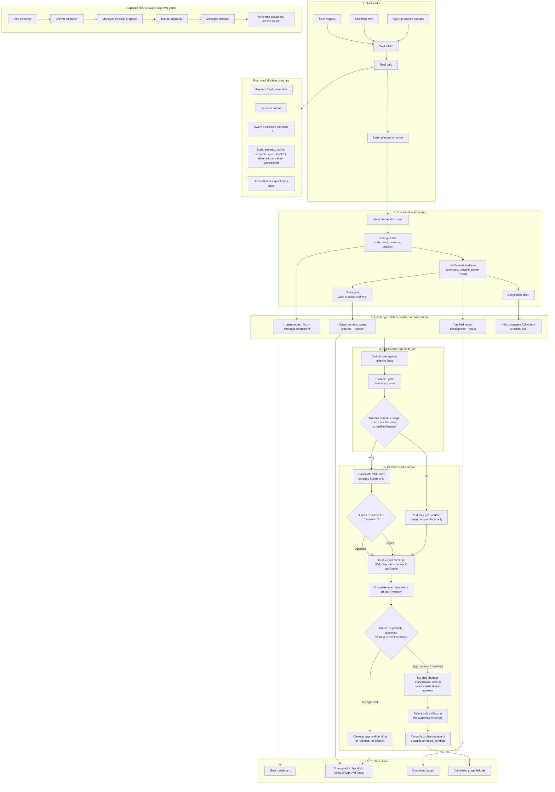

# Curator V2: goal-ledger intelligence, not transcript curation

## Summary

Curator V2 is a standalone rewrite. It does not import V1 runtime code, state,
or raw artifacts. References to `*-v1` contracts and schemas in this repository
mean the first version of a V2-owned interface; they do not imply V1 runtime
compatibility. Per owner direction, the deprecated and previously inoperable V1
runtime is outside this plan: V2 must not use it as an import source, fallback,
or rollback target. V1 shutdown and any artifact disposition belong to their
owning runtime and repository, not this V2 implementation.

The missing primary object is a **goal**, created from a user request, a checklist item, or an explicit agent subtask. V2 continuously records compact, evidence-backed lifecycle facts against that goal. A real SDE is a derived durable outcome—not the unit of capture.



## Core behavior

- At task start, V2 records: **problem**, **success criteria**, linked checklist item, and initial state.
- Parent goals may contain bounded child tasks with independent success
  criteria, evidence, dependency links, status, and next action. A parent stays
  open until every child is complete or explicitly retired and every declared
  dependency is complete.
- During work, agents emit compact typed facts rather than preserving full chats: intent, change, verification, open gate, completion, and cleanup.
- At task finish, V2 records one of:
  - **Completed:** every success criterion has direct evidence.
  - **Open/deferred:** completed facts, remaining criteria, blocker, and next action.
  - **Blocked:** exact failed dependency plus recovery path.
  - **Cancelled/superseded:** explicit reason; superseded work links to an
    active same-project replacement. Neither outcome asserts that criteria
    passed.
- Reopening a completed goal starts a new evidence epoch: prior facts remain
  immutable and visible, but pre-reopen verification does not satisfy current
  success criteria. Reopen requires a reason and concrete next action; completed
  parent/dependent goals must be reopened in dependency order. Criteria changes,
  cancellation, and supersession require separate explicit lifecycle events.
- A significance gate derives an SDE only when evidence supports a durable implementation, decision, recovery, or lesson. Routine progress remains a goal update.
- Every durable record is short bullets, separating observed facts from planned or unverified claims.
- An SDE approval or rejection records only the SDE disposition; it does not
  authorize destructive cleanup. After compact facts and the disposition
  receipt are durable, V2 must present the complete exact artifact inventory
  for a separate human cleanup approval. Neither SDE disposition nor expiry
  eligibility authorizes deletion. Purge only the approved inventory; report
  failed deletion as `purge_pending` and never hide it behind green health.
  Waiting for cleanup approval is a separate state, not a purge failure.

## Token and disk discipline

- No raw transcript store, cue queue, scratch archive, or paragraph synthesis pipeline.
- One bounded goal card plus deduplicated fact bullets; new events merge into the existing goal rather than creating duplicate records.
- Evidence references carry hashes, path/command identifiers, and outcomes—not command output or chat history.
- Status reports show: active goals, completed goals, explicit open gates, SDE candidates, and failed purges.
- The separate Host Steward reports disk growth and proposes managed cleanup; it performs no deletion without approval.

## Interfaces and tests

- `goal.start`, `goal.fact`, `goal.finish`, `goal.defer`, `goal.status`,
  `goal.reopen`, `goal.criteria_amended`
- `sde.assess`, `sde.confirm`, `artifact.purge_status`
- `artifact.cleanup_approve` (implemented as `artifact_cleanup_approve` in the
  API/MCP surface; human approval is bound to a complete exact inventory and
  recorded separately from SDE disposition)
- `steward.inventory`, `steward.propose_cleanup`, `steward.execute_cleanup`

Tests must prove that:

- a checklist task preserves its original success criteria through completion;
- an incomplete task stays open with a concrete next action;
- unsupported agent claims cannot close a goal;
- ordinary updates do not become SDEs;
- confirmed/rejected SDEs preserve compact facts and disposition receipts; no
  transient artifact is deleted until a separate human cleanup approval binds
  the exact complete inventory;
- an interrupted purge is retried and visibly reported;
- no host cleanup happens without explicit approval.

## V1 boundary

Per owner direction, the deprecated/inoperable V1 runtime is not a Curator V2 dependency. This plan does not freeze, inventory, migrate, clean, or use V1 as a rollback target. Do not inspect or modify the V1 repository or its data from this V2 project. At the owner's request, the Vhost Manager Hermes profile's legacy Curator MCP entry is disabled and its `curatormd-observer` hook now declares no events; the profile hook loader skips it. The profile-scoped gateway status showed only the default profile process. Host checks found no V1-named systemd unit, Docker container, or matching process. These checks cover the known Vhost profile integration and name-matched host runtimes; they are not an exhaustive proof that every possible V1 runtime elsewhere is stopped.

## Delivery checklist

This is the implementation and rollout checklist for the proposed V2 landscape.
Checkboxes describe verified repository state, not architectural intent:

- `[x]` Implemented in this repository and covered by the current unit tests.
- `[ ]` Open: proposed, not implemented, or not yet verified end to end.
- `[!]` Decision or external dependency required before the item can close.

Progress counts refer to rows in this **Delivery checklist** section only.
Reusable work-cycle and request templates and later acceptance prompts are not
delivery items and are excluded from the numerator and denominator. Snapshot
(2026-10-22): 132 of 174 delivery rows are complete; 42 are open. The count
includes implementation rows in sections 0–10, 12, and Definition of done. It
excludes section 11's reusable execution templates; their per-task checkboxes
are not delivery progress. Historical narrative counts below are not current.

An item closes only when its listed observable evidence exists. Unit tests prove
the behavior of this library slice; they do not prove a running backend,
consumer plugin, Hermes integration, or production deployment.

### 0. Product contract and bounded ownership

- [x] Define a goal as the primary record, with problem, success criteria,
      status, owner/checklist references, and next action.
- [x] Keep the global backend in this repository; keep repository-specific
      plugin and config in each consuming repository.
- [x] Keep Hermes runtime, event router, gateway, profiles, and Host Steward
      outside CuratorMD ownership. Host Steward belongs to the Hermes Core account.
- [x] Define raw chats, transcripts, imports, cues, and scratch as temporary
      evidence only, never canonical knowledge.
- [x] Define a strict, versioned, project-context lifecycle event envelope with bounded UTF-8 serialization and typed goal/fact payloads.
- [x] Publish versioned event, goal, fact, SDE, receipt, error, and plugin
      data-shape contracts with compatibility and migration rules; validate
      runtime events and records against the machine-readable schema bundle.
- [x] Record supported data-retention, privacy, threat-model, and operator
      requirements from the actual deployment owners. The owner-approved local
      alpha policy records the eaglesvn UID-bound reviewer, separate exact-
      inventory cleanup approval, 72-hour maximum and prompt expiry, artifact
      holds, privacy/canonical-data boundary, fail-closed missing identity, and
      Hermes Core root-account ownership of Host Steward. Production identity,
      retention, external hold discovery, deployment recovery, and live runtime
      remain separate open gates.
- [x] Record boundary-changing decisions in architecture decision records.
      [`ADR 0001`](adr/0001-managed-markdown-projection-integrity.md) documents
      the managed Markdown checksum, legacy behavior, and why it does not settle
      the deployment system-of-record policy; future boundary changes still
      require their own ADR.

### 1. Goal intake and lifecycle

- [x] Start a goal with a compact problem statement, one or more named success
      criteria, and optional owner/checklist references.
- [x] Constrain goal and criterion fields so they stay bounded and readable.
- [x] Preserve the initial criteria on the goal record through lifecycle
      transitions.
- [x] Record typed intent, change, verification, open-gate, completion-claim,
      outcome, cancellation, and supersession facts as single compact bullets.
- [x] Keep a goal open when a completion claim lacks passing evidence for any
      criterion; record the unmet criteria and a concrete next action.
- [x] Permit completion only when every criterion has independently verified
      passing evidence.
- [x] Represent blocked and deferred outcomes with a reason and recovery or
      next-action path.
- [x] Make goal/fact transitions transactional and make duplicate facts
      idempotent.
- [x] Test criteria preservation, incomplete goals, evidence-gated completion,
      compact facts, duplicate facts, status filtering, and rollback on failure.
- [x] Add bounded source IDs and optional monotonic source sequences to the
      versioned event envelope; atomically advance per-project/source cursors with
      goal/fact changes and keep sequence gaps retryable without applying facts.
- [x] Serialize fact append against completion across SQLite connections and
      reject a fact if the goal is complete at the transaction's write boundary;
      cover with a deterministic two-connection regression test.
- [x] Reopen a completed goal with a reason and next action, preserve its prior
      facts, require completed parent/dependent goals to reopen in dependency
      order, and prevent pre-reopen evidence from satisfying the new work epoch.
- [x] Amend a non-complete goal's criteria only through an explicit
      revision-checked event; preserve append-only criteria history and require
      fresh evidence after amendment. Completed goals must be reopened first;
      history is bounded to 16 versions per goal.
- [x] Define cancellation/supersession as append-only terminal outcomes, require
      an active same-project replacement for supersession, reject retirement while
      children/dependents remain unfinished, and serialize competing terminal
      transitions so the first wins and later transitions conflict. Reopen,
      dependency, evidence, and parent-completion consequences are specified in
      `docs/event-contract-v1.md` and covered by lifecycle/event/concurrency tests.
- [x] Add `lifecycle_revision` to goal status; atomically advance it for
      status/criteria transitions and require MCP clients to submit their
      observed revision for finish/defer/block/reopen/amend operations. Stale
      writes leave facts and state unchanged; legacy raw events without a
      revision are interpreted as revision 1 and fail closed after transition;
      migrated goal rows receive a revision-2 fence because prior transition
      counts cannot be reconstructed.
      Tests cover stale defer/block and criteria writes, event failure receipts,
      and verified multi-connection terminal races.
- [x] Exercise every public lifecycle action against every persisted goal
      status. Dedicated activation/reopen/retirement operations own their state
      changes; rejected actions preserve status, revision, and facts. The
      generic transition primitive cannot set those dedicated target states or
      finish a planned goal.
- [x] Generate mixed lifecycle action sequences across planned, active, open,
      blocked, deferred, complete, cancelled, and superseded states; verify
      revision progression, criteria revisions, evidence-epoch resets, and
      rejection atomicity after each action.
- [x] Generate parent/child/dependency action sequences; prove finish requests
      preserve explicit open gates until related work resolves, parent/dependent
      retirement is rejected while work remains unfinished, and rejected actions
      leave every linked goal and fact list unchanged.
- [x] Exhaust all reopen orders for a nested parent/child tree with a completed
      prerequisite; enforce parent-first and dependent-before-dependency reopen
      order while preserving prior facts and requiring fresh criterion evidence.
- [x] Implement reference-plugin adapters for explicit user requests, bound
      checklist rows, and accepted child subtasks; every route requires caller-
      supplied success criteria, checklist intake preserves an exact source
      line/revision, and child intake preserves its parent link. Tests prove
      criteria are unchanged and missing criteria are rejected. Hermes-authored
      intake and a real consumer workflow remain separate open integration gates.
- [x] Capture an optional bounded next action at goal intake through the
      versioned event, MCP, and repository-plugin paths; report a missing action
      explicitly and include the concrete step in TODO/report output. Legacy
      payloads remain valid. Event round-trip/schema, project-plugin persistence,
      report, and MCP regressions cover the local contract; this does not prove
      a live consumer emits the action.
- [ ] Demonstrate the lifecycle through a real consumer workflow, from request
      capture to a truthful planned/active/completed/open/blocked/deferred/
      cancelled/superseded status view. Progress (2026-10-20): the installed
      alpha MCP launcher ran against the actual Vhost Manager repository config
      and a separate V2 smoke database. A goal and fact were written, exact
      retries across fresh subprocesses were idempotent, changed event content
      conflicted, and a finish request without criterion evidence remained open.
      `goal_report` showed the open TODO and `goal_status` retained the unmet
      criterion. This uses manually supplied Hermes context and test-only write
      access; a Vhost Manager application producer and live profile route remain
      open, so the real consumer workflow item is not closed. Progress
      (2026-10-21): all six Vhost installed-package contracts pass, including
      a bounded hook-to-installed-MCP round trip through the installed profile
      launcher; Hermes discovers 45 tools and the Vhost profile endpoint reports
      ready. The global 335-test suite, strict Pyright, errors-only Pylint,
      Bandit, locked dependency audit, and diff check pass. This remains
      synthetic consumer evidence: no live Vhost Manager session or real user
      request has traversed the endpoint, so this item remains open.
      Progress (2026-10-21): a one-shot Hermes Codex app-server session was
      run from the Vhost Manager checkout. Read-only Hermes and Curator state
      confirms source sequences 10 and 11 (`codex:turn:start` and
      `codex:turn:end`) were each acknowledged once and processed/applied by
      Curator; both match the active profile/project/goal binding. Curator
      activity is now 12 processed receipts, with event payload JSON cleared
      after processing; the existing intent/change facts remain deduplicated.
      The V2 database passes `PRAGMA quick_check=ok`. This proves the one-shot
      profile CLI route only. Hermes gateway status reports only the default-
      profile PID, V2 `project_health` remains `unknown`, and no Vhost Manager
      application UI/request workflow or canonical application-target write
      was exercised, so this item remains open.
      Progress (2026-10-21): a read-only Hermes profile prompt attempted
      `goal_report` for the existing smoke goal, but the profile returned
      `user rejected MCP tool call`. Read-only V2 SQLite still shows the goal
      active at lifecycle revision 1 and the existing 12 processed receipts;
      no state changed. The approval boundary was not bypassed, so the real
      consumer lifecycle/status workflow remains open.
      Follow-up (2026-10-21): the profile tool-selection list had omitted
      `goal_report`; it now selects that read-only tool (12 selected Curator V2
      tools total), with the prior mode-0600 profile config backed up. Hermes
      MCP connection/discovery still succeeds. Hermes' session store confirms
      the one-shot session issued `mcp.curator_v2.goal_report` and received the
      tool result `user rejected MCP tool call`; read-only V2 state remains
      unchanged. The omitted tool was a real configuration gap, but was not
      sufficient to explain the rejection; the actual profile call/approval
      path remains open.
      Additional verification (2026-10-21): re-ran the seven installed Vhost
      consumer contracts against the current alpha wheel; all seven pass,
      including `goal_report` through the installed stdio launcher, configured-
      target persistence in disposable state, and two-consumer isolation. This
      verifies the installed plugin/tool path and synthetic consumer contracts,
      but does not clear the rejected Hermes model-session call or establish a
      Vhost application workflow; this checklist item remains open.
      Follow-up profile smoke (2026-10-21): after the profile-local plugin
      passed Hermes discovery/doctor, a bounded one-shot request from the
      Vhost Manager checkout asked the configured profile to create one planned
      smoke goal and read its status. Hermes returned `goal_start` rejected;
      the requested goal was absent on a read-only SQLite check, the goal count
      remained one, all 12 existing receipts remained processed, and SQLite
      `quick_check` remained `ok`. No direct-MCP or database-write workaround
      was used. The live consumer workflow remains open pending an allowed
      profile tool call. Additional verification (2026-10-22): built the
      current Curator source as a wheel, installed it into a disposable Python
      3.12 environment, and reran the Vhost-owned Hermes managed-MCP harness.
      The actual Hermes `HookRegistry`/`HookContext` acknowledged three
      bounded lifecycle events, exact replay, and failed-delivery retry;
      planned-goal binding and reviewer-only persistence stayed denied, the
      Vhost projection reconciled, and private metadata/out-of-scope targets
      remained absent/unchanged. The seven Vhost installed-consumer contracts
      also pass against this wheel. This is current-wheel local composition,
      not a live user request or production deployment; the item remains open.
      Local alpha install (2026-10-22): the wheel from commit `060b325` is now
      installed in the dedicated `renew-ssl-coding` Curator V2 environment;
      the seven Vhost contracts and Hermes managed-MCP harness pass there too.
      The installed core module hashes match source. MCP discovery reports 47
      tools and `auth=none`; gateway status shows only the default-profile PID,
      so interactive profile authorization and a live application request
      remain unverified.
      Latest local alpha package (2026-10-22): built from Curator commit
      `24cae4c`, wheel SHA-256
      `3f552edf5edafa9f509a491e385dfc6286751e99ebf1cf5dd7dddead5d62ca1a`,
      and installed in the dedicated profile environment. All 35 installed
      Python module hashes match source. Seven Vhost consumer contracts and the
      Hermes Core managed-MCP harness pass; the harness processes three
      lifecycle events and verifies retry/replay, binding denial, reviewer
      denial, projection reconciliation, and privacy canaries. Hermes MCP
      discovery exposes 47 tools with `auth=none`. Read-only SQLite reports
      schema 20, `quick_check=ok`, one goal, two facts, 12 inbox receipts, and
      two project grants. Gateway status lists only the default-profile PID.
      This verifies the current package/plugin composition and stored database
      integrity, not an interactive Vhost request or authenticated identity;
      the lifecycle checklist item remains open.

### 2. Evidence and fact ledger

- [x] Store evidence references (kind, locator, SHA-256, outcome), not raw
      command output, chat content, or transcript bodies.
- [x] Require evidence references on verification facts and link each
      verification fact to a success criterion.
- [x] Default to reject-all evidence verification when no trusted adapter is
      configured.
- [x] Separate completion claims from verification facts in the domain model.
- [x] Define trusted evidence adapters and their authentication, freshness,
      scope, and revocation rules in
      [`evidence-adapters-v1.md`](evidence-adapters-v1.md). Local typed receipt
      adapters enforce the documented bindings and source ceilings; tests use
      synthetic host receipts and do not prove source authentication.
- [x] Persist compact host-provided verification attestations beside immutable
      verification facts, include them in fact digests and capacity accounting,
      and revalidate source revision, adapter, and subject on each criterion
      check. Legacy facts receive no invented provenance and remain unverified.
- [ ] Integrate repository runners, service probes, browser sessions, and
      authenticated human-confirmation sources with deployment-owned credentials,
      trust roots, revocation checks, and end-to-end probes; a generic resolver
      protocol plus synthetic tests does not close this gate.
- [ ] Complete the source-specific integrations for repository diffs/tests,
      service probes, browser proof, and authenticated human observations, each
      bound to deployment trust roots and end-to-end source evidence. Local
      progress (2026-10-21): `GitCommitDiffResolver` now resolves only full
      commit-ID ranges from its host-configured Git worktree, streams a bounded
      diff into SHA-256, and emits path-free repository-diff provenance through
      the existing `RepositoryEvidenceAdapter`. A disposable-repository test
      verifies exact digest binding, project isolation, immutable-range behavior,
      and fail-closed byte limits. `LocalGitTestRunnerResolver` runs a
      host-configured argv in a disposable checkout at one exact commit, bounds
      runtime/output, rejects failing runs, and hashes output without returning
      it. Tests prove exact-commit execution despite later worktree edits,
      wrong-runner and failing-run rejection, output limits, process-group
      timeout cleanup, and path/content-free receipts. Its command and subject
      remain local host assertions; repository/test-runner credentials,
      service/browser sources, human identity, and deployment end-to-end proof
      remain open. The evidence module's 13-test suite and full Curator suite
      (350 tests) pass;
      strict Pyright, errors-only Pylint, Bandit, locked dependency audit, lock
      check, and `git diff --check` pass for the current local tree.
- [x] Bound immutable fact history to 512 facts/512 KiB per goal and 10,000
      facts/16 MiB per project; reject over-limit appends atomically without
      pruning, expose capacity gates in goal/project status, and test count/byte
      exhaustion plus idempotent retries at the ceiling.
- [x] Implement reviewer-approved fact-cap recovery: propose only eligible
      routine facts; preserve their exact source bullets and immutable IDs in a
      compressed, project-scoped archive with hashes for both canonical source
      records and compressed bytes; require an authenticated reviewer decision
      before removing any fact from the active ledger. Never compact verification,
      outcome, open-gate, lifecycle/criteria, decision, SDE-supported, or otherwise
      evidence-bearing facts. **User-selected policy:** retain the compressed,
      hash-verified source-bullet archive and compact only eligible routine facts
      after reviewer approval. **Exit evidence:** tamper detection, interrupted
      archive/ledger recovery, approval attribution, idempotent replay, archived
      fact retrieval, authenticated receipt reads, byte/count reporting, and
      capacity-resume tests pass; failed archive verification or persistence
      leaves active facts and the capacity gate unchanged.
- [x] Bound the global event inbox to 250,000 receipts and 128 MiB of retained
      logical row bytes across all projects; reserve room for failure metadata,
      reject new IDs before writes at the ceiling, preserve idempotent replays,
      never auto-prune, and expose aggregate-only capacity/gate status.
- [ ] Define an approved retention/compaction and recovery workflow for a full
      event inbox, plus budgets for every other permanent data class; prove safe
      recovery before enabling broad automatic capture.
- [x] Enforce explicit domain ceilings for criteria, dependencies, evidence
      references, SDE supporting facts, and per-receipt artifact paths, including
      direct callers that bypass serialized-event limits; cover limit and
      duplicate-manifest rejection with tests. Project-level fact ceilings are
      covered separately; backend-wide fact budgets and event-receipt retention
      remain open.
- [x] Add strict schema validation and reject-only high-confidence secret/PII
      pattern checks before lifecycle/domain writes; never auto-redact evidence.
      Regressions prove rejected event content is not written to the inbox or
      goal ledger. See `docs/content-safety-v1.md`.
- [ ] Threat-model scanner false negatives/positives, formats and jurisdictions
      beyond the current high-confidence patterns; expand based on deployment
      policy without claiming a clean scan is privacy certification.
- [x] Write a preliminary threat register for the local implementation boundary,
      explicitly separating implemented controls from deployment assumptions and
      residual risks; see [`threat-model-v1.md`](threat-model-v1.md). Owner review,
      deployment-specific policy, and validation remain open.
- [x] Provide project-scoped `goal_bullet_projection` output with separate
      recorded, evidence-verified, unverified-claim, and current-open-gate
      categories; stale gate facts remain labeled as history. Test open and
      complete states through service and MCP.
- [x] Provide a bounded, authenticated `goal_report` read with problem,
      criterion evidence, paged fact bullets, TODOs, dependencies, review, and
      canonical-write/purge state. Keep evidence locators/hashes in
      `goal_status`; verify open/unverified truth, paging limits, MCP exposure,
      and that evidence checks do not run under a SQLite write transaction.
      Child, pending-SDE, and receipt details are also paged (32/16/16 per
      report) with exact SQL aggregate totals; the report never hydrates their
      full histories to render a bounded page. Tests reject the former unpaged
      service calls and verify child totals and offsets. The report also shows
      the exact captured checklist item and a separate bounded list of current
      open gates, distinct from historical gate facts and TODO actions.
- [x] Keep `goal_status` and its bullet projection bounded as well: facts are
      capped per goal, criteria history is capped by lifecycle policy, and SDE
      candidates/purge-pending receipts are returned in 32/16-record pages with
      exact totals, candidate state counts, and next offsets through
      service/API/MCP/plugin. More backlog is an explicit open gate, not silent
      omission.
- [x] Provide an authenticated `goal_list_page` that returns only compact goal
      cards, total matches, and the next offset; apply status filters before
      paging. Keep the legacy full-snapshot list available only up to 100 goals
      and fail with a capacity error above that bound, so overview reads do not
      materialize unbounded fact/review history. Tests cover filter/order,
      pagination, authorization, and the compatibility guard.
- [x] Verify deduplication across retries and semantically duplicate adapter
      events without collapsing distinct evidence or decisions; see event,
      lifecycle, property/fuzz, and immutable-review replay tests.

### 3. Significance and human SDE review

- [x] Distinguish routine progress from implementation, decision, recovery,
      or verified-lesson materiality.
- [x] Refuse a routine SDE candidate and require selected supporting facts.
- [x] Require a selected passing verification fact before creating an SDE
      candidate; keep candidate facts within the assessed goal.
- [x] Deduplicate repeated assessments over the same supporting facts.
- [x] Keep SDE candidates pending explicit human approval or rejection.
- [x] Require a fail-closed host review-authorizer before decisions; store the
      author's opaque authenticated subject and optional single-line rationale in
      the immutable receipt. The default has no reviewer and rejects decisions.
- [x] Document qualification examples and non-examples for each materiality
      category, including how expected impact differs from measured outcomes;
      see `docs/sde-review-policy-v1.md`.
- [x] Provide a bounded, project-scoped in-process review queue and candidate
      detail containing the goal and selected supporting facts/evidence.
- [x] Expose project-scope-authorized SDE review queue, detail, packet, and
      decision operations through the API/MCP surface. Decision calls also
      require a separately injected fail-closed reviewer authorizer; API/MCP
      tests cover permission denial, both dispositions, immutable receipts,
      rationale, timestamp, and conflicting retries.
- [ ] Bind review decisions to verified Hermes Core user/project permissions
      and exercise authenticated reviewer identity end to end. The current
      local profile ID is an operator assertion, and synthetic test authorizers
      do not satisfy this production identity gate. For local alpha only,
      `eaglesvn` is selected as the sole human reviewer through an attended CLI
      bound to the current Linux UID; the `renew-ssl-coding` Hermes profile has
      no authenticated human subject and remains unable to review or purge.
      A disposable end-to-end CLI test now exercises its actual grant ledger,
      pending SDE, exact staged inventory, canonical write, and purge. Schema
      v21 now requires a distinct cleanup approval bound to the complete exact
      manifest and canonical projection proof before deletion; focused lifecycle
      and MCP regressions cover missing, mismatched, stale, and approved cleanup.
      It does not close the Hermes identity gate.
      Additional verification (2026-10-22): the current Codex client attempted
      the read-only Curator V2 `goal_list` tool without Hermes profile context;
      the server returned `unauthenticated` / trusted Hermes context required,
      and no goal state changed. This is distinct from the successful
      disposable Hermes managed-MCP harness and does not prove this session's
      user identity. Persistent goal-ledger updates from this client remain
      unverified.
- [x] Make an SDE decision and its artifact manifest immutable after the first
      durable receipt; repeated requests with changed decision or targets conflict.
- [x] Record bounded, idempotent corrections as linked append-only follow-up
      records rather than rewriting prior decisions; require reviewer
      authorization and persist reviewer identity, rationale, and timestamp.
      Review detail and canonical Markdown expose the correction; project usage
      counts its records/UTF-8 bytes. Covered by store, API, MCP, and projection
      tests. The original decision receipt remains unchanged.
- [x] Verify every generated SDE review packet uses a single-line rationale
      linked to selected compact fact bullets and evidence references; multiline
      session recaps are rejected by the domain model and regression-tested.
- [x] Keep pending and rejected SDE candidate narratives out of canonical
  Markdown; only approved candidates project, while every human decision stays
  represented by compact facts and its immutable audit receipt.
- [x] Add reviewer-quality feedback and evaluation metrics without claiming
      autonomous learning or improvement absent measured evidence. Schema v12
      stores one append-only, host-authorized label per reviewer/candidate after
      a durable disposition; identical retries are idempotent and conflicting
      second submissions fail. Project summaries and Prometheus counts exclude
      identities and rationales, and storage usage accounts for the feedback
      bytes. Labels are human QA observations, not ground truth or model-training
      signals. Local API/MCP, persistence, schema, and migration tests cover the
      flow; production review authorization and feedback-retention policy remain
      open.

### 4. Receipt, artifact inventory, and purge transaction

- [x] Commit a review receipt, decision, fact digest, and artifact references
      before any purge attempt.
- [x] Gate purge on a project plugin's successful canonical Markdown write;
      record the allowlisted target and projection hash immutably before releasing
      cleanup, and leave the receipt pending if the write fails.
- [x] Require a distinct, explicit human cleanup approval for every destructive
      purge, bound to the complete exact inventory and recorded in its own
      durable receipt. SDE approval/rejection and expiry eligibility do not
      authorize deletion. Schema v21 stores the separate approval and its
      canonical projection proof; the plugin rechecks the live complete
      inventory before accepting it, persists the approval before deletion,
      and retries only approvals whose projection proof is durable. Focused
      lifecycle and MCP tests prove no deletion before approval, rejection of a
      changed file/manifest, exact-manifest approval, and retry after an approved
      purge failure. The attended expiry approval remains a separate path.
- [x] Require the adapter to mark the full artifact inventory complete before
      deleting any artifact, including an explicitly confirmed empty inventory.
- [x] Restrict purge to exact regular files below the configured staging root;
      reject path escapes, directories, symlinks, unsafe platforms, and hash
      mismatches.
- [x] Make missing-file retries idempotent and persist per-artifact purge
      outcomes and attempts.
- [x] Keep incomplete inventories and failed deletions visible as
      `purge_pending`; preserve canonical facts and receipts across store reopen.
- [x] Test approval and rejection, incomplete and partial inventories, empty
      complete inventory, hash mismatch, path escape, symlink/directory, retry,
      crash-after-delete recovery, replayed decisions, and durable receipts.
      Additional progress (2026-10-20): the MCP SDE lifecycle acceptance test
      now includes both a held and an unheld transient artifact. After canonical
      persistence, the unheld file is purged in the same operation while the
      held file remains pending; a unique transient-content canary is absent
      from canonical Markdown. This is local end-to-end test evidence, not a
      live consumer or production purge scheduler. The current full Curator
      suite passes 320 tests; Pyright reports zero diagnostics, errors-only
      Pylint, Bandit, locked dependency audit, and `git diff --check` pass.
      Additional progress (2026-10-21): the regression now explicitly asserts
      that canonical persistence completes before the unheld artifact is
      immediately purged, the held artifact remains, and a unique transient
      content canary is absent from Markdown. The current full V2 suite passes
      336 tests; strict Pyright, errors-only Pylint, Bandit, locked dependency
      audit, and `git diff --check` pass. This remains local synthetic-reviewer
      evidence of canonical persistence, held-artifact exclusion, and purge
      recovery. The separate cleanup-approval gate is implemented; production
      purge scheduling and retention approval remain open.
- [x] Implement inventory discovery in each staging adapter and prove it
      accounts for every temporary artifact class (raw chat, cue, import, scratch,
      generated intermediate, and duplicate). Progress (2026-10-18): the
      reference-plugin scanner regression inventories representative files for
      all six classes under its configured staging root, including same-content
      files at distinct paths. This does not prove real producers route every
      artifact into that root; producer adapters and out-of-root coverage remain
      open. Additional progress (2026-10-20): the producer API now has a
      regression that stages all six supported classes through atomic publication
      and verifies one complete fresh inventory retains each distinct path and
      matching digest, including same-content artifacts. The reference producer
      contract is covered; real producer routing and out-of-root coverage remain
      open. The focused plugin module passes 37 tests and the full suite passes
      321 tests; strict Pyright, errors-only Pylint, Bandit, locked dependency
      audit, and `git diff --check` pass for this local delta.
      Additional local progress (2026-10-21): the project-wide manifest is now
      reachable through the authenticated API and a read-only MCP tool guarded
      by the project's `review` grant, matching per-goal manifest access. API
      coverage proves orphaned files appear in the complete project snapshot
      and a read-only-only grant is denied; the MCP contract confirms the new
      tool returns a project-scoped manifest. A root-scan regression covers all
      six configured artifact classes plus unrecognized files under an
      orphaned goal directory. This still does not prove real
      producers route every artifact into staging; out-of-root coverage remains
      open. The local launcher now has an explicit `--allow-review` ceiling
      for this tool; review stays disabled by default and requires the exact
      durable project grant. The clean Python 3.12 wheel acceptance covers the
      installed review-gated inventory call without using a Vhost profile.
      Local reference-adapter acceptance is complete: its scanner inventories
      all six declared artifact classes, duplicate-content paths, orphaned goal
      directories, and unrecognized classes, while subprocess coverage verifies
      artifacts staged through the bounded producer CLI. This row covers the
      local reference adapter only; real producer routing and out-of-root
      artifact discovery remain open integration work.
- [x] Implement reference-plugin discovery for every regular file inside the
      selected goal directory beneath the configured staging root, with bounded
      streaming SHA-256, an explicit incomplete state on skipped/changed/over-
      limit entries, and a fresh exact manifest comparison before a reviewer-
      declared complete inventory can release purge. The packet carries the
      goal scope, and tests prove another goal's artifacts cannot enter its
      manifest; producer routing and out-of-root coverage remain open.
- [x] Define retention exceptions and legal/operational holds; ensure held
      artifacts cannot be accidentally purged. Local v9 storage now accepts
      reviewer-selected `legal` and `operational` holds, exposes `held` state,
      excludes held targets from explicit and scheduled retries, and keeps the
      receipt pending. Local v10 adds exact authorized release with durable
      actor/time/rationale audit and resumes purge only after release commits.
      There is no implicit expiry or release. The owner approved the local-alpha
      rule that SDE disposition clears only its review hold; legal/operational
      artifact holds require a separate release. Purge and retry tests prove a
      held file remains present with zero purge attempts through store reopen,
      then is deleted only after the separate audited release. The MCP lifecycle
      test also keeps a held artifact while purging an unheld artifact after
      canonical persistence. This local-alpha checklist item is complete.
      Production retention policy, discovery of holds from external source
      systems, authenticated Hermes reviewer identity, and deployed operations
      remain separate open gates.
      Additional verification (2026-10-22): the full locked suite passes 368
      tests; strict Pyright, errors-only Pylint, Bandit, locked dependency
      audit, lock sync, and `git diff --check` pass. A read-only check of the
      configured local V2 SQLite database reports `quick_check=ok`, schema
      version 20, one goal, two facts, 12 inbox rows, one project registration,
      and two grants. The MCP ledger read still returns `unauthenticated`, so
      trusted-profile protocol access and live capture remain unverified. A
      full Pylint inventory reports 293 non-blocking refactor/convention
      findings; repository-wide structural cleanup remains open.
- [x] Implement persisted per-artifact capped exponential backoff, a bounded
      scheduler-facing due-retry pass, and status visibility for each retry
      deadline; preserve the authenticated explicit retry as an immediate
      operator override. Test delayed selection, due execution, and recovery.
- [ ] Operate purge retries under a production scheduler with dead-letter
      alerting and reconciliation for process/database failure between each
      transaction boundary. Progress (2026-10-19): added the
      `curatormd-v2-maintenance` one-shot entrypoint. It requires explicit
      `--execute-due-purges`, binds one repository-owned config/project, caps a
      pass at 1,000 receipts, and delegates only to the due/backoff-aware purge
      service while holding the project's staging lock. It reports aggregate
      complete/pending counts and exits nonzero on pending work or sanitized
      runtime failure; no review decision, hold release, or backoff override is
      available. CLI tests cover opt-in, batch binding, pending alert status,
      sanitized errors, and store closure; a plugin test proves lock ownership.
      A disposable end-to-end test injects a purge failure, closes/reopens the
      SQLite store through the CLI, and proves the exact previously reviewed
      artifact is removed only after its retry deadline. The full 282-test
      suite, Pyright, errors-only Pylint, Bandit, and `git diff --check` pass.
      This remains a local scheduler job unit, not an installed production timer,
      dead-letter delivery, or crash/reconciliation drill; those gates remain
      open. Operator usage and
      trust constraints are in
      [`consumer-operations-v1.md`](consumer-operations-v1.md#run-one-due-purge-retry-pass).
- [x] Expose project-scoped per-receipt and per-artifact status, creation age,
      attempt count/timestamp/age, last error, and read-only safe recovery action
      through the service/API/MCP status path; persist each attempt before file
      deletion so crash-after-delete remains observable. Schema v3 migrates
      existing targets with receipt creation time; migration, failure, pending,
      completed, and interrupted-deletion tests cover the local slice.
- [ ] Aggregate purge and other required-work states into truthful operational
      health; green must remain impossible while required work is pending,
      overdue, or unaccounted for. This requires the production scheduler and
      health/alert integration, not just the project-scoped status tool.
      Additional progress (2026-10-20): API regressions now prove that a pending
      SDE review and a held artifact with a pending purge receipt/artifact each
      force `degraded` status even when every dependency probe is healthy. The
      existing local aggregator's exact pending-work counts and gate codes are
      exercised directly. Production scheduler state, alert delivery, and
      storage-adapter failure accounting remain open. Additional progress
      (2026-10-21): local health now emits `staging_budget_reached` when a
      complete bounded staging scan observes bytes or file count at or above
      the consumer's configured project limit; the open-gate metric exposes
      the condition for monitoring. Regressions cover both byte and file
      limits. Incomplete scans retain their separate degraded gate, and no
      retention policy or deletion behavior is inferred. Production scheduler
      state and alert delivery remain open. Additional local progress
      (2026-10-21): staging-root and lock acquisition failures in health inputs
      now map to fixed error codes and a `staging_adapter_unavailable` gate;
      project health remains readable but degraded, and Prometheus exposes the
      gate. A focused regression covers both surfaces. This does not cover
      production storage adapters or scheduler/alert failures. Additional
      local progress (2026-10-22): operational counts, health gates, and
      Prometheus metrics now include schema-v20 attended expiry receipts and
      their remaining targets. A regression proves an incomplete expiry
      receipt forces degraded status even when host dependency probes are
      healthy. This remains local SQLite evidence; production scheduler,
      alerting, and process/database reconciliation remain open.
- [ ] Complete a failure-injection test matrix against the production storage
      and staging adapters, not only local temporary files.

### 5. Global backend, persistence, and operations

- [x] Provide a SQLite-backed application-service/store slice with private
      database-file permissions and atomic transitions.
- [x] Expose in-process goal start/fact/finish/defer/block/status/list and
      SDE assess/confirm/purge-status operations.
      SDE confirmation records disposition only. Destructive cleanup now uses
      the separate schema-v21 cleanup-authorization receipt and canonical
      projection proof described in section 4 above.
- [x] Expose an authenticated, project-scoped paginated goal-card list that
      reports total/next offset, supports lifecycle filters, and avoids loading
      fact/review histories for overview reads. Keep the legacy full-snapshot
      list bounded to 100 matching goals and return a capacity error above that
      ceiling; request `goal_report` or `goal_status` for details. Tests cover
      pagination, filtering, authorization, and fail-closed legacy behavior.
- [x] Expose the same compact pagination for child-task listings and bound the
      legacy full-snapshot child view to 100 siblings. Parent ownership,
      lifecycle filtering, authorization, and compact-card results are tested;
      internal completion checks still inspect every child independently.
- [x] Validate version-1 lifecycle event envelopes, reject unknown/duplicate
      fields and payloads over 16 KiB; persist idempotent inbox receipts and
      discard payload text after explicit processed-state transition, without
      treating project IDs as authentication. Typed MCP retries now compare a
      durable semantic digest that excludes only regenerated transport time;
      changed event content still conflicts. Migration v17 backfills the digest
      only for still-retained payloads, while processed legacy receipts keep
      the strict raw-digest fallback.
- [x] Apply supported goal/fact lifecycle events and their processed receipts
      in one SQLite transaction through a service bound to one project ID; failed
      events roll back ledger mutations and remain retryable with safe error codes.
- [x] Add a transport-neutral fail-closed API facade with project/action
      authorization hooks, bounded version-1 event JSON ingress, request-limiter
      interface, goal/review/status/purge operations, and cross-project denial
      tests.
- [x] Implement actual MCP SDK v2 tools over stdio with host-bound caller,
      project, and producer identity; cover list/schema and goal lifecycle using
      in-memory client and real subprocess stdio tests. Progress (2026-10-19):
      the installed `curatormd-v2-mcp` console launcher also passed an isolated
      temporary-consumer round trip: an explicitly write-granted profile started
      and read back a typed planned goal with its configured project ID, problem,
      and success criterion intact. The MCP schema exposes neither project nor
      caller identity arguments. The stdio client context shut down cleanly;
      this is local launcher evidence, not live Hermes identity or deployment
      verification.
- [ ] Connect the MCP factory to verified Hermes identities/profile selection;
      use a shared production rate limiter and verify its permissions through
      the real Hermes transport. Progress (2026-10-19): the local stdio factory
      now injects a bounded SQLite token bucket shared by workers using the same
      database (120 requests per subject/project per 60 seconds; at most 10,000
      tracked buckets). Migration v13 and cross-connection/concurrency tests
      cover quota enforcement, restart persistence, full-refill-only idle-bucket
      cleanup, clock rollback, and fail-closed registry bounds. Verified Hermes
      identity, production quota policy/configuration, distributed limiting, and
      real Hermes transport remain open.
      Progress (2026-10-20): the local profile-bound launcher now rejects every
      MCP tool call unless Hermes-injected profile and session metadata are
      present and the profile exactly matches the operator-pinned launcher
      identity. In-memory and real stdio regression tests cover missing,
      mismatched, and valid context; all 298 Curator tests, strict Pyright,
      errors-only Pylint, and Bandit pass. This is fail-closed local
      host-context binding, not cryptographic authentication or proof of a live
      Hermes transport; those and production
      limiter policy remain open.
      Progress (2026-10-20): the launcher now also requires an active durable
      project registration matching the canonical repository-root fingerprint,
      exact config-file hash, and backend API version, and reads exact grants
      from SQLite on every request. A separate attended `curatormd-v2-access`
      command can provision and audit local grants outside MCP; its operator
      identity is only the local OS UID. Progress (2026-10-20): 300 full-suite
      tests pass on Python 3.13.15, strict Pyright, errors-only Pylint, Bandit,
      lock audit, and diff check pass, including attended registration, exact
      grants, launcher enforcement, and noninteractive/wrong-confirmation
      denial. Verified Hermes identity, authenticated administrator identity,
      and live Hermes transport remain open; profile metadata is not
      cryptographic authentication.
      Source audit (2026-10-20): Hermes Core's opted-in MCP metadata currently
      contains host-derived profile/session coordinates and an optional durable
      event marker. Gateway `AIAgent` objects also hold source `user_id` and
      platform values, but registry-tool dispatch forwards only session and
      turn IDs to the MCP handler. The Vhost alpha path is local/stdio and
      exposes no authenticated human subject. Do not treat profile, session,
      or unqualified source user IDs as verified identity; identity mapping
      and per-user permission checks remain open.
      Current verification (2026-10-21): `hermes -p renew-ssl-coding mcp test
      curator_v2` connects to the installed local stdio server and discovers
      46 tools. Hermes reports transport auth as `none`; this proves profile
      configuration and tool discovery only, not an authenticated identity or
      a tool-call authorization round trip. Identity and permission checks
      remain open. Additional disposable consumer acceptance (2026-10-21):
      `/home/eaglesvn/dockerz/renew_ssl/tests/vhost-manager/test_curatormd_v2_hermes_managed_integration.py`
      passed against Hermes Core's actual `HookContext`, managed stdio MCP,
      and the installed Curator launcher. Three events were processed; exact
      replay was acknowledged, a failed delivery retried, explicit active-goal
      binding passed while planned-goal binding failed, and the configured
      Vhost Markdown projection reconciled. The private model canary and cwd
      path were absent from Markdown, the out-of-scope target stayed unchanged,
      and review-authorized persistence remained denied. This disposable run
      uses synthetic registration/grants and profile metadata; authenticated
      identity, the interactive Vhost application workflow, and deployment
      remain open.
- [x] Implement a local bounded durable router pass with a fixed trusted
      project/service map, transactional idempotent processing, attempt-counted
      retries, capped persisted exponential retry due times, source-sequence
      ordering, poison-event quarantine with retained payload, audited human-
      authorized retry, and aggregate queue-age metrics; cover
      failure/retry/order/auth/migration behavior with unit/API/MCP tests.
- [x] Add local cross-process worker coordination using atomic SQLite event
      claims with expiring owner leases, expired-claim recovery, owner-fenced
      processing/failure commits, and aggregate active/expired claim counts;
      cover competing connections, reclaim, stale-owner rejection, and schema
      migration with tests. This does not prove a deployed worker topology.
- [ ] Operate the router under a production scheduler with production alert
      delivery, restart/load/failure-injection probes, and deployment-observed
      lag; local SQLite leases and due-time backoff do not satisfy this gate.
      Local progress (2026-10-20): added the packaged `curatormd-v2-router`
      one-shot command. It requires `--route-events`, accepts up to 128
      operator-specified repository roots, validates each project config, and
      claims only events for those fixed project IDs; omitted projects remain
      pending and unmodified. The batch is capped at 1,000 and output contains
      only aggregate counts. Focused router/CLI tests prove opt-in and
      cross-project isolation. An installed-wheel Vhost consumer test routes
      only its configured project and leaves an unbound project's event
      received in disposable SQLite. The command is installed in the isolated
      Vhost alpha environment. It is not a worker, production scheduler, alert
      path, or health observation; those gates remain open.
- [x] Implement an explicitly invoked, project-scoped Markdown projection with
      target revalidation, per-goal idempotent blocks, atomic replacement, bounded
      UTF-8 reads/writes, and preservation of unrelated document content.
- [x] Add deterministic reconciliation between the structured ledger and the
      Markdown projection, including safe recovery when either side is updated
      before a crash. Progress (2026-10-18): a read-only per-goal comparison now
      reports `synced`, `missing`, `divergent`, or `malformed` with block hashes
      and does not mutate either store. The comparison is now surfaced through
      project-authorized API and MCP `goal_reconcile`; API/MCP tests cover missing,
      synced, and divergent states and prove caller denial and no rewrite on
      manual document edits. Tests cover ledger-first updates followed by an
      explicit projection retry across a reopened SQLite store, plus an
      interruption after Markdown replacement but before the canonical receipt
      update; after reopening SQLite, retry commits the receipt and only then
      releases the empty-inventory purge gate. This is recovery across a store
      connection restart, not process-kill or power-loss testing.
      Project-level `project_reconcile` now pages at most 100 SQLite goals,
      scans the configured target once (maximum 8 MiB), identifies orphan and
      malformed marker hashes plus unrecognized-marker counts, and marks
      inventories over 5,000 markers incomplete. Tests prove pagination, orphan
      detection, scan-bound reporting,
      project authorization, and no mutation. Manually edited/malformed conflicts
      are not auto-resolved. Additional progress (2026-10-19): generated goal
      blocks now carry an unkeyed SHA-256 content checksum. New projections
      update stale checksummed blocks, but checksum-mismatched edits fail closed;
      exact legacy blocks may be upgraded only when they match the current
      SQLite projection, and stale unsealed legacy blocks are preserved. Tests
      cover manual-edit rejection, legacy upgrade/refusal, reconciliation, and
      purge ordering. This is accidental-edit detection, not authentication or
      an authoritative-store decision. Production recovery and system-of-record
      policy remain open.
- [ ] Define the system of record and recovery behavior when SQLite, canonical
      Markdown, and a consuming repository disagree.
- [ ] Add backups, restore drills, schema migrations, integrity checks, and
      supported upgrade/rollback procedures. Local non-overwriting SQLite
      backup/restore helpers and integrity tests now exist; production drills,
      migration/rollback drills for deployment data, and supported upgrade/
      rollback policy remain open. Local migration paths through v17 are
      covered; the v0-to-v1 step has an injected-rollback fixture, v1-to-v2
      preserves existing inbox receipts,
      v2-to-v3 backfills purge-target age, and v3-to-v4 adds persisted retry
      scheduling without delaying legacy failed events; v4-to-v5 adds expiring
      worker claims without losing persisted retry deadlines; v5-to-v6 adds
      purge retry deadlines while keeping legacy failed artifacts immediately due;
      v6-to-v7 stores initial goal status/source event IDs and deliberately leaves
      older provenance unknown rather than inferred; v7-to-v8 adds verification
      attestation storage with empty legacy defaults, preserving facts without
      treating old verification as currently trusted; v8-to-v9 adds a nullable
      artifact hold kind, leaving legacy targets unheld; v9-to-v10 adds hold
      placement/release audit fields and includes only explicitly released
      held targets in purge selection.
      Sequential migration functions are isolated in
      `src/curatormd_v2/schema_migrations.py`; `CuratorStore` retains the
      surrounding transaction boundary and unversioned-schema bootstrap.
      Additional progress (2026-10-20): added a destination-race failure test
      for non-overwriting backup installation. It creates the competing file
      after destination validation but before the hard-link install, then
      verifies the concurrent file is preserved and the verified temporary
      snapshot is removed. The focused test and full 303-test suite pass;
      strict Pyright, errors-only Pylint, Bandit, locked dependency audit, and
      `git diff --check` pass. This is local filesystem evidence, not a
      production backup or restore drill. Version 16 redacts legacy purge
      exception details while preserving retry state, with injected rollback
      coverage. Version 17 retains semantic event-retry digests, backfills only
      bounded payloads still present, and is covered by migration and typed MCP
      replay/conflict tests. A second migration regression verifies processed
      v16 receipts with discarded payloads remain on strict raw-digest conflict
      behavior instead of receiving a guessed semantic identity. Further
      progress (2026-10-21): `curatormd-v2-storage` now exposes the tested
      integrity-checked helpers as explicit backup and restore subcommands.
      Restore requires `--restore-to-new-path`; both operations preserve
      existing destinations, redact paths and exception details from output,
      and report a compact verified result. Four CLI regressions prove a typed
      goal/fact round trip, explicit restore consent, no-overwrite behavior,
      and sanitized failure output. Production storage drills, off-host backup
      policy, and active-database switch/rollback remain open.
- [ ] Publish operational dashboards and alerts for event intake, goal state,
      evidence rejection, review backlog, inventory completeness, purge backlog,
      storage growth, and adapter errors.
      A local authorized `project_metrics` / `project_prometheus_metrics`
      exporter now renders bounded, content-free Prometheus exposition for
      health, queues, goals, dependencies, project-attributed logical storage,
      bounded staging measurements, and current failed/quarantined receipts by
      fixed evidence-rejected, evidence-adapter-error, and other categories.
      Categories derive from sanitized exception type codes; raw exception
      text, event payloads, and evidence references are never metric labels.
      Event-ingress regressions distinguish unsupported proof from an operational
      resolver exception and prove neither failure accepts verification facts.
      This is a snapshot function, not deployed scrape infrastructure or
      alerting. Host scrape endpoint, dashboards, alert rules/delivery, and
      operator budgets remain open.
- [x] Define local truthful health semantics: green requires every required
      host dependency explicitly healthy, a complete empty staging inventory,
      available event/fact capacity, and zero event/review/purge backlog or
      expired claims; degraded/unknown states expose exact bounded gate codes.
      The authenticated API and MCP `project_health` read aggregate these local
      observations without event/artifact content; missing/failed probes remain
      unknown, while known failures/backlogs remain degraded. Exact review/purge
      counts use SQL aggregates, not bounded queue samples. Host readiness must
      include timezone-aware observation timestamps no older than 60 seconds;
      stale, malformed, missing, or over-five-second-future observations remain
      unknown. Local database aggregates share one SQLite read snapshot while
      staging is scanned separately through its bounded no-follow traversal.
      Tests cover auth,
      unknown probes, probe exceptions, backlog, staged artifacts, healthy
      preconditions, timestamp freshness/skew, malformed probes, and MCP output.
      Production probes, schedulers, alerting, and dashboard wiring remain open.
- [x] Expose content-free project activity separately from operational health:
      retained event receipts by processing state, last received/processed
      times, goal/fact totals, and pending/approved/rejected SDE counts. The
      project-authorized API/MCP read reveals no event or record identifiers or
      content. `events_observed` reports retained inbox history only; it is not
      a producer connection or capture-completeness guarantee. Tests distinguish
      an empty project with unknown and healthy host readiness from a project
      with observed events but zero SDEs, and verify pending-SDE counts through
      the API/MCP.
- [x] Report project-attributed logical record counts/UTF-8 bytes by data class
      and lifecycle event class/status, plus separately labeled global SQLite
      database/WAL file sizes and a bounded, content-free scan of each configured
      project staging tree; expose only through project-authorized API/MCP reads
      and test processed-payload discard, denied access, scan bounds, symlink
      rejection, and SDE correction accounting.
- [x] Provide non-overwriting SQLite online backup and restore-to-new-file
      helpers with integrity checks, private file permissions, symlink rejection,
      and corruption/round-trip tests; see [`storage-recovery-v1.md`](storage-recovery-v1.md).
- [x] Version the local SQLite schema; migrate unversioned legacy databases to
      v13 atomically, preserve records, prove v0 rollback on injected failure,
      migrate v1 router metadata without losing receipts, backfill v2 purge
      target timestamps, add v3 retry scheduling, and refuse unsupported future
      versions; see
      [`schema-migrations-v1.md`](schema-migrations-v1.md).
- [ ] Measure staging/temp bytes and model/token use per project, then define
      budgets, retention thresholds, and alerts. Fact-history limits exist, but
      staging bytes and file counts are now locally measurable by fixed
      temporary-artifact class through the authorized API/MCP and metrics; files
      outside the goal/class layout are grouped as `other`, with completeness
      reported separately. Progress (2026-10-19): the per-project plugin config
      can opt into byte and file-count staging budgets; budgeted writes fail
      closed on incomplete inventory, surface the configured limits in the
      authorized storage read, and never delete artifacts. The bounded scan is
      an observation, not a retention policy or delete authorization. Backend-
      wide budgets, retention thresholds, age policy, and alerts remain open.
      Provider/model token usage is not collected by Curator. It belongs to
      Hermes Core's local project-usage accounting; Host Steward remains a
      separate root-account host-disk concern and must not own project token
      records. Hermes source now records reported Codex app-server token counts
      locally only when a durable project binding exists, excludes counts from
      hook/Curator event payloads, and distinguishes missing usage from zero.
      Progress (2026-10-20): the Hermes Core fork now
      includes an opt-in, read-only `project_usage` profile plugin pinned to one
      configured project ID. It reports source totals and provider/model
      groups, distinguishes unknown usage from zero, and does not expose
      goal/session/event IDs or create a missing ledger. Its focused tests and
      Hermes lint/health checks pass; enabling and verifying it in a real
      project profile remains open. Progress (2026-10-21): Hermes Core now also
      accounts for reported main provider API responses by the selected
      provider/model, aggregates multiple provider/model groups within one
      turn, and marks missing or unassignable usage unknown. The opt-in
      read-only plugin reports both sources while excluding auxiliary calls and
      unbound sessions; private turn/session identifiers and token counts stay
      out of Curator events and ordinary hooks. Focused Gateway, accounting, and
      plugin coverage passes locally. Progress (2026-10-21): enabled the
      read-only tool in the isolated `renew-ssl-coding` profile for the exact
      `vhost-manager-alpha` project. Its old local ledger was backed up and
      migrated; the profile-scoped PluginManager registered the tool and its
      read-only call returned six Codex turns (five reported, one unknown),
      with no claim of complete usage. This proves local profile configuration,
      schema upgrade, registration, and read path only; the profile has not yet
      captured a Hermes provider API turn using the new writer, and billing
      reconciliation remains open. Additional progress (2026-10-21): a
      composed local regression passes mocked provider responses through
      `record_response_usage`, the finalizer's private usage handoff helper, and
      the bound SQLite writer, preserving the reported group and marking the
      missing group unknown. Separate Gateway coverage proves the hook writer
      consumes these fields and excludes them from ordinary hook payloads. This
      is local source-to-ledger evidence, not a live provider call. Progress
      (2026-10-21): the project-usage tool and README now clarify that token
      bucket definitions follow source normalization: input may exclude cache
      buckets, while the source-reported total may already include them. The
      provider fixture and aggregate assertions now use canonical cache-aware
      totals. Event-receipt retention, backend-wide budget policy, retention
      thresholds, alert delivery, and age-based
      cleanup approval remain open before broad capture. Further progress
      (2026-10-21): attempted provider calls that fail after entering the
      transport now mark that provider/model group unknown, and the common
      conversation result boundary attaches usage accumulated on terminal
      retry/error paths that return before finalization. A focused regression
      verifies the failed-call group remains unknown and is available to the
      private Gateway handoff. The provider-accounting, plugin, and Gateway
      suites pass 24 tests; Hermes `scripts/check` passes all 12 checks. The
      full Curator suite passes 336 tests, strict Pyright reports zero
      diagnostics, and errors-only Pylint, Bandit, dependency audit, lock, and
      diff checks pass. Budget policy, retention thresholds, alert delivery,
      billing reconciliation, and live provider capture remain open. Further
      progress (2026-10-21): the
      read-only Hermes `project_usage` response now separates captured-row
      token completeness from project-wide coverage completeness. It reports
      `coverage_complete=false` and names auxiliary calls outside the active-turn
      callback, attempts without a returned response, and unbound sessions as
      exclusions. Normalized auxiliary responses in an active turn are grouped
      under their own provider/model; a returned response with missing usage
      marks that route unknown. The focused accounting/plugin/Gateway/auxiliary
      suites pass 36 tests and Hermes `scripts/check` passes all 12 checks.
      Project-wide usage completeness, auxiliary attempts without responses,
      budgets, billing reconciliation, and retention/alert policy remain open.
      Current profile-local verification (2026-10-21): installed the source
      plugin files only under
      `/home/eaglesvn/.hermes/profiles/renew-ssl-coding/plugins/project-usage`;
      Hermes lists it enabled for that profile and `plugins doctor --ci`
      confirms runtime discovery, import, and one registered read tool. A
      bounded handler read returns six `vhost-manager-alpha` turns (five
      reported, one unknown), source `codex_app_server`,
      `coverage_complete=false`, and `tokens_complete=false`; token values were
      not printed. Curator's separate V2 store remains schema 17 with
      `quick_check=ok`, 12 processed/applied receipts, cursor 11, two facts,
      one active goal, zero retained inbox payloads, and no purge targets.
      This verifies the local read-only plugin and V2 persistence state, not
      provider API capture by the installed Hermes runtime, a Vhost application
      request/canonical write, authenticated identity, or healthy production
      readiness. Provider capture, project-wide completeness, budgets, billing
      reconciliation, and retention/alert policy remain open.
      Current verification (2026-10-21): Hermes Core's profile usage accounting,
      Gateway persistence, and project-usage plugin pass 26 tests across three
      files; `python3 scripts/check` passes all 12 checks and the Hermes diff
      check is clean. A direct Curator V2 `project_health` read from this
      unauthenticated Codex context returns `unauthenticated`; current runtime
      health and persistence status therefore remain unknown. No checklist item
      closes from this verification. Additional verification (2026-10-22):
      the focused Hermes project-usage/Codex-accounting/hook/outbox suite passes
      46 tests across five files. Its first run exposed a test-isolation issue:
      bootstrap read the neighboring real-home install manifest because this
      checkout is beneath `~/.hermes`; the two affected test fixtures now bypass
      dependency activation while retaining the isolated test home and HTTP
      fakes. Ruff, `git diff --check`, and `python3 scripts/check` pass, with all
      12 Core checks green. This is local source/test evidence only; it does not
      prove a live provider response, production profile health, complete usage,
      budget policy, retention policy, or alert delivery.
- [ ] Verify restart recovery, duplicate delivery, delayed ordering, load,
      database locking, backup restore, and multi-project isolation. Local unit
      coverage now explicitly closes/reopens SQLite with a sequence-gap event
      pending, applies the missing predecessor and queued event in order, then
      replays the same stable event ID without a duplicate fact. Separate tests
      cover retries/quarantine, cross-connection claim fencing, backup restore,
      and two repository plugins sharing one store without sharing goals. The
      full deployment-like load/restart/locking/disk-growth matrix remains open.
      Additional progress (2026-10-19): a subprocess regression now kills a
      worker with `SIGKILL` immediately after it durably claims an event, waits
      for the one-second lease to expire, then routes the event from a second
      process and verifies the goal mutation/receipt exactly once. This proves
      local crash-lease recovery. The same test then takes a consistent SQLite
      snapshot, restores it to a new file, and verifies both the processed
      receipt and goal state survived. Production worker topology, load, and
      power-loss durability remain unverified. Hermes Core's project-usage
      ledger also has a local close/reopen/replay regression: persisted
      provider/model counts survive reopening, and replaying the same
      turn-end event leaves counts unchanged. Cross-process Hermes delivery,
      full end-to-end integration, and production restart/load behavior remain
      open. Progress (2026-10-21): a new eight-way concurrent replay test uses
      two independent Hermes outbox connections against the same SQLite file;
      exactly one provider-usage row is inserted and aggregate tokens remain
      unchanged. This verifies local cross-connection serialization and
      idempotency for one repeated turn, not sustained load or production lock
      behavior. The wider restart, delayed-ordering, load, disk-growth, and
      production recovery matrix remains open.

### 6. Per-project plugin and repository boundary

- [x] Define the version-1 config contract and a minimal reference plugin
      adapter in a module separate from the global application service.
- [x] Parse a repository-owned `.curatormd-v2.toml` with strict schema, bounded
      size, project identity, read scope, checklist bindings, registered evidence
      adapter names, staging root, and Markdown persistence targets.
- [x] Bind the reference plugin to a configured project ID; validate checklist
      and read paths against repository scope, re-check staging at bind time, and
      expose only project-scoped goal/event operations.
- [x] Test two separate repository configs sharing a backend while retaining
      isolated goal listings, plus traversal, symlink, unknown-field, adapter,
      target, size-limit, and project-binding rejection.
- [x] Add a bounded staging usage observer that reports only regular-file count
      and sizes, does not open artifact contents or follow symlinks, and marks
      skipped/over-limit scans incomplete; this is not complete purge inventory
      discovery and cannot authorize cleanup.
- [x] Add reviewer-authorized staging manifest discovery with streaming hashes;
      verify the complete manifest at approval/inventory finalization and leave
      receipt pending when a file is skipped, changed, or absent from the user's
      submitted list. Cooperating plugin writers, review/finalization, and purge
      operations now serialize through an exclusive staging-directory lock; a
      concurrent streaming-writer regression proves a review scan sees the
      atomically published file, not a partial. Direct filesystem writers bypass
      this advisory lock; external producer coordination remains open.
- [x] Install a plugin package and its config in an actual consumer repository;
      the template is not an installed integration. The current alpha consumer
      is Vhost Manager under `/home/eaglesvn/dockerz/renew_ssl`. Its repository-
      owned config binds project `vhost-manager-alpha` and separate V2 staging
      and persistence paths. The rebuilt `0.1.0a1` wheel is installed in the
      isolated `renew-ssl-coding` profile environment. Hermes connects and
      discovers 45 tools; a project-bound `goal_list` returns an empty list
      from the isolated V2 database. The profile now has a bounded write grant
      and installed local lifecycle hook. A separate disposable V2 lifecycle smoke exercised goal/fact
      writes, fresh-process exact retries, changed-content conflict, incomplete
      finish remaining open, and report TODO visibility. This is local package
      and plugin evidence only. A fresh consumer-bound smoke (2026-10-20) used
      the installed alpha stdio launcher with Vhost Manager's actual config and
      a disposable database: goal start, exact event replay, and project-bound
      status passed under synthetic test-only registration/grants; it touched
      no consumer persistence or staging files. GPTMD remains a separate
      consumer and is outside this Vhost Manager alpha evidence; no GPTMD state
      was inspected or changed. Authenticated identity, app-side producer,
      live gateway delivery, canonical persistence by an approved pilot, and
      deployed runtime remain open. Additional local package acceptance
      (2026-10-21) built `0.1.0a1`, installed its wheel into a fresh Python
      3.12 environment, passed the installed consumer-bound MCP launcher
      lifecycle test, exercised all five operational command entrypoints, and
      verified the installed backup/restore round trip on disposable SQLite
      files. This validates the packaged local alpha artifact; it is not a
      production deployment or authorization to broaden capture. The Vhost
      profile's installed `0.1.0a1` MCP server connects and exposes 45 tools;
      all seven repository-owned Vhost integration contracts pass, including
      bounded event delivery, project isolation, and configured Markdown
      persistence in disposable state. Hermes reports transport auth as `none`,
      so this is local alpha integration, not authenticated identity evidence.
      Additional deployment progress (2026-10-21): rebuilt the repository's
      `dist/curatormd_v2-0.1.0a1-py3-none-any.whl` and installed that exact wheel
      into the isolated Vhost profile. SHA-256 is
      `fcce3c0e343c79a7e800153131e0dd4b43a02087055dd6a6a257f9cbe01e688f`;
      all 32 installed Python module hashes match this source tree. Fresh MCP
      discovery and all seven Vhost contracts pass. The Vhost application
      workflow and production gates remain open.
- [x] Validate config schema, ownership, path confinement, secrets policy,
      and supported backend version at plugin startup. The reference loader
      requires config ownership to match the repository root, rejects
      group/world-writable config, recursively applies the reject-only
      sensitive-content policy without echoing values, and requires exact
      `backend_api_version = 1`; regression coverage exercises each rejection.
      The current local wheel/config installation is recorded below; released
      upgrade compatibility and live Hermes authorization remain unverified.
- [x] Implement local project registration and exact authorization so a plugin
      cannot read or write another project's goals, artifacts, or records.
      Progress (2026-10-19): the API registry rejects project IDs that do not
      match each plugin's repository config, and `ProjectGrantAuthorizer` now
      provides immutable exact subject/project/action grants with no wildcard
      access. Schema v11 adds durable project registration, host-supplied
      repository/config fingerprints, separate audited registry lifecycle,
      exact scoped grants, and append-only revocation records. The SQLite
      authorizer denies unregistered/suspended projects; host-admin operations
      require a separate injected policy and are not exposed through MCP. The
      API still defaults to deny. Trusted Hermes identity, authorized registry
      provisioning, and deployment denial tests remain open. Progress
      (2026-10-20): repository config loading now derives
      a root-path fingerprint and SHA-256 of the exact validated config bytes.
      The local launcher is wired to the durable registry/grants: it requires
      an active fingerprint/version match plus exact `read` and optional
      `write` grants, rechecks registration and revocation on every API action,
      and never self-registers or grants access. Cross-project stdio isolation,
      missing registration, config drift, and live suspension denial are
      covered. Trusted Hermes authentication and authenticated host-admin
      provisioning remain open; injected request metadata is not cryptographic
      identity, and deployment denial tests remain open. Progress
      (2026-10-22): `test_two_stdio_projects_sharing_database_remain_isolated`
      proves local launchers cannot list or read each other's goals, while
      `test_two_repository_plugins_share_backend_without_sharing_goals` now
      also places a file under project A's staging root and proves project B's
      plugin rejects a per-goal scan for that foreign goal and excludes the
      file from its complete project inventory. Separate canonical projections
      remain confined to each configured consumer path.
      This closes local project registration/grant and plugin-isolation
      behavior only. Verified Hermes human identity, authenticated registry
      administration, and deployment-level denial tests remain open.
- [x] Implement reference-plugin checklist mapping that records the configured
      source ID, exact selected source line, and SHA-256 file revision; source edits
      do not mutate an existing goal snapshot. Format-specific consumer adapters
      remain open; the local package/config installation evidence is recorded
      in the preceding consumer-install item.
- [x] Keep repository inspection read-only by default and require explicit
      allowlisting for any action adapter. The optional repository config
      `actions.adapters` defaults to empty and accepts only adapter IDs also
      registered by the trusted host. This reference plugin exposes no action
      execution API; future execution still needs its own scoped policy and
      tests. See [project plugin config](project-plugin-v1.md).
- [x] Implement local ephemeral staging with bounded retention and a complete
      purge inventory; do not treat local staging as canonical persistence.
      Progress (2026-10-19): review inventories now bind to
      `.curatormd-v2/staging/<goal-id>/`, carry `scope_goal_id`, treat a missing
      directory as an explicit complete-empty manifest, and fail closed on
      symlinked/unsafe scopes; fixtures prove cross-goal files are excluded. A
      producer-facing streaming writer now writes atomically beneath the
      configured goal/class directory, rejects path injection and replacement,
      and applies hard technical ceilings (64 MiB/file, 256 MiB and 500 files
      per goal). These are not age/retention policy. Age-based retention,
      approved retention budgets/thresholds, network-filesystem lock behavior,
      and evidence that every source producer writes beneath the correct goal
      directory remain open. Additional progress (2026-10-19): the package now
      includes `curatormd-v2-stage`, a local stdin-only producer adapter that
      delegates to `ProjectPlugin.stage_artifact` after loading the consumer's
      validated config and shared database. Two subprocess tests prove exact
      payload streaming into `0600` staging, SHA-256 output without payload
      disclosure, sanitized failure, and no partial artifact for an unbound
      goal. This is a generic local producer entrypoint, not integration with
      any real transcript/import/test producer or a remote authentication path.
      The end-to-end MCP SDE/review test now stages its import through this CLI,
      includes it in the reviewer inventory, writes canonical bullets before
      cleanup, retains the file under an explicit operational hold, and purges
      the exact file immediately when the test reviewer releases that hold.
      The test uses synthetic host authorization; real reviewer identity and
      source-producer wiring remain open.
      Additional local progress (2026-10-21): `ProjectPlugin` now exposes a
      bounded project-wide artifact inventory in addition to per-goal review
      inventories. It hashes regular files through the existing no-follow
      scanner and includes orphaned/unregistered goal directories, preventing
      them from disappearing from the project snapshot. A regression verifies
      a complete manifest across two active goals and one orphaned directory.
      This remains read-only inventory; it does not authorize purge, define age
      retention, or prove every producer uses the staging adapter. Additional
      policy decision (2026-10-22): the owner approved a local-alpha default
      under which raw chat/transcript, cue, import, scratch, generated
      intermediate, and duplicate artifacts become eligible for expiry once
      compact facts are recorded and any related SDE is approved or rejected,
      with 72 hours as the absolute maximum age. That SDE decision clears
      only its pending-review hold; legal/operational artifact holds require
      separate release. Expiry eligibility is not authorization to delete;
      cleanup still requires a separate human approval bound to the exact
      complete inventory. Schema v19 stores content-free publication times for
      files written through the producer adapter. Expiry discovery hashes the
      full project inventory and marks artifacts eligible after facts are
      recorded following staging and related SDE disposition. Pending SDE
      review delays prompt expiry but never extends the 72-hour maximum age:
      at that ceiling, transient source files may become eligible while the
      SDE remains separately reviewable from its canonical facts. Explicit
      legal/operational holds remain excluded until separately released.
      Unknown ages or incomplete
      scans fail closed. This
      scan is exposed through the project-review-authorized
      `project_expiry_inventory_discover` API/MCP tool; it does not approve or
      delete files. Local progress (2026-10-22): schema v20 adds an attended
      local-UID decision for the exact displayed inventory, persists the
      reviewer/hash/target receipt before unlink, skips and rechecks active
      holds, and retains content-free `purge_pending` failures for backoff
      retries. The review CLI refuses hidden prompts and can retry only a prior
      receipt; the one-shot maintenance command retries SDE and expiry receipts
      without creating approvals. The hard age threshold is 72 hours, and
      eligibility begins promptly after recording and related SDE disposition.
      This local-alpha checklist item is complete: it covers goal-scoped bounded
      staging, full fail-closed inventory, separate canonical facts, an attended
      exact-inventory approval for expiry, and durable purge receipts with retry
      status. SDE-related cleanup separately requires the schema-v21 approval,
      bound to the complete exact manifest and canonical projection proof.
      Real source-producer wiring and network-filesystem locking remain open in
      their respective integration work. Production retention policy, scheduler
      deployment, and Hermes-authenticated reviewer identity remain separate
      release gates; this local implementation does not close them.
- [ ] Test two isolated consumer repositories, including cross-project access
      denial and independent configuration/persistence through real plugins and
      their configured persistence adapters. Progress (2026-10-19): the local
      fixture test now projects two isolated goals through separate repository
      configs into each configured `persistence/HISTORY.md`, verifies neither
      projection contains the other project's goal, and refuses cross-project
      persistence. Real consumer repositories and trusted persistence adapters
      remain untested. Additional progress (2026-10-19): a subprocess MCP
      integration test now starts two separately configured consumer launchers
      against the same SQLite backend, writes one goal through each, verifies
      each project lists only its own goal, and verifies cross-project status
      reads return not-found. This proves local process/config/store isolation;
      real consumer persistence adapters and live Hermes identity/runtime
      isolation remain open. Progress (2026-10-21): the Vhost consumer contract
      now copies its actual `.curatormd-v2.toml` into a disposable Git checkout,
      starts and activates a goal through the installed MCP launcher, and
      verifies the installed `ProjectPlugin` writes and reconciles only the
      configured Vhost Markdown target. The test confirms an unconfigured
      target is rejected and a read/write-only launcher cannot persist without
      the separate review grant. All six installed-package Vhost contracts
      pass. This verifies one consumer config and the local Markdown adapter;
      authorized review persistence, a second real consumer, and live Hermes
      identity/runtime isolation remain open. Additional local progress
      (2026-10-21): the installed-package Vhost contract now starts two
      separately configured consumer launchers against one disposable SQLite
      store. Each has an exact project/profile grant; cross-project status
      requests return not-found, and each configured Markdown projection
      contains only its own goal. The first config is copied from Vhost's real
      repository; the second is a synthetic consumer config, so a second real
      consumer and trusted live identity remain open. All seven Vhost contracts
      pass under the installed alpha environment.
- [x] Document plugin installation, upgrades, disablement, and recovery for a
      repository owner in [`consumer-operations-v1.md`](consumer-operations-v1.md).
      The runbook explicitly distinguishes a local profile-ID assertion from
      authenticated identity, separates on-disk configuration from live
      gateway state, and requires new-path backup/restore and owner approval for
      recovery decisions. It is guidance for the local reference binding, not a
      production deployment or recovery drill.

### 7. Hermes Core integration (including separate Host Steward)

- [x] Define the Hermes event envelope and map Codex app-server task/session
      lifecycle to Curator goal events without retaining raw session transcripts.
      Progress (2026-10-19): the Hermes Core source checkout now exposes
      profile-scoped `codex:turn:start` and `codex:turn:end` Gateway hook events
      with bounded runtime metadata only. Curator V2 now defines
      `goal.activity_observed` for compact Hermes activity. Facts apply only
      to active goals; non-active events receive a durable suppression receipt
      and advance the source cursor atomically, preventing a delayed event from
      wedging the producer queue. Exact replay stays suppressed after goal
      reopening, and the next ordered event is accepted. MCP-to-backend and
      lifecycle tests verify active write, terminal suppression, replay, and
      reopen/order recovery. This completes the local contract and mapping, not
      live gateway activation or authenticated profile/project identity.
      Curator V2 also now provides a
      local stdio launcher that pins one profile assertion to the project ID in
      that repository's config, defaults to read-only, and limits optional
      writes to that project. The profile ID remains an operator assertion,
      not authentication; a local source binding is not live identity or
      deployment evidence. The current Vhost Manager read-only alpha binding
      and its test limits are recorded under the consumer-plugin item above.
      Progress (2026-10-19): [`event-contract-v1.md`](event-contract-v1.md#proposed-hermes-codex-turn-mapping)
      now specifies the safe translation semantics: turn start is intent,
      normal turn end is a non-verifying change fact, and interrupted/failed
      turns are open-gate facts. It requires an authenticated profile/project/
      session/goal binding, stable source sequencing, exact-envelope retries,
      and no raw prompt/runtime metadata in durable facts. This is a contract
      only; host binding and live Curator delivery remain unimplemented.
      Progress (2026-10-19): the backend now has a tested
      reference translator from those bounded hooks to compact
      `intent`, non-verifying `change`, or `open_gate` fact events. It requires
      an exact session match against an explicit host-supplied goal binding,
      derives stable opaque IDs, requires producer-assigned sequence/timestamp,
      and rejects unknown hook fields;
      transient model/provider/cwd/turn/session IDs and failure details are not
      copied into facts. A local acceptance test routes mapped start/end events
      through the SQLite inbox/router into the bound goal ledger and confirms
      normal turn completion cannot satisfy criteria. Additional progress
      (2026-10-19): Hermes Core source now supports profile-pinned Codex hook
      registries and an opt-in, per-profile SQLite outbox. It commits a bounded
      event envelope, stable event ID, source ID/sequence, and timestamp before
      dispatch; only literal `True` acknowledges delivery, and pending records
      retry after gateway startup or the next event. Outbox storage excludes
      prompt/response/tool content, model/provider/cwd, and exception messages.
      Hermes hook and profile A→B→A tests pass locally. This is source/unit-test
      evidence only: the Curator consumer is not yet wired to the durable hook,
      no current session-to-goal binding is resolved, and no live lifecycle
      event has traversed the router. Hermes identity authentication, binding,
      consumer delivery, end-to-end privacy/replay proof, and runtime acceptance
      remain open.
      Progress (2026-10-20): Hermes now binds a session to the configured
      project and active goal only after Curator's `hermes_goal_bind` validates
      that exact goal; the profile-local SQLite outbox refuses unbound
      sessions. The shared opaque source ID is derived identically by Hermes
      and Curator, and session IDs are bounded before they enter the binding.
      The Curator adapter now routes the exact outbox envelope through the
      trusted MCP event tool and acknowledges only a processed/duplicate
      receipt. A new in-memory acceptance test exercises adapter → trusted MCP
      metadata → translator → project authorization → durable goal fact; a
      matching Hermes regression verifies successful activation is persisted
      and an unbound session is not queued. A later grouped local run passed 86
      Hermes tests across six Codex-hook, profile-scope, MCP-trust, migration,
      and Host Steward files; Ruff passes on the changed Hermes Python files.
      This proves source-level
      local integration only. The profile ID remains a local assertion, the
      durable hook is not installed in an active profile, and no running
      gateway/session, authenticated identity, production router, or deployed
      event was exercised; those gates remain open. Terminal Hermes activity
      now produces a durable `suppressed_nonactive_goal` disposition, advances
      the per-source cursor atomically, and remains suppressed on replay after
      goal reopening; the next sequence is accepted. Live hook activation stays
      gated on the independent deployment and identity requirements.
      Additional progress (2026-10-20): the durable queue now retries after
      both process-level `gateway:startup` and profile-scoped `agent:start`, so
      a recovered profile drains pending deliveries at its next run even when
      no new lifecycle callback has arrived. A registry-restart regression
      proves ordered delivery and acknowledgment through `agent:start`; 14
      hook and multiplex-scope tests passed, as did Hermes Ruff/health checks.
      Real gateway restart and deployed-profile delivery remain unverified.
      Additional progress (2026-10-20): a Hermes subprocess regression commits
      an outbox event and exits without closing SQLite, then uses fresh
      processes to verify exact-envelope retry, duplicate enqueue idempotency,
      durable acknowledgment, and no replay after acknowledgment. The new
      process test and all 8 hook tests pass; Hermes `scripts/check` passes all
      12 checks with zero blocking/advisory findings. This proves local outbox
      process-crash recovery only; live gateway supervision, cross-process MCP
      delivery, identity, and deployment remain unverified. Additional
      progress (2026-10-20): a Curator subprocess acceptance test now sends a
      Hermes-format envelope through the repository-bound hook adapter into a
      separate Curator stdio MCP process, repeats the event, and reopens the
      child process's SQLite store to confirm one durable fact and receipt. It
      uses synthetic profile/session metadata and does not launch Hermes or its
      outbox; the full Curator suite passes 304 tests, strict Pyright and
      errors-only Pylint pass. Real gateway-to-MCP dispatch, authenticated
      identity, and deployment remain unverified.
- [x] Integrate profiles, runtime, global router, managed MCP gateway, and
      project-scoped plugin bindings under the Hermes Core account boundary.
      Additional progress (2026-10-20): Hermes gateway hooks now receive a
      public profile-scoped `ctx.call_mcp` capability only when a handler
      declares it. Calls are default-deny under a per-hook MCP allowlist and
      still pass through Hermes' managed MCP handler and local-stdio trust gate;
      profile identity remains host-derived. Curator's adapter now requires
      this public capability and no longer imports Hermes private internals.
      Its separate-process acceptance test uses the public call shape to send
      an event through Curator stdio MCP, retries it, and verifies one durable
      fact/receipt. A Hermes regression now exercises `HookContext.call_mcp`
      through the managed MCP handler and verifies the final request metadata
      contains only the Hermes-derived profile, host session, and literal
      durable marker. The Curator suite passes 304 tests, Pyright reports zero
      diagnostics, and Bandit, errors-only Pylint, and `git diff --check` pass.
      Hermes' expanded 24-test trust-gate suite and the final 46-test grouped
      hook/MCP/trust run pass; Ruff, `scripts/check` (12 checks), and
      `git diff --check` pass. These are local source/process checks using
      synthetic test identity; full profile/project authorization, a running
      Hermes outbox-to-Curator route, and deployment remain open. Additional
      progress (2026-10-20): refactored Curator's project hook adapter into
      bounded payload construction, public MCP invocation, and durable receipt
      validation helpers. The focused adapter tests pass (3), the full Curator
      suite passes 320 tests, strict Pyright and errors-only Pylint pass, and
      the adapter has no targeted branch/return/statement-count findings. The
      full warning-level inventory fell from 272 to 270; the adapter still has
      only synthetic Hermes identity and no live profile activation.
      Additional Hermes Core test progress (2026-10-20): a gateway regression
      now binds a session/goal in the profile-local outbox, persists a bounded
      Codex event, dispatches it through a real durable hook handler receiving
      public `ctx`, calls the allowlisted managed MCP handler with session and
      durable-event context, and acknowledges only the processed receipt. The
      12-test hook module and all 12 Hermes `scripts/check` checks pass. The
      regression now invokes the production `_make_tool_handler` and its
      managed call path against a fake connected MCP session, with a separate
      test loop; it verifies the processed receipt, outbox acknowledgment, and
      Hermes-derived profile/session/durable-event request metadata. This still
      does not launch a configured Curator stdio process or prove authenticated
      identity, profile authorization, or live profile activation. Further
      progress (2026-10-20): extended that managed-MCP regression so a
      nonterminal `queued` result leaves the durable event pending, and a later
      `duplicate` receipt acknowledges it. All 12 focused gateway hook tests
      pass, and Hermes `python3 scripts/check` passes all 12 repository checks.
      The integration remains local source/test evidence; the configured
      Curator stdio server, authenticated identity, and live profile route are
      still unverified. Current recheck (2026-10-21): the Hermes gateway-hook,
      MCP trust-gating, and Host Steward focused suites pass 57 tests together;
      `python3 scripts/check` passes all 12 checks with zero blocking or
      advisory findings. The Vhost installed consumer contract passes seven
      cases. These results revalidate local integration and ownership boundaries
      only; no real Vhost event or authenticated Hermes user was exercised.
      Further local progress (2026-10-21): the Vhost source hook now accepts an
      exact `curator-v2 bind <goal-id>` instruction, forwards only the parsed
      active goal ID and host session ID through allowlisted managed MCP, and
      acknowledges binding only when Hermes reports the durable outbox write.
      Lifecycle delivery checks the Codex working directory against the
      consumer's `.curatormd-v2.toml` project ID and does not forward that path.
      Seven Vhost installed-package tests, 36 Hermes hook/trust tests, and all
      12 Hermes checks pass. This is source/test evidence only: the active
      `/usr/local/lib/hermes-agent` service lacks the matching public HookContext
      capability, so the updated profile hook was not left installed or loaded.
      A new composed Hermes regression now exercises public `HookContext.call_mcp`
      through the production MCP handler, confirms the bounded `bound` result,
      reopens the temporary profile outbox, and verifies the actual session to
      goal mapping. The focused 25-test trust-gate suite passes. This remains
      local source/process evidence; real session binding and delivery remain
      open.
      Live-route probe (2026-10-21): the selected profile is configured for the
      Codex app-server runtime and its V2 local-stdio server and hook allowlist
      are present. The profile outbox's sole active binding points to a session
      Hermes reports as nonexistent; a bounded resume probe therefore produced
      no new event or Curator receipt. The old binding and alpha records were
      left intact. A later bounded read-only check (2026-10-21) found the
      profile outbox integrity check clean, 11 acknowledged events at source
      sequences 1-11, and no pending events; the Curator V2 database has source
      cursor 11 and 12 processed receipts. The current installed alpha wheel
      was rebuilt from this checkout and reinstalled only in the dedicated
      `renew-ssl-coding` alpha virtualenv; all seven disposable Vhost consumer
      contracts pass, and the profile MCP test connects with 45 tools. This is
      local Vhost-profile route evidence; it does not verify the Vhost
      application UI/request workflow, cryptographic identity, or production
      authorization and runtime. A fresh profile ensure probe (2026-10-21)
      reports `state=ready` with a profile-scoped systemd endpoint, and the
      Curator MCP test still discovers 45 tools. The separate gateway status
      command reports only the default manual gateway PID; this does not prove
      profile event delivery or the Vhost application workflow.
- [x] Verify that profile/project selection and permission checks are explicit
      and that events cannot cross project boundaries. Additional progress
      (2026-10-20): the separate-process Hermes adapter acceptance test now
      preloads a goal under a second project in the same SQLite backend, sends
      an outbox-shaped event for that foreign goal through the project-A Curator
      MCP process, verifies the adapter does not acknowledge it, and confirms
      the foreign project's facts remain unchanged. The three focused adapter
      tests and full 317-test Curator suite pass; Pyright, errors-only Pylint,
      Bandit, and diff checks pass. This proves local project isolation in the
      synthetic stdio harness only; authenticated Hermes identity, live profile
      wiring, and deployed cross-project behavior remain open. Current focused
      re-run of `tests/test_hermes_hook.py`: all three separate-process, real-MCP,
      and project-routing tests pass.
- [x] Keep Host Steward inside Hermes Core. CuratorMD may receive only an
      approved cleanup result/reference when relevant; it does not own or execute
      host cleanup. Progress (2026-10-20): Curator's real stdio MCP tool list
      explicitly excludes Host Steward inventory and cleanup tools; Hermes
      Core's 19 focused Host Steward tests pass, including a named-project
      profile isolation check, and `python scripts/check` passes all 12 checks.
      Curator source contains no Host Steward executor or registration. This
      proves the local code ownership boundary only; live root-account
      installation and runtime isolation remain open in the deployment gate.
- [x] Host Steward inventory attributes configured filesystem/service-target
      growth to known owners and labels the remainder as unattributed instead
      of deleting it.
      Progress (2026-10-19): the Hermes Core source checkout now contains an
      opt-in `host-steward` plugin prototype, scoped to the root Hermes account
      and unavailable in named project profiles. Its tools inventory only
      operator-configured directories using bounded metadata-only traversal,
      retain a compact prior snapshot, and report review-only proposals with
      exact targets, owner, reclaim estimate, service impact, and recovery path.
      Symlinks, broad roots, and incomplete scans cannot produce proposals. Six
      focused plugin tests plus Ruff and strict type checks pass. This source
      change is not installed or enabled in the live account; no service-growth
      automatic owner attribution, service inventory, and live inventory have
      not been verified. The item remains open.
      Progress (2026-10-20): the bounded Host Steward prototype is commit
      `621d6facb6` on the upstream-based Hermes feature branch and is published
      to `eagles-edu/hermes-agent`. At that point six Host Steward tests passed
      in the combined 97-test batch; Ruff and `git diff --check` passed. No PR
      or hosted CI run was claimed. The branch was then observational only:
      human approval, managed cleanup, post-cleanup verification, and receipts
      had not yet been implemented; nothing was installed or enabled in the
      live Hermes account. Additional progress (2026-10-21): the Hermes Core
      implementation now compares complete, unchanged configured target scans
      against a prior snapshot, attributes measured growth by configured owner
      and associated service units, and reports the remaining filesystem
      increase as `unattributed_growth_estimate_bytes`. Incomplete, overlapping,
      or changed bindings suppress attribution. The focused Host Steward file
      passes 21 tests and Hermes `scripts/check` passes all 12 checks. This
      closes the local inventory behavior only; live root-account inventory,
      automatic service discovery, and observed host-growth attribution remain
      open deployment/runtime gates.
      Current account-boundary check (2026-10-21): `/root/.hermes` is owned by
      root with mode 0700 and its config is root-owned mode 0600, but the root
      config has no `host-steward` enablement and `/root/.hermes/plugins` has no
      plugin manifest. The Hermes Core focused Host Steward suite passes 21
      tests and `python3 scripts/check` passes all 12 checks. This verifies the
      local implementation and confirms that root-account activation is still
      open; no inventory or cleanup was run on the host.
- [x] Host Steward generates a bounded proposal with exact targets, expected
      reclaimed space, service impact, and recovery path.
- [x] Host cleanup requires a distinct human approval; the proposal generator
      cannot approve or execute its own proposal.
- [x] Host Steward uses managed cleanup interfaces, verifies free space and
      service health afterward, and records an auditable cleanup receipt.
- [x] Test that host inventory is observational, no deletion occurs without
      approval, Curator cannot invoke arbitrary host deletion, and host cleanup
      never writes project knowledge.
      Progress (2026-10-20): the Hermes Core plugin now registers only the
      fixed `empty_configured_cache` action; unknown action IDs are rejected,
      cleanup accepts a proposal ID (never a model-supplied path/command), and
      the standard Hermes pre-tool approval gate is bound to the proposal and
      exact inventory-manifest digest. A separate plugin receipt is required
      for a `once` choice, so yolo/off-mode bypasses and remembered
      session/permanent approvals cannot authorize cleanup. Approval tokens
      expire and are consumed atomically. The action rescans the target and
      uses bounded no-follow directory-descriptor operations to remove only
      unchanged regular files/directories. It checks free-space and configured
      systemd service health, and persists bounded decision/execution receipts
      in Hermes plugin state. Missing service probes, failed checks, partial
      cleanup, and approval identity unavailable from Hermes are reported as
      incomplete/failed rather than green. Ten Host Steward tests cover
      review-only inventory, approval bypass, once versus always, exact target
      revalidation, cleanup, receipt reads, and project-profile isolation; the
      grouped Hermes regression run passed 101 tests, Ruff, and
      `git diff --check`. These are local source/unit-test results only: cleanup was
      exercised against disposable test directories, disk/service verification
      used test doubles, and no real-host cleanup, live account install, hosted
      CI, authenticated reviewer identity, or deployment recovery drill was
      performed. Additional progress (2026-10-20): corrected the Hermes plugin's
      top-level ownership description and added regressions for symlink
      substitution after approval, unhealthy-service refusal, unconfigured
      service verification (`verification_incomplete`), and sanitized partial-
cleanup receipts. All 14 focused Host Steward tests pass; `python scripts/check`
      reports all 12 checks passing, with 0 blocking/advisory
      findings. These remain local disposable-host tests; approval identity,
      live account install, host-level attribution, and deployment recovery
      remain open. Additional progress (2026-10-20): the Hermes Core fork now
      exposes explicit receipt reconciliation after operator-confirmed process
      stop. A simulated interruption after deletion leaves the durable receipt
      `running`; reconciliation preserves the receipt, marks it
      `interrupted_requires_review`, requires fresh inventory/verification, and
      does not retry deletion. All 15 focused Host Steward tests pass, and
      Hermes `python scripts/check` passes all 12 checks. This proves local
      recovery behavior only; cross-process supervision, authenticated
      approver identity, real host attribution, live installation, and
      deployment recovery drills remain open.
      Further progress (2026-10-20): a root-account regression confirms the
      Host Steward manifest and registrations contain exactly its five host
      tools, while its inventory/proposal/receipt paths leave a consumer
      `persistence/HISTORY.md` sentinel unchanged. The exact one-time approved
      cleanup test now also confirms cleanup of a separate disposable cache
      leaves that consumer history unchanged. All 21 focused Host Steward
      tests pass. This is local source evidence; live root-account installation,
      approved target inventory, and runtime isolation remain open.
      Further progress (2026-10-20): Host Steward inventory now compares the
      root filesystem used-byte delta with allocated-byte deltas for unchanged,
      complete configured targets, groups the measured growth by configured
      owner, and labels the remainder as an unattributed growth estimate.
      Baseline and partial-coverage states are explicit. Four disposable-path
      regressions verify unknown growth, owner-plus-remainder reporting, and
      suppression of owner attribution for incomplete scans and overlapping
      targets; all 19 focused Host Steward tests and Hermes `scripts/check`
      pass. This remains a configured-target estimate; attribution of
      unconfigured paths, service growth, and live host growth remain open.
      Additional progress (2026-10-20): inventory snapshots now retain each
      configured target's service-unit bindings and report positive allocated-
      byte growth for stable, complete targets with those bindings. A changed
      binding makes coverage partial and suppresses owner/service-target
      attribution. The focused regression suite and Hermes `scripts/check`
      pass. This is configured metadata association, not evidence that a named
      service caused writes; actual service-owned growth, unconfigured paths,
      live Host Steward inventory, and installation remain open. The local
      configured-target attribution item is verified by the current tests;
      actual service causality and live host attribution remain open.
- [x] Document independent failure and recovery paths for Hermes Core,
      CuratorMD backend, project plugins, and Host Steward in
      [`component-failure-recovery-v2.md`](component-failure-recovery-v2.md).
      This is local implementation guidance; production authority, identity,
      retention, backup, deployment, and recovery drills remain open.

      Fresh Hermes Core verification (2026-10-21, source head
      `9b8fc71e30`): repository `scripts/run_tests.sh` passes 61 tests across
      `tests/gateway/test_hooks.py`,
      `tests/agent/test_profile_usage_accounting.py`, and
      `tests/agent/test_codex_app_server_integration.py`; `python3
      scripts/check` passes all 12 checks. The Hermes integration checkout is
      clean. Host Steward remains Hermes Core-owned; these local checks do not
      prove live root-account enablement, authenticated reviewer identity,
      production supervision, or deployment recovery.
      Additional verification (2026-10-22, unchanged Hermes source head
      `9b8fc71e30`): focused Host Steward and gateway-hook suites pass 39 tests,
      and Hermes Core `python3 scripts/check` passes all 12 checks. The Hermes
      checkout remains clean. This rechecks local integration code only; root
      account enablement, authenticated identity, live supervision, and
      deployment recovery remain open.

      Vhost alpha package update (2026-10-21): rebuilt wheel SHA-256
      `b141087b8f9359097d5246195d8c9a09cc60a8fae37dfb128539956c267f94b3`
      was installed only in the dedicated `renew-ssl-coding` alpha virtualenv;
      all 34 installed module hashes match Curator source. The seven Vhost
      consumer contracts and the Hermes-managed disposable integration harness
      pass. Profile MCP discovery connects with `auth=none` and discovers 46
      tools. A read-only SQLite probe after the supported schema migration
      reports `quick_check=ok`, schema 18, one project goal, two facts, 12
      processed event receipts, zero retained inbox payload JSON bytes, and
      both SDE context columns. No Vhost source or application data changed.
      This package/profile integration result does not prove authenticated
      identity, successful interactive MCP approval, application workflow,
      production health, or deployment recovery.

### 8. Security, privacy, token, and disk controls

- [x] Bound key goal, criterion, fact, evidence locator, and SDE rationale
      fields in the current domain model.
- [x] Create SQLite database files with owner-only permissions and ignore
      runtime database files in Git.
- [x] Hash-check staged artifacts and confine deletion to a configured root.
- [x] Threat-model untrusted prompts, malicious repository content, forged
      evidence, symlink/path races, compromised plugins, and replay attacks;
      [`threat-model-v1.md`](threat-model-v1.md) records local controls and
      residual risks. A deterministic purge regression now replaces a staged
      leaf after descriptor hashing and proves the replacement is not removed.
      The model remains proposed and does not close owner approval, same-user
      filesystem races, or deployment-specific adversarial testing.
      Additional progress (2026-10-21): Markdown target open/read/atomic-replace
      failures and staging-root open failures now raise fixed public errors
      after leaving the OS exception handler. Regression tests inject private
      filesystem paths and confirm they are absent from error text, causes, and
      contexts. The focused Markdown persistence and project-plugin suites pass
      19 and 38 tests. This is partial exception-path evidence; the broader
      log/WAL/trace/backup/upstream data-flow review remains open. Additional
      progress (2026-10-21): purge path-confinement and filesystem failures now
      raise fixed public errors without chaining path-bearing `ValueError` or
      `OSError` details. A regression checks the message, cause, and context;
      the purge suite passes 22 tests. This remains partial evidence for the
      broader raw-material flow criterion.
- [ ] Apply least-privilege identities, encrypted transport/storage where
      appropriate, secret rotation, audit access, and project-level authorization.
- [x] Establish explicit maximum event sizes and stream large sources; add
      regression tests that demonstrate bounded memory for large imports.
      Event envelopes are limited to 16 KiB; repository plugin staging reads
      source streams in 64 KiB chunks and limits each artifact to 64 MiB. A
      generated 24 MiB import regression verifies the exact output size/hash,
      rejects any read request above 64 KiB, and measures peak traced Python
      allocations below 4 MiB. This proves the local staging implementation's
      allocation bound, not total process RSS or end-to-end producer behavior;
      see `tests/test_project_plugin.py`.
- [ ] Prove raw material is not copied into logs, exceptions, metrics, traces,
      backups, or canonical persistence. Progress (2026-10-19): the hosted
      launcher now emits a generic startup failure instead of echoing exception
      text, and a backup regression proves a successfully processed event's
      serialized source envelope is absent from the SQLite snapshot while its
      digest receipt restores. This is bounded local evidence only: failed or
      quarantined events intentionally retain payloads for retry, and full
      logging/WAL/trace/upstream data-flow review remains open. Additional
      progress (2026-10-19): an MCP failure regression now captures the emitted
      warning and verifies it contains only the sanitized public error code and
      exception type, not the sensitive exception detail. Full cross-boundary
      log/trace and user-facing renderer verification remains open.
      Progress (2026-10-20): purge exception strings, including filesystem
      paths, are no longer persisted in artifact status; the store accepts only
      fixed failure codes, a regression injects a sensitive marker and checks
      it is absent from status, and SQLite v16 redacts legacy failed-target
      details while preserving retry state. This closes only the purge-status
      boundary; raw content may still remain in retry/quarantine payloads and
      full logs, WAL, backup, trace, upstream, and canonical data-flow review
      remains open.
      Progress (2026-10-20): a recognized credential-like event is rejected
      before inbox/goal writes; a regression checks the marker is absent from
      the public exception, project metrics, and a SQLite backup. Existing
      independent regressions cover sanitized MCP error/log output and
      successful-event backup receipts. This does not close failed/quarantined
      retry payload, full WAL/trace/upstream, or universal sensitive-data
      detection review. Additional progress (2026-10-20): the same rejection
      regression now scans the live SQLite main/WAL/SHM files and the configured
      canonical Markdown target for the marker. The focused API suite and full
      303-test suite pass. This covers one rejected-event path only; logs,
      traces, other artifact classes, and cross-boundary flow remain open.
      Additional progress (2026-10-20): malformed event JSON and invalid UTF-8
      no longer retain request source through chained decoder exceptions, and
      duplicate-key errors no longer echo attacker-controlled field names.
      Regression tests inspect both exception cause/context and public text at
      the event decoder and API boundary. The focused 69-test run and full
      308-test suite pass; Pyright, errors-only Pylint, Bandit, and diff checks
      pass. This covers event-input exceptions only; the wider log, trace,
      archive, backup, and upstream data-flow review remains open.
      Further progress (2026-10-20): invalid TOML and invalid UTF-8 checklist
      errors also no longer retain raw source through chained exceptions. New
      regressions inspect public messages and exception cause/context. The
      focused event/API/config suite passes 104 tests and the full suite passes
      310; Pyright, errors-only Pylint, Bandit, and diff checks pass. This is
      still bounded local coverage; broader privacy review remains open.
      Further progress (2026-10-20): archived JSON decode and invalid archive
      enum failures now return content-free integrity errors without retaining
      raw archive data in exception causes or context. Nine focused archive
      tests and the full 312-test suite pass; Pyright, errors-only Pylint,
      Bandit, and diff checks pass. This closes two archive error paths only;
      broader archive, backup, logging, trace, and upstream review remains open.
      Further progress (2026-10-20): event/domain enum and timestamp parsing,
      maintenance batch-limit parsing, and canonical Markdown UTF-8 errors now
      raise sanitized errors without chained source-bearing exceptions.
      Regressions inspect exception causes/context and public messages. Focused
      event, evidence, lifecycle, maintenance, and Markdown suites pass 114
      tests; the full suite passes 317, with Pyright, errors-only Pylint,
      Bandit, and diff checks passing. Broader log, trace, upstream, and
      remaining exception-boundary review stays open.
      Further progress (2026-10-20): invalid API error codes and unresolved
      configured paths no longer expose caller-controlled values through
      exception causes or messages. Focused error/config tests pass (40), the
      full suite passes 319, and Pyright, errors-only Pylint, Bandit, and diff
      checks pass. The larger cross-boundary privacy review remains open.
      Further progress (2026-10-20): a new MCP stdio-client regression sends a
      credential-like event through `event_ingest`, captures the warning log,
      and proves the canary is absent from both the public tool error and log
      record. The focused regression and full 325-test suite pass; Pyright,
      errors-only Pylint, Bandit, and `git diff --check` pass. This proves one
      sanitized MCP log/error path. V2 has no trace exporter; this does not
      establish trace safety, nor close WAL/retry payload, backup, canonical,
      upstream, or other log paths. Further progress (2026-10-20): the same
      MCP regression now also scans the live SQLite main/WAL/SHM/journal files,
      the configured canonical Markdown target, and staging files for the
      canary. The focused regression and full 327-test suite pass; strict
      Pyright reports 0 diagnostics, errors-only Pylint and `git diff --check`
      pass. This extends only the rejected MCP event path; retry/quarantine,
      trace, and broader source-to-sink privacy reviews remain open. Further
      progress (2026-10-21): a router CLI regression injects a private marker
      through a project-config exception and verifies the command emits only
      its generic failure message. All three router CLI tests pass. This closes
      only that local stderr boundary; retry/quarantine, trace, backup, and
      broader source-to-sink privacy review remain open.
      Further progress (2026-10-21): a durable-router regression injects a
      private exception detail during delivery and verifies the router emits
      no log containing it, then drives the same event through quarantine, an
      audited operator retry, and another failed delivery. Routing results,
      receipts, and the retry audit omit a distinct private exception marker;
      `last_error` stores only the exception type, while inbox JSON retains the
      separate source-payload marker for retry. Together with existing API
      metrics tests, this covers one local failed-to-quarantined-to-retried
      source-to-sink path. It does not establish trace/exporter safety or cover
      every retry, quarantine, backup, canonical, and upstream path; the privacy
      item remains open. The focused router regression and full locked suite
      pass (338 tests); strict Pyright, errors-only Pylint, Bandit, locked
      dependency audit, and lock check pass.
      Additional progress (2026-10-21): the event router, service failure
      receipts, and MCP warning logs now use a fixed allowlist for exception
      labels; arbitrary plugin-defined exception class names become
      `unexpected_exception`. Regressions place a private marker in both the
      dynamic class name and exception message and verify it is absent from
      router results, durable error codes, MCP results, and logs. The full
      locked suite passes 340 tests; strict Pyright, errors-only Pylint,
      Bandit, dependency audit, and lock check pass. This closes only the
      dynamic exception-label path; retry payloads, traces, backup/WAL,
      canonical and upstream flows, and broader log review remain open.
- [ ] Define retention and deletion policies by artifact class, with measured
      disk budgets and monitoring for unexplained growth.
- [x] Add dependency, static-analysis, type, and security checks to CI with
      pinned/reviewed tool versions and documented failure handling.

### 9. Verification and release gates

- [x] Run unit coverage for the implemented goal lifecycle, evidence gate,
      significance gate, transactional store, and safe purge slice.
- [x] Prove a fact initially validated on an active goal cannot append after a
      concurrent connection completes that goal.
- [x] Run strict Pyright, focused Pylint for the versioned event contract,
      the complete unit suite, and `git diff --check` for this work slice.
- [ ] Resolve existing repository-wide Pylint findings. Progress (2026-10-18):
      extracted the lifecycle test's loop-captured action helper, wrapped
      overlong lines, simplified one unnecessary `try/else`, and switched test
      temporary-directory ownership to `TestCase.enterContext`; centralized
      exact-integer validation without accepting booleans/subclasses; documented
      production interfaces and test fixtures; and simplified an idempotent
      approval comparison; split goal-card, audit-receipt, and goal-started
      validation into ordered helpers without changing first-error behavior;
      and separated complex event-payload parsing from the dispatch function.
      and documented the migration fixture's explicit evidence verifier.
      Extracted the ordered V2-V6 migration steps into a dedicated module while
      retaining their caller-owned transaction boundary; all migration fixtures
      still pass. The new module has a clean full Pylint run.
      Pylint now treats descriptive `test_*` names as the test-method
      documentation. The full suite passes (221 tests) on Python 3.12, 3.13,
      and 3.14, including authorized/content-free exporter coverage. Pyright has
      0 diagnostics, errors-only and focused Pylint checks pass. A 2026-10-19
      full-suite cleanup corrected import ordering, long lines, exact runtime
      type checks, a needless return, and missing test docstrings; added
      regressions for exact booleans and retention-hold impostors; and added
      the proposed content-free Hermes turn mapping contract. The 2026-10-19
      full Pylint inventory reports 258 non-blocking findings, mostly refactor,
      duplicate-code, and design diagnostics. A focused cleanup removed eight
      line-length, missing-test-docstring, and import-style findings without
      weakening behavior; errors-only Pylint remains clean. Additional
      verification (2026-10-19): after adding process-kill lease recovery
      coverage, the full suite passes 288 tests on Python 3.13.15 and Pyright
      reports 0 diagnostics. A fresh full Pylint inventory has 258 findings,
      all below the configured blocking error/fatal gate; the structural
      cleanup remains open.
      Additional verification (2026-10-20): the full suite now passes 294 tests;
      strict Pyright, errors-only Pylint, Bandit, locked dependency audit, and
      `git diff --check` pass. The schema/migration slice through SQLite v15
      adds explicit applied/suppressed event dispositions and fact source-event
      provenance; Hermes terminal
      activity is tested through the local MCP path, and a 59-test focused
      Hermes regression set passes. The local delta was uncommitted and had
      not run in hosted CI at that checkpoint. Progress (2026-10-20): the
      integration is now five commits on
      `codex/curator-v2-hermes-integration-upstream`, based on current upstream
      `main` and published to the user's fork `eagles-edu/hermes-agent`. The
      combined six-file Hermes batch passes 97 tests; Ruff and `git diff
      --check` pass. Two test fixtures explicitly suppress an unrelated read
      of the neighboring live Hermes install manifest because this checkout
      itself lives under `~/.hermes`. No PR or hosted CI run is claimed. The
      profile remains an operator assertion, not authenticated identity; live
      hook installation, production routing, deployment verification, and
      Host Steward approval/execution remain open.
      Structural complexity/interface findings and broad catches at fail-closed
      host/MCP boundaries remain; this gate remains open. A later
      2026-10-19 observability slice adds fixed-category current event-failure
      metrics and raises the fully passing Python matrix to 244 tests; deployed
      scrape, dashboards, and alerts remain open. Progress (2026-10-20): the
      project-health snapshot aggregator was decomposed into local queue/staging
      evaluation and required dependency-probe evaluation, removing the single
      77-statement health method's branch/local/statement-limit findings without
      changing its fail-closed status rules. All 30 API tests and four MCP server
      tests pass, strict Pyright reports 0 diagnostics, repository errors-only
      Pylint passes, and targeted API Pylint no longer reports complexity on
      the snapshot aggregator. A fresh full Pylint run still reports structural,
      interface, duplicate-code, and broad-catch findings across the backend;
      this checklist item remains open. Additional progress (2026-10-20):
      decomposed `CuratorService.process_event` into explicit inbox claim,
      evidence preparation, transactional dispatch, source-fact attribution,
      and retryable-failure phases. Event behavior remains covered by the full
      301-test suite; strict Pyright reports 0 diagnostics, errors-only Pylint
      passes, and `git diff --check` is clean. Focused full Pylint no longer
      reports dispatcher complexity/size findings. The full warning-level
      inventory and broader structural cleanup remain open. Further progress
      (2026-10-20): decomposed the goal bullet projection into criterion, fact,
      status, review, purge, and capacity-gate sections. Regressions verify
      pending-review/purge pagination links and the visible fact-capacity gate;
      all 301 tests pass and strict Pyright is clean. Full repository warning-
      level Pylint cleanup remains open. Additional progress (2026-10-20): the
      attended access CLI now centralizes operation policy and confirmation
      identity; its focused Pylint run reports 10.00/10, its two CLI tests pass,
      and strict Pyright reports 0 diagnostics. Repository-wide Pylint remains
      open: the full run exits 28 at 9.77/10 with non-blocking design,
      duplication, and warning findings. Further progress (2026-10-20): removed
      the new producer/backend contract helper's boolean-expression complexity
      warning by comparing explicit persisted and producer field tuples. Its
      focused Pylint run is clean, its regression and the full 302-test suite
      pass, and the full warning-level score is now 9.78/10 (exit 28); the
      repository-wide structural, duplication, and design findings remain open.
      Further progress (2026-10-20): extracted the common temporary consumer-
      repository directory layout into `tests/project_fixtures.py` and reused
      it across API, plugin, Markdown, MCP, producer CLI, and hosted MCP tests.
      The six affected modules pass 96 tests and the full suite passes 303;
      strict Pyright, errors-only Pylint, and `git diff --check` pass. The
      repository-wide duplicate-code findings fell from 35 to 24; the full
      inventory fell from 288 to 279 messages but remains at 9.78/10, exit 28.
      Broader interface, complexity, and duplication cleanup remains open.
      Additional progress (2026-10-20): reused the shared deterministic
      `TestVerifier` and `TestReviewAuthorizer` fixtures across lifecycle,
      purge, and Markdown tests where their behavior is identical. The focused
      lifecycle/Markdown/purge modules pass 79 tests, and the full suite passes
      303; strict Pyright, errors-only Pylint, and `git diff --check` pass.
      Repository-wide full-Pylint findings fell from 279 to 276, including
      duplicate-code findings from 24 to 22. The score remains 9.78/10, exit
      28; broad warning-level cleanup remains open. Further progress
      (2026-10-20): decomposed the Hermes Codex event mapper into bounded event
      type/context validation, lifecycle fact classification, and stable ID
      derivation helpers without changing its public contract. The six focused
      Hermes event tests and full 303-test suite pass; strict Pyright,
      errors-only Pylint, Bandit, locked dependency audit, and `git diff --check`
      pass. Full warning-level Pylint is down from 276 to 274 findings and
      rates the repository at 9.79/10 (exit 28). The repository-wide cleanup
      remains open. Additional progress (2026-10-20): extracted cancellation
      and supersession request validation, replacement ancestry checks, and
      child/dependency guards from `CuratorStore.retire_goal`, keeping the same
      transaction boundary and check order. The focused lifecycle and event
      suites pass 76 tests; the full suite passes 303. Strict Pyright,
      errors-only Pylint, Bandit, locked dependency audit, and `git diff --check`
      pass. The full warning-level inventory fell from 274 to 272 findings at
      9.79/10 (exit 28); repository-wide cleanup remains open.
      Further progress (2026-10-20): wrapped the newest long lines, corrected
      local fixture import ordering, and documented nested test helpers. A
      fresh full-Pylint JSON inventory falls from 292 to 274 findings; the
      remaining findings are mainly interface/complexity, duplicate-code, and
      design warnings. The 98 focused affected tests and 319-test full suite
      pass; strict Pyright, errors-only Pylint, and `git diff --check` pass.
      Full warning-level cleanup remains open.
      Further progress (2026-10-20): added context-manager support to
      `CuratorStore` so its SQLite connection can be scoped to resource
      lifetime, and moved project-access test setup to `TestCase.enterContext`.
      Exact boolean validation continues to use the shared strict runtime
      validator. The full suite passes 320 tests; Pyright, errors-only Pylint,
      Bandit, locked dependency audit, and targeted Pylint for resource/type
      checks pass. The full warning-level inventory is 272 findings, down from
      274; repository-wide cleanup remains open. Additional verification
      (2026-10-20): after adding the six-class reference-producer inventory
      regression, the full suite passes 321 tests on Python 3.12.3. Strict
      Pyright, errors-only Pylint, Bandit, locked dependency audit, and
      `git diff --check` pass. The full Pylint inventory remains at 270
      non-blocking findings; repository-wide cleanup remains open. Additional
      progress (2026-10-21): preserved the router's exact-tuple project-binding
      check, documented its intentional strictness for Pylint, and added a
      regression rejecting tuple subclasses. Also extracted the router CLI's
      project-bound queue counter aggregation, removing its excess-local
      finding without changing emitted counters. The full suite passes 336
      tests, strict Pyright reports zero diagnostics, errors-only Pylint,
      Bandit, locked dependency audit, and `git diff --check` pass. Focused
      router CLI Pylint is 10.00/10. A fresh warning-level inventory falls
      from 279 to 277 findings (19 convention, 252 refactor, 6 warning); the
      broad repository cleanup remains open. Further progress (2026-10-21):
      the profile-bound MCP launcher's sanitized startup boundary now documents
      its intentional broad catch for Pylint. Its focused 11-test module passes,
      and the launcher file has a clean full Pylint run; this removes one
      local warning but leaves repository-wide cleanup open.
      Further progress (2026-10-21): moved the Hermes integration test's MCP
      and Curator imports to module scope, removing its import-outside-toplevel
      findings without changing behavior. All three focused Hermes-hook tests
      pass. Full focused Pylint now reports six structural findings in that
      module; repository-wide cleanup remains open. Additional progress
      (2026-10-21): documented the Hermes hook's fail-closed broad exception
      boundary for Pylint and added a regression proving a source-bearing MCP
      adapter exception is not acknowledged or exposed. All three focused
      Hermes-hook tests pass; focused full Pylint and errors-only Pylint pass.
      The fresh repository-wide inventory falls from 267 to 266 findings, with
      warnings reduced from five to four. Repository-wide structural cleanup
      remains open. Additional progress (2026-10-21): factored the retry-audit
      query shared by the router retry and privacy tests into one test helper.
      The router test module now has no full-Pylint findings, and a fresh
      repository-wide inventory falls from the observed 267 to 265 findings,
      with duplicate-code messages reduced from 30 to 28. The full locked suite
      passes 338 tests; repository-wide structural cleanup remains open.
      Additional progress (2026-10-21): the router and maintenance one-shot
      CLIs now use `CuratorStore`'s context manager for consistent SQLite
      closure. Their focused CLI tests and the store resource tests pass. The
      full 339-test suite, strict Pyright, errors-only Pylint, Bandit, locked
      dependency audit, and lock check pass; the three changed files have a
      clean full Pylint run. A fresh repository-wide Pylint inventory falls
      from 264 to 261 findings, with duplicate-code messages reduced from 27
      to 24. Repository-wide cleanup remains open; this change closes no
      checklist item.
      Additional progress (2026-10-21): a fresh full warning-level inventory
      at `e609fa6` reported 289 findings, including four line-length and two
      missing-helper-docstring findings in Git evidence and privacy test files.
      This cleanup fixes those six findings without changing behavior. The
      affected API, MCP, and Markdown suites pass 60 tests; strict Pyright and
      targeted Pylint for the changed files pass. Full repository-wide Pylint
      cleanup remains open, and its total has not yet been recomputed after
      this delta.
      Further progress (2026-10-21): split the hash-verified purge adapter's
      path traversal, descriptor lifetime, file verification, and unlink steps
      into private helpers without changing the check order or safe error
      boundary. All 354 tests pass, including the 23 purge lifecycle tests;
      strict Pyright, repository errors-only Pylint, focused purge complexity
      Pylint, Bandit, and `git diff --check` pass. The refreshed full warning
      inventory falls from 283 to 280; repository-wide cleanup remains open.
      Further progress (2026-10-21): documented six intentional Pylint
      exceptions at the fail-closed readiness, sanitized tool/producer error,
      and explicitly timed subprocess boundaries. Focused Pylint for those
      rules and line length passes. A fresh full warning-level inventory falls
      from 280 to 274; this records justified exception handling and does not
      close the repository-wide cleanup item.
      Further progress (2026-10-21): moved amended-criteria uniqueness
      validation into a private helper without changing validation order or
      error text. Both focused lifecycle amendment tests pass, strict Pyright
      reports zero diagnostics, and errors-only Pylint and `git diff --check`
      pass. The fresh full warning-level inventory falls from 274 to 273; the
      repository-wide cleanup item remains open.
      Further progress (2026-10-21): aggregated event and SDE status rows as
      dictionaries inside the existing read transaction, removing two
      intermediates from `project_activity_status` without changing its
      snapshot boundary. Its focused API regression passes; strict Pyright,
      errors-only Pylint, and `git diff --check` pass. Full warning-level
      findings fall from 273 to 272; repository-wide cleanup remains open.
      Further progress (2026-10-21): constructed the bound `ProjectPlugin`
      directly in the local MCP API map, removing one unnecessary local from
      `build_local_profile_mcp`. All 13 hosted-MCP tests pass, and focused
      `R0914` Pylint, strict Pyright, repository errors-only Pylint, Bandit,
      and `git diff --check` pass. The previous full warning inventory had 272
      findings; it was not recomputed for this small change. Repository-wide
      Pylint cleanup remains open. Fresh inventory (2026-10-22): the full
      repository reports 295 findings (283 refactor, 12 oversized-module
      convention findings, and no warnings), down from 306 immediately before
      the latest style cleanup. Eleven convention/warning findings were removed
      through test-fixture import ordering, test-double documentation and
      unused-parameter naming, and line wrapping. Focused review-CLI and
      project-plugin suites pass 51 tests; strict Pyright, errors-only Pylint,
      Bandit, dependency audit, lock check, and `git diff --check` pass. The
      broad structural cleanup remains open.
      Additional progress (2026-10-22): factored the review CLI tests' shared
      local reviewer grants and candidate/staging setup into named helpers.
      The focused eight-test file passes; full-suite verification passes 368
      tests, strict Pyright, errors-only Pylint, Bandit, locked dependency
      audit, and `git diff --check`. The full warning-level inventory fell from
      295 to 293; review-CLI file findings fell from 38 to 36. This removes two
      test-local complexity findings without suppressions; broad cleanup
      remains open.
      Further progress (2026-10-22): extracted bounded retry execution from
      the maintenance CLI entrypoint and separated stable descriptor-based
      staged-file hashing into a helper, preserving no-follow reads, identity
      checks, byte-count validation, and descriptor closure. Five maintenance
      CLI tests and 43 project-plugin tests pass. The 368-test full suite,
      strict Pyright, errors-only Pylint, Bandit, dependency audit, and diff
      check pass. Full Pylint is down to 291 findings (279 refactor, 12
      oversized-module convention); the maintenance CLI and staged-file hash
      helper have no remaining findings. Repository-wide cleanup remains open.
      Additional progress (2026-10-22): simplified bounded project Markdown
      reconciliation by using the target reader's content directly and
      calculating scanned UTF-8 bytes at the result boundary. All 19 focused
      Markdown tests and the 368-test full suite pass; strict Pyright,
      errors-only Pylint, Bandit, locked dependency audit, and diff check pass.
      Full warning-level findings are now 290 (278 refactor, 12 oversized-
      module convention), with no remaining reconciliation locals finding.
      Broader cleanup remains open.
      Further progress (2026-10-22): split project-marker scanning into a
      bounded marker-index pass and a block-classification pass for malformed
      and orphan markers. All 19 focused Markdown persistence tests and the
      full 368-test suite pass; strict Pyright, errors-only Pylint, Bandit,
      locked dependency audit, and `git diff --check` pass. Full Pylint is 289
      findings (277 refactor, 12 oversized-module convention); the marker scan
      no longer reports excess locals. Repository-wide cleanup remains open.
      Further progress (2026-10-22): factored trusted-receipt scope matching
      and timestamp/revocation freshness checks into explicit adapter helpers.
      All 13 evidence-adapter tests and the full 368-test suite pass; strict
      Pyright, errors-only Pylint, Bandit, dependency audit, and diff check
      pass. The full Pylint inventory is 287 findings (275 refactor, 12
      oversized-module convention). Deployment-owned source credentials, trust
      roots, and end-to-end source probes remain open.
      Further progress (2026-10-22): extracted bounded TOML/schema validation
      from `_read_project_document` into `_parse_project_config`; the
      project-config file no longer reports the excess-branch finding. The 43
      focused project-plugin tests and full 368-test suite pass; strict Pyright,
      errors-only Pylint, Bandit, locked dependency audit, and `git diff --check`
      pass. A fresh repository-wide inventory is 286 findings (274 refactor,
      12 oversized-module convention); broad cleanup remains open.
      Further progress (2026-10-22): isolated no-follow Markdown target opening
      and sanitized missing/open errors in `_open_target`, keeping descriptor
      reading and closure in `_read_target`. All 19 focused Markdown tests and
      the full 368-test suite pass; strict Pyright, errors-only Pylint, Bandit,
      locked dependency audit, and `git diff --check` pass. The full Pylint
      inventory is 285 findings (273 refactor, 12 oversized-module convention);
      `_read_target` no longer reports too-many-branches. Broad cleanup remains
      open.
      Additional progress (2026-10-22): the current full Pylint run reported
      291 non-blocking findings, including one overlong manifest-construction
      line in `tests/test_purge.py`. Wrapped that comprehension without changing
      behavior; the targeted `C0301` check now passes. The full inventory was
      not rerun after the formatting change, and no tests were rerun. Broad
      repository cleanup remains open.
- [x] Add pinned type/lint/test/dependency-security commands to CI with
      documented failure handling; see `docs/ci-v2.md`.
- [x] Add producer/backend contract tests shared with real project plugins.
      Progress (2026-10-19): a published consumer `goal.started` JSON example
      now has a valid exact-checklist SHA-256 and is replayed through the
      authenticated backend in an isolated configured consumer. The test
      verifies durable receipt identity, same-payload idempotency, persisted
      planned goal fields, and payload disposal. All 245 tests pass on Python
      3.12, 3.13, and 3.14. This is producer-fixture/backend compatibility
      evidence only; a shared test package and real plugin interoperability
      remain open. Progress (2026-10-20): added the importable
      `curatormd_v2.testing.assert_goal_started_event_contract` helper and
      consumer-facing usage guide. It checks JSON round-trip, exact-retry
      receipt stability, unchanged persisted `goal.started` fields, project
      identity, and zero retained event-payload bytes. A Curator reference-
      plugin regression exercises the helper. The full 302-test suite, strict
      Pyright, errors-only Pylint, Bandit, locked dependency audit, and
      `git diff --check` pass; a wheel build includes the helper module. This
      remains local reference-plugin evidence;
      shared execution by a consumer plugin and real producer routing remained
      open. Progress (2026-10-20): Vhost Manager now runs the shared helper in
      `tests/vhost-manager/test_curatormd_v2_contract.py` against its actual
      repository config and a disposable SQLite store using the installed alpha
      package. Both consumer tests pass: the shared helper proves exact retry,
      persisted goal fields, project attribution, and zero retained
      event-payload bytes; the installed MCP stdio test uses synthetic
      test-only grants and verifies goal start, exact replay, and project-bound
      status against a disposable database. This closes shared helper
      execution by one real consumer plugin; app producer routing and live
      Hermes delivery remain open.
      Alpha integration progress (2026-10-20): the Vhost Manager consumer hook
      and profile are installed with the bounded Curator V2 MCP allowlist and
      exact project write grant. The profile hook's managed-MCP behavior is
      exercised through a test bridge into the installed Curator stdio server.
      A synthetic
      event was durably recorded and its duplicate receipt cleared the Hermes
      outbox; the consumer test suite now passes four tests. The fourth runs
      the consumer hook against the installed alpha stdio process through a
      test bridge for Hermes `ctx.call_mcp`. It sends turn-start and turn-end
      in source order, retries each exact event, verifies both processed
      receipts and the resulting intent/change facts, and checks
      prompt/response/failure canaries are absent from SQLite and sidecars.
      This closes local
      profile/plugin/managed-MCP wiring only. A real interactive session,
      authenticated identity, canonical consumer Markdown write, production
      runtime, and retention/approval gates remain open.
- [x] Add deterministic property/fuzz tests for generated event validation,
      evidence-gated lifecycle transitions, path traversal, and event/fact
      replay; see `tests/test_property_fuzz.py`.
- [x] Exercise the MCP tool contract with the SDK in-memory client and real
      stdio subprocess; use temporary SQLite and repository plugin fixtures.
- [ ] Add deployment-level integration tests using the Hermes router,
      production canonical persistence adapter, and representative consumer
      repositories. Local composition progress (2026-10-21): the Vhost consumer
      contract now runs the installed Curator stdio launcher in a disposable
      clone of the Vhost repository, dispatches bounded Hermes lifecycle events
      through the consumer hook bridge, verifies processed receipts and compact
      facts, writes the configured Markdown projection, reconciles it, and
      confirms canary text and out-of-scope targets remain absent/unchanged.
      All seven Vhost contracts pass. This composes the local consumer adapter;
      it does not launch Hermes Core or its production router, use a production
      persistence target, or prove production deployment behavior, so the item
      remains open. Additional local progress (2026-10-21): the Vhost-owned
      `tests/vhost-manager/test_curatormd_v2_hermes_managed_integration.py`
      harness now imports Hermes Core's actual `HookRegistry` and `HookContext`,
      connects through its managed stdio MCP client to the installed Curator V2
      launcher, and loads the Vhost-owned hook in a disposable Hermes profile.
      It starts a planned goal, proves the Vhost `curator-v2 bind` command
      through `agent:start` cannot bind it before activation, then activates the
      goal and uses the same command to bind a second session explicitly.
      Lifecycle events under that binding are sent and exactly replayed for
      three cases (start, normal end, and interrupted end),
      confirms processed receipts, projects through the configured Vhost
      `ProjectPlugin`, reconciles through managed MCP, and
      checks private metadata and out-of-scope targets remain absent/unchanged.
      The harness drives Hermes Core's actual
      `GatewayTurnProgressMixin._event_callback_sync` from a worker thread,
      awaits its scheduled gateway-loop delivery, and confirms exact callback
      requeue does not add another Hermes outbox row before replaying the event
      through managed MCP.
      For the interrupted event, the disposable profile temporarily removes
      the MCP server from the hook allowlist; the harness verifies the outbox
      retains the event unacknowledged, restores the grant, and confirms retry
      processing acknowledges it before exact replay.
      It also proves a write-only MCP grant is denied `goal_persist` and leaves
      the target unchanged; the trusted consumer adapter then performs the
      ordinary projection. SDE persistence remains reviewer-gated.
      Hermes Core now has a focused two-profile registry regression: each
      profile loads and dispatches only its own Curator hook. The 17-test
      gateway hook suite passes with the test runner. This strengthens local
      profile isolation evidence but does not replace gateway-service or live
      Vhost application verification.
      The harness passes locally. It does not run the Hermes gateway service,
      production router, actual Vhost application request, or production target;
      identity, retention, deployment and release gates remain open.
- [x] Add end-to-end acceptance tests for: start -> fact bullets -> evidence
      -> open or complete -> SDE review -> receipt -> complete artifact inventory
      -> purge -> truthful status; the MCP acceptance path is in
      `tests/test_mcp_server.py`.
- [x] Verify approval and rejection both preserve the intended compact facts
      while purging only the inventoried transient artifacts; the MCP acceptance
      test checks both decisions, canonical receipts, exact inventory, and purge
      outcomes.
- [x] Verify every success criterion is either evidenced complete or named as
      open with blocker and next action in the final status view.
      Current-checkout evidence (2026-10-20): bounded `goal_report` shows each
      open criterion's linked open-gate fact or an explicit lack of passing
      evidence, its owner (or `unassigned`), a criterion-specific verification
      action, and the stored goal-level next action separately. Regression
      tests cover both a linked blocker and the no-evidence fallback. This
      makes local report evidence explicit; it does not close the external
      identity, retention, deployment, or live-runtime gates.
- [x] Verify no clean/green status while required review, event, inventory, or
      purge work is pending, failed, or unknown.
      Local API coverage asserts degraded health for pending and failed events,
      pending review, pending purge receipts, present staging artifacts, and an
      incomplete bounded inventory. It asserts unknown health for unobserved or
      failed dependency probes. This proves the local API snapshot contract;
      external probes, alert delivery, and deployment behavior remain open.
- [ ] Run security, privacy, load, restart, restore, and disk-growth tests on
      deployment-like infrastructure.
- [x] Publish release notes, supported versions, known limitations, and
      operator runbooks before declaring the system production-ready. The
      versioned alpha scope, supported Python range, limitations, and linked
      operator guidance are summarized in [`release-notes-v2.md`](release-notes-v2.md);
      detailed procedures remain in the consumer operations guide. This closes
      the documentation deliverable only and does not declare production
      readiness or close deployment, identity, retention, recovery, or runtime
      gates.
      Alpha-preparation progress (2026-10-20): the package is versioned
      `0.1.0a1`, and [`alpha-v2.md`](alpha-v2.md) records its local candidate
      scope, declared Python support, and open gates. The wheel and source
      archive build; a clean Python 3.12.3 install passes the packaged MCP
      launcher acceptance test, and the current 330-test suite, Pyright,
      errors-only Pylint, Bandit, and locked dependency audit pass.
      Local package progress (2026-10-21): review access now has an explicit
      launcher opt-in, `--allow-review`, and remains limited to an exact durable
      project review grant. The clean Python 3.12 wheel acceptance test exercises
      the installed launcher through goal start/status and project-wide staging
      inventory; five installed operational CLI entrypoints also respond to
      `--help`. Default-deny, foreign profile/project, and review-without-grant
      regressions pass. This is local packaging evidence, not authorization to
      enable review in a consumer profile or evidence of live identity.
      The previously recorded wheel is installed in the isolated Vhost Manager
      Hermes profile; Hermes discovers 45 tools and a project-bound read returns
      an empty V2 goal list. The local Vhost alpha profile now has a bounded
      write grant and installed project hook; synthetic managed-MCP delivery
      and terminal outbox receipt are verified. A real interactive application
      producer and production runtime remain open. This is not a publication
      or owner-approved release; this
      checklist item remains open.
      Current-checkout recheck (2026-10-20): all 330 locked tests pass; strict
      Pyright reports 0 diagnostics; errors-only Pylint, Bandit, the locked
      dependency audit, and `git diff --check` pass. A wheel built from this
      worktree installs into a clean temporary Python 3.12.3 environment, where
      the installed consumer-bound MCP launcher acceptance test passes. This
      is package-boundary evidence only. In Hermes Core, the focused trust-
      gating/gateway-hook suite passes 36 tests and `python3 scripts/check`
      passes all 12 checks. The rebuilt local wheel was reinstalled into the
      isolated Vhost Manager profile environment; `hermes mcp test` connects
      and discovers the 45-tool server surface (the profile config selects 10
      tools), and all five consumer contract tests pass against the installed
      package and disposable state. The profile-scoped gateway status lists
      only the default gateway PID, so no gateway restart or real interactive
      session was claimed. This is synthetic/local consumer evidence.
      The installed wheel also includes the explicit `curatormd-v2-router`
      entrypoint; its `--help` surface is verified in the isolated profile.
      Deployment, authenticated identity, retention, real-session delivery,
      and live-runtime gates remain open.
      Read-only V2 persistence probe (2026-10-20): the profile's configured
      SQLite database passes `PRAGMA quick_check` at schema v17 and contains
      one registered Vhost project, one active goal, one fact, and two
      processed event receipts; retained event-payload bytes are zero. The V2
      health tool reports `unknown` because five runtime dependency probes are
      unobserved. No legacy capture-status bridge was used.
      Vhost alpha test deployment (2026-10-20): `hermes -p renew-ssl-coding
      gateway ensure --json --timeout 45` returned `state=ready` with a
      profile-scoped endpoint under the Hermes supervisor. A subsequent
      profile MCP test connected and discovered 45 tools. Ordinary gateway
      status still lists the default gateway PID; no interactive Vhost event
      was emitted. This proves local endpoint readiness, not event delivery
      or authenticated identity. Current package-boundary progress
      (2026-10-21): the clean-wheel CI job now invokes all five installed
      operational CLI entrypoints and performs a storage CLI backup/restore
      round trip into a new path, verifying the restored row and SQLite
      integrity. A clean Python 3.12.3 wheel environment passes those checks
      and the installed consumer-bound MCP acceptance test. This verifies
      packaging and local CLI behavior only; production recovery, deployment,
      and release approval remain open.
      Local alpha readiness recheck (2026-10-21): the locked Curator suite
      passes 338 tests on Python 3.12; strict Pyright, errors-only Pylint,
      Bandit, locked dependency audit, lock check, and `git diff --check` pass.
      The installed Vhost consumer suite passes all seven contracts against
      the isolated alpha wheel. Hermes Core's focused gateway/outbox/MCP suite
      passes 42 tests and `python3 scripts/check` passes all 12 checks. This
      verifies the local backend, repository plugin, and Hermes route for the
      Vhost application smoke-test boundary. It does not verify a Vhost UI or
      request workflow, a canonical application-target write, authenticated
      identity, production retention/recovery, or release approval; no
      production gate closes from this verification.
      The isolated `renew-ssl-coding` Hermes gateway ensure returned
      `state=ready` with a profile-scoped systemd endpoint, and the profile MCP
      test connected and discovered 45 tools (`auth=none`). This confirms the
      isolated deployment route is available for alpha testing; it does not
      close the separate Vhost application-workflow or identity gates.
      Current local verification (2026-10-21): all 350 locked Curator tests
      pass; strict Pyright, errors-only Pylint, Bandit, locked dependency
      audit, lock check, and `git diff --check` pass. A freshly built
      `0.1.0a1` wheel installs with its declared dependencies into a disposable
      target and imports the packaged Git evidence resolvers. This verifies
      package inclusion and importability, not a live consumer workflow or
      deployment trust.
      Vhost alpha install (2026-10-21): rebuilt the wheel from pushed Curator
      commit `aa12cd8` and installed it only in the isolated
      `renew-ssl-coding` profile environment. All 34 installed Python modules
      match the source hashes; the installed consumer contracts pass 7/7, and
      the Hermes-managed integration harness passes against disposable state.
      Hermes discovers 46 MCP tools with transport auth `none`. This verifies
      package/plugin composition only; it does not exercise the Vhost
      application workflow or establish authenticated identity. No Vhost
      source or application data changed.

      Vhost alpha runtime probe (2026-10-21): installed the bounded Hermes Core
      lifecycle-hook/outbox files plus the Hermes-root Host Steward plugin in
      the local runtime, backed up the prior files, restarted the system gateway,
      and verified `active/running`. The `renew-ssl-coding` profile endpoint
      returns `state=ready`; Curator MCP stdio discovery connects and exposes
      45 tools. A consumer-hook regression now parses the JSON-text MCP result
      while still requiring `hermes_goal_binding=bound` and
      `binding=validated`; all seven Vhost consumer contracts pass. Two real
      profile sessions left bounded Codex events in Hermes' durable outbox, but
      Curator has no new live event receipt: source sequence 2 remains
      unacknowledged after eight attempts and later events remain queued. A
      direct CLI session also reported a rejected MCP tool request, so this is
      not proof of gateway-hook acknowledgment. Curator persistence remains
      intact (`quick_check=ok`, two prior processed receipts). The full locked
      Curator suite passes 336 tests with strict Pyright, errors-only Pylint,
      Bandit, dependency audit, and diff check. Hermes focused integration
      tests pass 58 cases and `scripts/check` passes 12 checks; its focused
      shell-hook suite has one real-home profile-isolation failure (52 passed,
      2 skipped), while the `hooks.entries` compatibility probe passes. Recover
      the runtime files from
      `/home/eaglesvn/.hermes/curator-v2-alpha-runtime-backup.0KzV1U` if needed.
      Live event acknowledgment, verified identity, retention, and deployment
      recovery remain open; no checklist item is closed by this probe.

      Follow-up diagnosis (2026-10-21): Hermes' durable outbox retains only
      `attempt_id`, `session_id`, and bounded turn outcome fields; it does not
      retain `cwd`. The Vhost consumer previously required `cwd` and therefore
      rejected every replayed durable lifecycle event before calling Curator.
      Updated the Vhost hook to require the exact `project_id` attached by the
      persisted Hermes session-to-goal binding instead, and added a no-`cwd`
      fixture. All seven Vhost installed-consumer contracts pass. Deployed the
      corrected hook into the isolated `renew-ssl-coding` profile with a
      timestamped recoverable backup; source and installed SHA-256 values
      match. After a system gateway restart, a fresh profile session replayed
      the queue: Hermes source sequences 1-9 are acknowledged, the current
      session binding matches its Vhost project and goal, and Curator's inbox
      cursor is 9 with 10 processed receipts. All nine source events have
      `applied` disposition; two compact `intent` and `change` facts are linked
      to the active Vhost goal. The source inbox rows retain no payload JSON.
      The global SQLite store passes `quick_check=ok`. A read-only
      `project_health` call through the installed V2 profile launcher returns
      `unknown` with zero pending/failed/quarantined events and five explicit
      unknown dependency gates: event router, purge scheduler, host identity,
      human review, and artifact-producer inventory. This is not a healthy/green
      result. The CLI response text claimed the bind was rejected,
      but the durable binding and receipt records confirm the write completed.
      The live Vhost event route is now verified for this local alpha profile;
      cryptographic identity, retention, and deployment recovery remain open.

      Alpha deployment recheck (2026-10-21): the profile gateway ensure again
      returns `state=ready`, and the installed Curator V2 MCP server connects
      with 45 tools discovered. All seven installed Vhost consumer contracts
      pass. Hermes Core's focused lifecycle-hook, durable-outbox, and trusted
      MCP suites pass 42 tests; `python3 scripts/check` passes all 12 checks.
      A profile-mediated `curator-v2 bind` interaction produced no result and
      was stopped. Read-only V2 state remains one active Vhost alpha goal,
      12 processed receipts, source cursor 11, zero stored event payload JSON,
      and `quick_check=ok`; no goal or receipt change is evidenced. This
      confirms the backend, local consumer plugin, and discoverable Hermes
      route are ready for an application smoke test, but the interactive goal
      operation and Vhost application workflow remain open. `project_health`
      remains `unknown`; identity, retention, recovery, and release gates stay
      open.

      Local package recheck (2026-10-21): extracted the shared strict positive-
      integer CLI limit parser into `src/curatormd_v2/cli_args.py`, preserving
      the router and maintenance command ceilings. The current installed
      profile module hash matches the source module. The full locked Curator
      suite passes 340 tests; strict Pyright, errors-only Pylint, Bandit,
      dependency audit, lock check, and `git diff --check` pass. The isolated
      Vhost consumer suite passes 7/7 contracts, and MCP discovery connects
      with 45 tools. Hermes Core `python3 scripts/check` passes all 12 checks.
      The rebuilt wheel SHA-256 is
      `ad6ee0e214757e007765dafa806539be3fcea6fdfb2134a48484ad08dcfa1192`.
      This verifies the installed local package boundary; no Vhost application
      request or canonical application-target write was exercised. Identity,
      retention, production scheduling/recovery, and release approval remain
      open.

      Profile-mediated alpha smoke attempt (2026-10-21): an unattended Hermes
      session launched from the Vhost Manager checkout reached the configured
      profile, but its first Curator V2 `goal_list` call returned `user rejected
      MCP tool call`. No goal, binding, or receipt was created. A read-only
      Vhost Manager `/api/status` probe reported the local service and Nginx/OLS
      configs active and valid; it does not exercise a Curator-backed
      application request or canonical target write. No approval was bypassed.
      The profile approval path remains open; this attempt closes no checklist
      item.

      Current alpha package after the privacy follow-up (2026-10-21): rebuilt
      wheel SHA-256 is
      `2773a8e05fc28dc8e45c236b75e208428c276cfa201a98de96891c616cc2bb0e` and
      is installed in the isolated Vhost profile. The seven installed consumer
      contracts pass, MCP discovery exposes 45 tools, and the installed
      `markdown_persistence.py` and `project_plugin.py` hashes match source.
      This refreshes the local package evidence but does not resolve the
      profile approval rejection or close application workflow, identity,
      retention, recovery, or release gates.

      Latest Curator source package (2026-10-21): following the purge privacy
      fix, the rebuilt wheel SHA-256 is
      `ed728e38b88ef208e47d6a48ae6ee2982531703cd6eedf51ceb82aca5f695d77`.
      It is installed in the isolated Vhost profile; all seven consumer
      contracts pass, MCP discovery exposes 45 tools, and installed purge,
      Markdown persistence, and project-plugin module hashes match source.
      The full Curator suite passes 343 tests. No checklist item closes from
      this local verification; the profile approval, application workflow,
      identity, retention, recovery, and release gates remain open.

      Latest Curator source package (2026-10-21): after sanitizing direct-store
      purge-target errors, wheel SHA-256
      `f2c4ffa40bf33bb35d5925436911eabc9c93dcbeed149aa6212ef2bd275a5383`
      is installed in the isolated Vhost alpha profile. The full Curator suite
      passes 344 tests; all seven installed Vhost contracts pass, MCP
      discovery exposes 45 tools, and installed store, purge, Markdown
      persistence, and project-plugin module hashes match source. No checklist
      item closes from this local verification; the profile approval,
      application workflow, identity, retention, recovery, and release gates
      remain open.

      Hermes lifecycle privacy follow-up (2026-10-21): the Codex event producer
      now emits only the fixed failure labels `exception`,
      `postprocess_exception`, and `codex_error`; the durable outbox independently
      drops any other `failure_kind` before serialization. Six focused producer,
      outbox, and usage regressions pass, including a secret-like canary check
      against SQLite's stored event JSON. Hermes `python3 scripts/check` passes
      all 12 checks and targeted Ruff lint passes. Curator's locked 344-test
      suite, Pyright, errors-only Pylint, Bandit, locked dependency audit, lock
      check, and `git diff --check` pass. The Hermes routed shell-hook suite
      passes 53 tests with two Windows-only skips after its temporary-home
      regression isolates installed-command lookup from the real user
      manifest. Whole-file Ruff format checking still reports existing
      formatting changes in four already-dirty Hermes files; no mass reformat
      was applied. The disposable Vhost managed-MCP harness also passes after
      the outbox change: explicit binding, planned-goal rejection, three
      lifecycle events, failed-delivery retry, exact replay, denied reviewer
      persistence, and reconciled Markdown projection all remain verified.
      Neither the synthetic consumer run nor this local privacy regression
      closes a checklist item; application workflow, identity, retention,
      recovery, live runtime, and release gates remain open. A read-only Curator
      `goal_list` call from this Codex session returned `unauthenticated` because trusted Hermes profile
      context was unavailable; current backend goal persistence therefore
      remains unverified in this session.

      Latest local report-source verification (2026-10-21): the MCP SDE/purge
      acceptance regression compares `goal_report` against persisted lifecycle,
      fact, receipt, and artifact state both while a held artifact is
      `purge_pending` and after authorized release/retry reaches `complete`.
      It verifies the exact problem, terminal outcome, verified criterion and
      proof fact, current purge gate, canonical target, terminal next-action
      wording, purge status, and removal of the gate/TODO only after successful
      purge. The focused test and full 344-test Curator suite pass; Pyright,
      errors-only Pylint, Bandit, dependency audit, lock check, and diff check
      pass. This closes the final-summary consistency checklist item for this
      local MCP flow only. Authenticated reviewer identity, real application
      workflow, retention, production recovery, live runtime, and release gates
      remain open.

### 10. V1 ownership boundary

V1 inventory, migration, cleanup, and rollback are not Curator V2 tasks. Do not
inspect or modify a V1 repository, database, Markdown, or artifact store from
this plan. At the owner's request, the current Vhost Manager Hermes profile's
legacy Curator MCP entry is disabled and its V1 observer hook is disabled at
the profile manifest; the loader skips it. The profile-scoped gateway status
showed only the default profile process. Host checks found no V1-named
systemd unit, Docker container, or matching process. This evidence covers the
known Vhost profile integration and name-matched host runtimes; it does not
prove that every possible V1 runtime elsewhere is stopped.
V2 rollout and rollback use only the V2 profile binding, V2 receipts, and
consumer-owned canonical records.

### 11. Developer task and checklist contract

This is the required user-visible workflow for every captured development
request. A task is not complete merely because an agent says it is complete or
because the system reports healthy.

#### Repeatable work-cycle checklist

Run this small cycle at intake, after each meaningful work batch, and at
handoff. It makes partial completion and remaining work visible without
replaying the full session:

- [ ] **State the task.** Show the source checklist/request item, a concise
      problem statement, repository/project, owner, and whether this is a new or
      reopened goal.
- [ ] **Define success.** List stable, observable success criteria and how each
      one can be verified before implementation begins. Preserve the original
      wording/source revision; make later changes explicit amendments.
- [ ] **Plan bounded work.** Break work into accepted tasks/subtasks with a
      named result, dependencies, and verifier. Separate research, advice,
      proposed actions, and decisions; label estimates and hypotheses as such.
- [ ] **Record only useful deltas.** At each update, append deduplicated,
      provenance-linked bullets for new research, decisions/advice, changes,
      verification results, and blockers. Do not repeat unchanged context or
      retain raw chats, command dumps, imports, or scratch material as facts.
- [ ] **Reconcile success criteria.** For every criterion, show `verified` with
      linked proof, or `open` with the exact missing proof, blocker/owner, and
      next action. A claim, recommendation, expected result, or user report is
      not independent verification.
- [ ] **Set the honest outcome.** At handoff state `complete` only if all
      criteria pass; otherwise state `open`, `blocked`, `deferred`, `cancelled`,
      or `superseded`, summarize
      facts completed to date, name the remaining checklist/TODO item, and give a
      concrete next action. Do not erase partial progress or mark the source
      checklist item done merely because the agent stopped.
- [ ] **Resolve review and cleanup separately.** Show SDE state, cleanup
      authorization, canonical write/receipt state, artifact-inventory
      completeness, and purge state as independent fields. SDE disposition and
      destructive-cleanup approval are separate human decisions; neither
      substitutes for the other. Persist canonical facts and both applicable
      decision receipts before deletion. Leave unapproved cleanup visibly
      awaiting authorization and failed cleanup visibly `purge_pending`, with a
      safe retry owner/action. Cleanup success must not mark unfinished
      development complete.
- [ ] **Keep the update efficient.** Emit a bounded bullet delta and current
      status, not another narrative recap. Apply configured per-event, per-goal,
      evidence, staging-byte, and retention limits; report budget/limit pressure
      and request an explicit compaction or retention decision before discarding
      required audit facts.

**Required handoff summary:** `Problem`; `Success criteria`; `Verified facts to
date`; `Outcome`; `Open checklist/TODO items`; `Blocker and next action`; `SDE
review`; `Canonical write/receipt`; `Artifact inventory/purge`. Each field must
come from the current goal ledger or be explicitly labeled unavailable, never
filled from an unsupported inference.

#### Per-request execution checklist

Apply this checklist to each captured request, checklist item, or accepted
subtask. These boxes are a task-instance template, not implementation-status
checkboxes. The goal outcome, SDE review decision, and artifact-cleanup state
are independent: approving an SDE does not complete a goal, rejecting one does
not erase verified facts, and a purge failure does not invalidate already
verified work.

- [ ] **Intake and preserve scope.** Record the source request/checklist item,
      repository/project, owner, parent and stable source IDs, concise problem,
      and initial state. Preserve original success-criterion wording and source
      revision/hash; do not silently rewrite intent.
- [ ] **Define success before implementation.** Give each criterion a stable ID,
      observable pass condition, allowed verifier/evidence kind, and expected
      result. Identify external or human gates separately from code/test work.
- [ ] **Decompose transparently.** List proposed subtasks with their own problem,
      criteria, dependencies, owner, and expected result. Keep agent-proposed
      work visibly proposed until accepted; link accepted children to the parent
      and do not let an unaccepted proposal expand authorized scope.
- [ ] **Record work as typed, compact facts.** Distinguish research findings
      (source and date/reference), advice/recommendations (not decisions), plan
      or intent, implementation/change, verification result, open gate, and
      outcome. Keep each fact a deduplicated bullet with provenance; do not copy
      chats, transcript passages, large command output, or raw artifacts.
- [ ] **Track criterion evidence as work proceeds.** Link each criterion to
      proof facts and record verifier, exact check/probe identifier, result, and
      evidence hash/reference. Separate observed results from inference,
      expected impact, user report, and unverified claims.
- [ ] **Keep the live task list truthful.** Show each goal/child as planned,
      active, complete, open, blocked, deferred, cancelled, or superseded; expose unmet criteria,
      dependency/blocker, owner, and next action. Partial progress remains
      visible as completed facts plus open work; never check off a source item
      solely because its agent session ended.
- [ ] **Decide the task outcome independently of review/cleanup.** Mark
      `completed` only when every required criterion has passing evidence.
      Otherwise record `open`, `blocked`, or `deferred`, the exact remaining
      criterion/reason, and a concrete next action. A completion claim is not
      verification; SDE approval/rejection and purge success are not goal
      criteria unless explicitly declared as such at intake.
- [ ] **Assess significance from supported facts.** Deduplicate facts first;
      keep routine updates on the goal. For a candidate SDE, select only
      material, durable facts and passing evidence, with concise impact and
      retrieval value. Label planned, inferred, and measured impact distinctly.
- [ ] **Present separate human decisions.** For SDE disposition, show the
      proposed bullet record, selected fact/evidence references, project scope,
      and decision consequences. For destructive cleanup, separately show the
      complete exact eligible artifact inventory, hashes, target, and deletion
      consequences. A single SDE approve/reject decision never authorizes
      cleanup. Record each decision, reviewer, time, and rationale in its own
      immutable receipt; no purge is allowed before the exact cleanup
      authorization receipt is durable.
- [ ] **Persist before purging.** Write the approved compact facts (or the
      required rejection/goal facts) and durable receipt to the configured
      canonical target, verify the resulting projection/hash, then persist a
      separate human cleanup-authorization receipt bound to the complete exact
      inventory before purging only that allowlisted inventory. Keep evidence
      needed for unresolved criteria only when policy explicitly permits it;
      never delete source, canonical, or unrelated user files.
- [ ] **Close the cleanup loop.** Report per-artifact deleted, already absent,
      held, changed, or failed state. Retry safe failures idempotently. Any
      missing, rejected, or stale cleanup approval prevents deletion and stays
      visible as awaiting authorization. An incomplete inventory,
      persistence/receipt failure, or failed deletion remains visible as
      `purge_pending` with owner and recovery action; it must not be hidden by a
      green service-health indicator.
- [ ] **Reconcile and report.** Compare the final user-facing summary with the
      stored goal, criteria, verified fact IDs, open gates, SDE decision, receipt,
      checklist state, and purge status. Include what is done, what remains,
      evidence available, and the next action; do not imply unverified deployment
      or runtime behavior.

**Per-request record shape:**

```text
Goal / source checklist ID / parent / project:
Problem (preserved source wording or faithful concise statement):
Success criteria:
  - [ ] Criterion ID — observable result — verifier/evidence kind
Accepted subtasks and dependencies:
  - [ ] Child ID — acceptance — owner — state
Facts (compact bullets, typed and linked to source/evidence IDs):
  - Research | Advice | Intent | Change | Verification | Open gate | Outcome | Cancelled | Superseded:
Criterion status:
  - Verified: criterion ID -> proof fact IDs and result
  - Open: criterion ID -> reason, owner, next action
Goal outcome: planned | active | complete | open | blocked | deferred | cancelled | superseded
SDE disposition: not-assessed | ordinary-update | pending | approved | rejected
Canonical write: not-started | pending | verified | failed (target/hash)
Cleanup authorization: not-requested | pending | approved | rejected | stale
Artifact inventory/purge: not-started | incomplete | awaiting-authorization | purged | purge_pending
SDE disposition receipt: decision ID, reviewer, timestamp, fact/projection hashes
Cleanup receipt: approver, timestamp, exact manifest hash, per-artifact purge results
Final report: completed facts, open items, recovery path, next action
```

- [x] Start request/checklist/subtask intake in explicit `planned` state by
      default, preserve caller-provided criteria, and require revision-checked
      acceptance before active implementation facts. Legacy internal service
      starts remain active-compatible. Verified through SDK in-memory and stdio
      MCP paths, plugin fixtures, and lifecycle tests.
- [x] Show the original request/source event ID, concise problem statement,
      owner/project, source checklist ID/revision, and initial state together in
      the bounded report. The v7 migration stores compact source IDs and
      creation state, preserves historical unknowns as null, and does not retain
      payloads; event and reopened-goal report regressions cover the flow. The
      MCP server initialization guidance now instructs connected assistants to
      bind the request/checklist item, define success before implementation,
      add typed compact fact bullets, reconcile verified/open criteria, and keep
      SDE review, canonical persistence, and purge separate. Regression coverage
      checks this guidance; it does not assert automatic event production or
      authenticated Hermes delivery.
- [x] Install and verify the goal-intake/report flow in a real consuming
      repository. The Vhost Manager's repository-owned config and installed
      alpha launcher now exercise goal start and exact replay, activation,
      compact change-fact recording, and `goal_report` against a disposable
      V2 database. The test checks project/owner, the recorded fact, the open
      criterion blocker, and the separate goal-level next action. Project
      registration/grants and Hermes metadata are synthetic test inputs; this
      closes the local consumer contract, not interactive user authentication,
      real-session delivery, or canonical persistence in a live session.
- [ ] Record success as named, observable criteria before implementation;
      preserve the source wording/version and require an explicit amendment event
      when criteria change.
- [x] Support in-process child goals with their own problem/criteria/status,
      same-project parent/dependency links, child listing, and evidence-gated
      completion of children and parent. The interactive task mapper and real
      consumer workflow remain open.
- [x] Encode research, advice, proposal, implementation/change, verification,
      and outcome as distinct fact kinds; plans and recommendations cannot be
      mistaken for verification facts. A bounded `goal_report` renderer is
      implemented; an interactive live-work interface remains open.
- [ ] During work, append deduplicated factual bullets with source/evidence
      references. Record changed files/components, commands or probes run, exact
      pass/fail result, and any side effects without copying full chats or large
      outputs into canonical records.
      Progress (2026-10-20): SQLite v15 links event-created fact bullets to
      their first durable source event while preserving unknown provenance on
      legacy/local facts. Bounded goal reports and canonical Markdown render the
      source ID; approval-gated compaction preserves it in the hash-verified
      archive. Event, migration, schema, compaction, and Markdown regressions
      cover replay, legacy nulls, archive retrieval, and rendered bullets. This
      does not yet automatically record changed-file lists or exact command
      results from live development sessions; that remains open.
- [x] Calculate per-criterion `verified`/`open` state from the configured
      verifier and include linked proof-fact IDs in each in-process goal snapshot;
      expose the goal's `open`/`blocked`/`deferred` outcome separately. Never infer
      success from a completion claim, empty queue, or green health light. A
      user-facing authenticated dashboard remains open.
- [x] At task finish, emit one explicit outcome: `completed` only if all
      criteria have passing evidence; otherwise `open`, `blocked`, or `deferred`
      with completed facts, unmet criteria, reason, owner, and concrete next
      action. Progress (2026-10-20): every evidence-gated finish now persists a
      typed `outcome` fact for `completed` or `open`; block and defer transitions
      retain their structured lifecycle status and a reason/recovery open-gate
      fact. Goal reports render the explicit outcome with current criterion
      evidence, owner, blockers, and next action. Lifecycle, MCP, and property
      regressions cover incomplete and completed finishes; all 330 locked tests,
      quality/security checks, and five installed Vhost consumer tests pass.
- [x] Keep partially completed work visible in the open-goal/checklist view;
      preserve finished child items and do not close or rewrite the parent goal to
      make the dashboard look clean. A focused lifecycle regression completes
      one child's evidence-gated work while another child remains active, then
      verifies both child states remain visible in the parent report, the exact
      open-child TODO remains present, and the parent remains active in the
      paged goal list. The full locked Curator suite passes 337 tests; strict
      Pyright, errors-only Pylint, Bandit, `uv audit`, lock check, and
      `git diff --check` pass. This closes the local reporting behavior only; a
      hosted dashboard and live Vhost request workflow remain open.
- [x] At every meaningful work checkpoint, expose verified facts to date and
      unresolved checklist items separately; verify this for active and reopened
      goals in the user-facing renderer. Progress (2026-10-20): `goal_report`
      renders the current lifecycle outcome, criterion proof state, bounded facts,
      current gates, and TODOs from stored records. The reopened-goal regression
      confirms prior proof remains visible as history while no longer counting as
      current verification, and the concrete reopen action remains visible.
- [x] Assess significance from verified durable facts. Ordinary maintenance
      stays a compact goal update; an SDE candidate contains only selected facts,
      evidence, impact, and retrieval value for human review. Routine progress
      creates no candidate; new significant proposals require a selected
      currently verified passing fact and compact impact/retrieval fields,
      persist them immutably, and remain pending human review. The v17-to-v18
      migration preserves existing candidates with null context. Focused
      API/MCP/lifecycle/migration tests cover these boundaries.
- [ ] Before a review decision, show the candidate bullets, provenance,
      evidence, and exact temporary-artifact inventory to the authorized reviewer.
      Progress (2026-10-19): a new `sde_review_packet` MCP read under project
      `review` authorization combines selected candidate facts/evidence with a
      fresh bounded, streaming-hash staging manifest. Tests verify the candidate
      and exact manifest match the existing inventory endpoint; read-only callers
      are denied before details are fetched. Inventory is point-in-time and
      decision-time manifest checks remain required; live authenticated reviewer
      UX is still open.
- [x] Require a separate human cleanup-authorization receipt bound to the
      complete exact manifest before any SDE-triggered purge. SDE disposition
      and initial canonical persistence leave the files untouched. Schema v21
      records the cleanup reviewer, manifest hash, approval time, and separate
      canonical projection proof. The plugin rescans the staging inventory,
      rejects stale/changed files, persists the approval receipt, then starts
      purge. The end-to-end MCP test covers changed-file refusal and approved
      retry; the focused lifecycle test covers missing and mismatched approval.
      `test_interrupted_purge_is_visible_and_retryable` continues to verify
      recovery after store reopen.
- [x] Verify the final user-facing summary against stored state: problem,
      success criteria, verified facts, outcome, remaining gates, purge status,
      and next action must agree. The MCP end-to-end SDE/purge regression now
      compares the report with stored state before and after hold release: it
      checks the exact problem, terminal outcome, verified criterion/fact ID,
      open purge gate, next action, canonical-write target, and `purge_pending`
      receipt, then confirms the gate/TODO clear only after purge reaches
      `complete`.
- [x] Add acceptance tests for each transition and for contradictory states,
      including completion claim without evidence, criterion changed mid-task,
      partial child completion, reviewer unavailable, incomplete inventory, and
      purge failure after the receipt is durable. Coverage maps to
      `test_lifecycle_action_matrix_matches_contract_for_every_goal_status`,
      `test_incomplete_finish_stays_open_with_concrete_next_action`,
      `test_criteria_amendment_is_versioned_and_starts_a_fresh_evidence_epoch`,
      `test_partial_child_completion_stays_visible_without_completing_parent`,
      `test_sde_correction_fails_closed_without_reviewer`,
      `test_partial_inventory_blocks_all_deletion_until_manifest_is_complete`,
      and `test_interrupted_purge_is_visible_and_retryable`, with
      `test_receipt_is_committed_before_purge_for_approve_and_reject` verifying
      durability ordering. All are included in the 337-test locked suite. Live
      reviewer identity and interactive decision UX remain separate open gates.

### 12. Ordered implementation slices and exit evidence

Close slices in dependency order. A checkbox in an earlier slice is not a
substitute for evidence at a later integration boundary.

- [ ] **A. Freeze contracts:** publish versioned goal/event/fact/SDE/receipt/
      plugin schemas, lifecycle transition rules, error codes, and compatibility
      policy; add executable contract fixtures.
- [ ] **B. Harden the local domain slice:** finish bounds, schema/privacy
      validation, concurrency/replay behavior, correction/supersession semantics,
      property tests, and the local v0-to-v16 migration fixtures; attach
      test evidence. Full transition/privacy coverage and production migration
      support remain open.
- [ ] **C. Complete storage and projection recovery:** define the authoritative
      record, reconcile SQLite and Markdown after interruption, test backup/restore
      and integrity recovery, and document operator repair steps. Local backup,
      restore-to-new-file, and SQLite migration fixtures exist; production drills
      and cross-store recovery remain open.
- [ ] **D. Build authenticated backend interfaces:** implement event ingress,
      review queue/detail/decision API, MCP transport, authorization, rate limits,
      audit identities, and end-to-end denial tests for wrong project/role.
- [ ] **E. Add durable routing and operations:** implement retry/quarantine,
      event lag, review and purge queues, truthful health, metrics/alerts, storage
      budgets, and restart/load/failure-injection evidence.
- [ ] **F. Integrate one real consumer plugin:** install repository-local config
      and adapter in a pilot repo; prove checklist source mapping, scoped evidence,
      canonical bullet persistence, full artifact inventory, and independent
      project isolation.
- [ ] **G. Integrate Hermes Core:** map real app-server lifecycle events through
      the global router and managed gateway; prove profile/project authorization
      and that no raw session transcript is retained.
- [ ] **H. Validate Host Steward separately:** test inventory attribution,
      explicit approval, managed cleanup, post-cleanup verification, receipt, and
      inability to write Curator project knowledge.
- [ ] **I. Pilot and release:** run the V2 consumer workflow and rollback drill,
      publish runbooks/release notes, and obtain owner sign-off on retention,
      cleanup, and capture policy. V1 migration or rollback is not a V2 gate.
- [ ] For each slice, record entry conditions, named owner, exact commands or
      probes, expected observable result, actual result, linked evidence, open
      failures, recovery path, and approval required before destructive actions.
- [x] Keep a release-gate summary in [`release-gates-v2.md`](release-gates-v2.md)
      that lists each slice as `not started`,
      `in progress`, `verified`, or `blocked`; include evidence links and never
      convert an untested proposal into a checked item.

### Definition of done

- [ ] A real request/checklist/subtask creates a correctly scoped goal with
      its original problem and success criteria intact.
- [ ] The user can see compact, deduplicated bullet facts; each verification
      fact points to independently checkable evidence, and unsupported completion
      claims remain open.
- [ ] SDE assessment produces reviewable candidates only for supported,
      material facts; a human's decision and rationale are auditable.
- [ ] SDE disposition and destructive-cleanup approval are separate human
      decisions. Canonical facts, the applicable decision receipts, and a
      cleanup-authorization receipt bound to the complete exact inventory are
      durable before deletion; every transient artifact is inventoried, safely
      purged or visibly pending, and retryable.
- [ ] Status reports exact active/completed/open/blocked/deferred goals,
      candidate/review counts, event errors, artifact-inventory state, and purge
      failures without false-green health.
- [ ] Hermes Core and Host Steward remain separate owners; Host Steward
      cleanup is approved, bounded, verified, and incapable of writing project
      knowledge.
- [ ] Per-project plugins are isolated and configurable without copying global
      backend state or mixing repository roots.
- [ ] Operational, security, retention, disk, token, upgrade, backup, restore,
      and rollback gates have evidence from deployment-like testing.
- [ ] Product owner signs off the pilot, remaining risks, and explicit policy
      for enabling capture and destructive cleanup.
