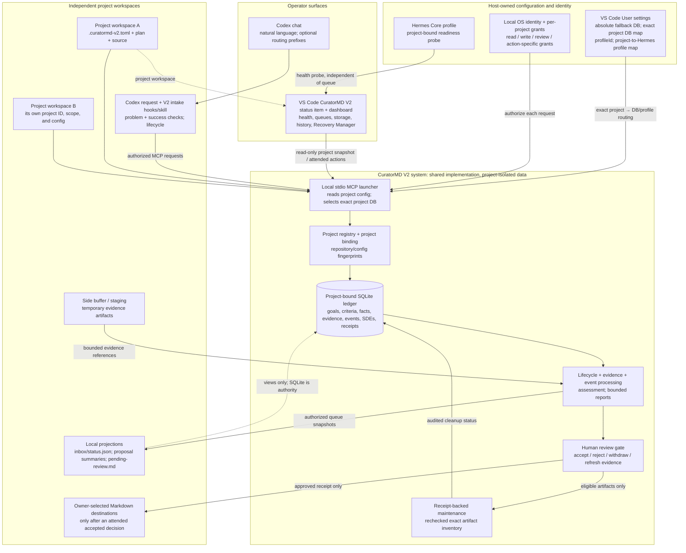

# CuratorMD V2 User Manual

**Audience:** project owners, developers, and operators using CuratorMD V2 from
Codex, Hermes, or the VS Code status extension.

**Scope:** CuratorMD V2 is a reusable, project-generic task ledger and review
system. This manual describes its system behavior and project configuration
model. Each project keeps its own configuration, source, local views, and
approved canonical knowledge.

## Abstract

CuratorMD V2 turns coding work into a small, auditable record: a problem, clear
success checks, progress facts, evidence, a completion state, and (when facts
merit durable learning) a proposal for a human to review. It is designed to
retain useful outcomes without keeping a transcript of the conversation.
SQLite is the authoritative ledger. Repository-side JSON and Markdown files
are working views or owner-approved persistence targets, not substitutes for
the ledger. A local project config pins each request to one project ID and one
database; host grants and the local identity determine which operations are
allowed. Hermes supplies profile-bound readiness information. The VS Code
extension displays health, queue, storage, history, and review state and
provides attended recovery actions.

CuratorMD V2 does not decide what knowledge should be published. It prepares
bounded candidate records from supported facts; the owner decides whether to
accept, reject, withdraw, or refresh them. Task completion and system health are
separate: a task can be complete while a proposal awaits review, and the
extension can report a healthy service while work remains in queues.

## History and problem addressed

CuratorMD V2 addresses a recurring problem in coding work: useful decisions
and verification are scattered across conversations, while keeping full
transcripts creates noise, privacy exposure, and weakly structured memory.
The system replaces transcript collection with explicit task state and compact
facts tied to a project and goal. This makes interrupted work resumable,
success criteria inspectable, and durable knowledge reviewable by its owner.

The design also addresses operational ambiguity. “Configured”, “readable”,
“healthy”, “captured”, “persisted”, and “approved” are different states. V2
keeps project health and task/review queues as separate reads, reports unknown
when it cannot establish a value, and preserves an audit receipt for reviewed
decisions and authorized cleanup.

CuratorMD V2 applies the same project boundary to every configured workspace:
the project owns its `.curatormd-v2.toml`, task plan, and local projections;
the host owns database/profile bindings and grants; CuratorMD V2 owns the
shared backend and integration implementation. Each project can use a
different profile, database, project ID, repository scope, and persistence
destinations.

## Solution conceived

V2 separates the work into five parts:

1. **Intake and lifecycle:** a natural-language request becomes a one-off goal
   or a child of an existing plan, with checkable success criteria.
2. **Evidence and facts:** progress is recorded as typed facts such as intent,
   change, verification, open gate, and completion. Verification distinguishes
   observed evidence from claims that have not been verified.
3. **Review and learning:** after confirmed completion, supported facts can be
   assessed into a pending SDE (Significant Development Event) proposal.
   Owner review controls what is accepted into durable project knowledge.
4. **Bounded persistence and cleanup:** accepted material is written only to
   selected configured documents. Temporary artifacts are eligible for
   cleanup only after the relevant approval receipt and exact inventory are
   confirmed.
5. **Operations and recovery:** Hermes readiness, Curator queue counts,
   storage, local projections, and review queues are observed separately. The
   extension shows actionable states and offers scoped, attended recovery.



**Diagram reading guide:** every project has its own ID, repository scope,
database binding, and grants. A nonempty database map requires an exact entry
for every configured project; a missing entry must fail closed rather than use
another project's database. `profileId` is a routing label, not a credential.
Hermes health is an independent host-readiness feed; it does not prove that a
user task was captured or that the Curator queue read succeeded. The V2 backend
and lifecycle arrows describe the system contract. Optional event-router or
scheduler dependencies appear as health gates only when that host deployment
configures them; their presence is not implied for every project.

## Before coding: configure a project workspace

### 1. Configure project identity and scope

Place `.curatormd-v2.toml` at the project root. Its `project_id` must be unique
in the host's Curator environment. Configure repository scope, checklist/plan
binding if used, staging location, and the persistence destinations approved
for that project. Treat this file as project-local routing and scope metadata;
it does not create host identity, grants, or Hermes profile credentials.

CuratorMD V2's own repository configuration permits all four canonical
knowledge files as persistence targets:

| CuratorMD system document | Purpose |
| --- | --- |
| `persistence/AGENTS.md` | Active, actionable repository rules. |
| `persistence/SOP.md` | Repeatable operating and recovery procedures. |
| `persistence/HISTORY.md` | Dated decisions and historical project context. |
| `persistence/LESSONS-LEARNED.md` | Verified causes, lessons, and prevention guidance. |

Those four targets belong to CuratorMD's repository configuration. For any
other configured project, its allowed destinations come from that project's
own config and knowledge policy. The review UI starts from the active project's
configured list and suggests destinations by content: dated outcomes to
`HISTORY.md`, verified reusable lessons to `LESSONS-LEARNED.md`, agent behavior
or routing changes to `AGENTS.md`, and repeatable procedures to `SOP.md`. The
owner reviews and can edit the final selection; an unconfigured document is
unavailable and cannot be approved.

### 2. Set host-level VS Code User settings

Use **User** settings, not workspace settings, for host database and profile
routing. Example shape (replace paths and IDs for the host):

```jsonc
{
  "curatormdV2.databasePath": "/absolute/path/to/curator/global.sqlite3",
  "curatormdV2.profileId": "host-selected-routing-label",
  "curatormdV2.databaseBindings": {
    "project-a": "/absolute/path/to/project-a/global.sqlite3",
    "another-project": "/absolute/path/to/another/global.sqlite3"
  },
  "curatormdV2.hermesProfileBindings": {
    "project-a": "project-a-coding",
    "another-project": "another-project-coding"
  }
}
```

| Setting | Meaning |
| --- | --- |
| `curatormdV2.databasePath` | Absolute fallback database path for a host using single-project routing. |
| `curatormdV2.databaseBindings` | Exact `project_id` to absolute database path map. When nonempty, every project needs an exact entry; no fallback is used for a missing key. Use separate databases when projects must be isolated. |
| `curatormdV2.profileId` | Host-selected profile routing label. It is not a user identity, secret, or authorization grant. |
| `curatormdV2.hermesProfileBindings` | Exact project ID to Hermes profile map used by the readiness probe and profile-scoped history. Missing mapping leaves Hermes health unknown. |
| `curatormdV2.hermesCommand` | Optional Hermes CLI path/command supporting the machine-readable Curator health probe. |
| `curatormdV2.serverCommand` | Optional local Curator V2 MCP launcher path/command. |
| `curatormdV2.evidenceConfig` / `evidenceConfigBindings` | Optional host-owned evidence verifier configuration; keep host files outside repositories and owner-only. An exact empty project binding disables shared fallback for that project. |

The extension rejects workspace overrides for host-sensitive routing and
launcher settings. Save the User settings and reload VS Code after extension
installation or update. Check the status item and open the dashboard to verify
the live feeds; a source change or installed package alone does not prove the
running window loaded it.

### 3. Confirm project access

Use the supported attended project access procedure for registration, binding,
or grants. The local service derives the authorization subject from the OS
identity and checks the required project grant on each request. Use the
smallest grant needed: `read`, `write`, `review`, event retry, retention-hold
release, and purge retry are separate authorities. Do not “repair” a missing
grant by re-enrolling the project or broadening unrelated grants.

## Operations and workflow while coding

### Start work

1. Open the intended project workspace.
2. State the coding request normally. Include the desired outcome and how it
   can be checked. Codex records the problem and success checks before
   implementation when the V2 intake integration is active.
3. For work that continues an existing plan, use the active plan item. If
   relationship is unclear, identify whether this is a plan continuation or a
   separate task before recording progress.
4. Begin implementation only after confirming the active goal and saved
   criteria. Record meaningful changes and verification as compact progress
   facts, not as a transcript.

### Route work in chat

Natural language is sufficient. These optional prefixes are explicit routing
shortcuts supported by the Codex integration:

There are no VS Code palette commands for starting or pausing a coding task,
and no slash-command vocabulary is required. The Codex integration interprets
the request in context; the prefixes below are optional routing controls.

| Chat wording | Effect |
| --- | --- |
| Normal work request | Start/resume a matching plan item or a one-off goal based on context. |
| `aotask: <work>` | Add a subtask or correction under the current active goal/plan item; keep its goal ID. |
| `ootask: <work>` | Force a distinct top-level one-off goal, separate from the current plan item. |
| `aatask: <request>` | Treat clearly unrelated repository work as an aside; do not mutate this project's goals or facts. |
| “hold” / “pause” | Save a checkpoint and defer the current task. |
| “resume” / “continue” | Find and reactivate the matching deferred task. If several match, select the intended one. |
| “next item” | Advance to the next child only when the current task is a plan item and the user intends to continue the plan. |
| “done” / “complete” | Request completion against saved checks. Codex must verify the checks and read back the confirmed lifecycle state. |
| “record this as durable knowledge” | Ask for an SDE proposal from supported facts. The proposal remains pending for owner review. |

“Finish this task” is an instruction to do the remaining work, not evidence
that it is already complete. Missing or stale evidence leaves the task open.
When complete, the report should contain a concise task summary and current
passing evidence for every success check. Only a confirmed complete state is
eligible for a separate SDE assessment.

### Review and persist learning

Open the VS Code status item or pending review document. Check the candidate's
facts, evidence state, completion outcome, significance/materiality, and
selected destinations. Accept or reject through the attended review flow.
Withdraw removes the pending proposal while retaining facts and receipts.
Refresh evidence reopens a completed task so new evidence can be recorded;
then finish and assess again. Acceptance is blocked when evidence is stale,
criteria are open, the candidate copy is stale/edited outside its editable
fields, or required artifact inventory cannot be confirmed. Save owner edits;
the extension preserves dirty or unrecognized review documents rather than
overwriting them.

Cleanup is a separate stage after an approved, canonically persisted receipt.
Review the exact cleanup inventory. Retry only artifacts covered by that
receipt after Curator rechecks the inventory. Finishing a task or accepting an
SDE does not authorize unrelated file deletion.

## Dashboard: values and interpretation

The bottom status item and dashboard combine separate observations. Read each
panel's state and timestamp; health and queue snapshots may have different
observation times.

### Status item colors

| Display | Meaning |
| --- | --- |
| Blue before a health read | No health read has completed yet. |
| Yellow | Health or review-count state is unknown or unavailable; inspect the feed-specific error and time. |
| Green | The latest valid project health snapshot is healthy. This does not imply empty queues or complete capture. |
| Red | The latest valid project health snapshot is degraded; inspect open gates and operational alerts. |
| Blue with a review count | Pending SDE reviews are outstanding. Review state takes precedence in the compact status item; pending approvals do not themselves degrade project health. |
| Purple in panels | Other review or action work needs attention. |

### Dashboard panels and fields

| Panel / value | What it means |
| --- | --- |
| **Hermes readiness** | Fresh profile-bound host probe and its dependency states. It is separate from Curator queue reads. |
| **Curator queue** | Fresh, complete, project-matched counts from the authorized SQLite snapshot. A failed read is unknown, never zero. |
| **Open gates** | Fixed health gate codes translated to plain language, such as event backlog, pending review, cleanup, capacity, staging scan, or dependency problems. |
| **Goal states** | Counts by lifecycle disposition. These describe saved work, not capture completeness. |
| **Events** | Retained receipt counts by event state, including waiting, processed, failed, quarantined, and expired/claimed states when reported. Failed and quarantined are different: manual retry is offered only for events Curator marks quarantined. |
| **Review queue** | Pending, approved, and rejected SDE proposal counts. Pending means owner action is still needed. |
| **Purge / expiry queues** | Approved or expired cleanup work waiting for eligible receipt-backed processing. A pending count is not authority to delete new artifacts. |
| **Facts and goals** | Retained project record totals. These do not reveal or reproduce the chat transcript. |
| **Project logical bytes** | Curator's logical record estimate for this project. |
| **Event payload bytes** | Retained payload accounting, distinct from project logical record bytes. Payloads may be scrubbed according to policy. |
| **SQLite main / WAL bytes** | Physical sizes of the shared database and write-ahead log. They are database-wide; do not attribute the full size to one project. A combined size over 250 MiB warns but does not block writes or control checkpointing. |
| **Staging bytes / inventory** | Observed size and whether the scan completed. An incomplete scan is a lower bound, not a complete total. The threshold warns at 75% and at/above the configured limit; it does not block writes. |
| **Filesystem capacity** | Available/used space for workspace and SQLite filesystems from the local host probe. At or below 10% free is a warning; unavailable values stay unknown. |
| **Health history** | Up to 60 timestamped checks scoped by project and mapped Hermes profile. The chart shows healthy high, degraded middle, unknown low. If VS Code global state cannot persist it, current samples may display but are marked unavailable for persistence. |
| **Operational error log** | Up to 100 bounded, project/profile-scoped error observations with category, safe summary, component, last-observed time, repeat count, and next action. It excludes raw exceptions, payloads, credentials, and project paths. |
| **Activity / goal report pages** | Paged read-only summaries. A page is a new authorized read; revision changes clear old pages and restart from page one. Old pages are not merged with new snapshots. |
| **Attention** | A compact list of degraded/unknown readiness, failed events/claims, review, cleanup, staging scan, or warning threshold. It is a snapshot, not external alert delivery or proof that all work was captured. |
| **Model/token use** | Not reported by this dashboard. A zero or blank value must not be inferred. |

Health history and the operational error log live in VS Code global state and
are scoped by the project plus its mapped Hermes profile. The database/WAL
sizes are shared-host measurements. The local JSON/Markdown projections are
rebuildable views; SQLite and approved persistence records remain authoritative.

## Troubleshooting and repair workflows

### Automatic behavior

The extension refreshes configured project health when it activates, when
workspace or Curator settings change, when the window regains focus, and on a
60-second dashboard interval. Health and queue feeds refresh independently.
Overlapping reads for one feed share a request. After three identical feed
failures, automatic checks for that feed pause to avoid a tight retry loop.
Opening the dashboard, requesting a manual refresh, or changing workspace or
Curator settings triggers a fresh attempt. The paused panel retains its last
source-specific failure and timestamp until a successful read.

The Codex integration performs bounded retries/readbacks for lifecycle and
projection work as described by the tool result. After an accepted SDE receipt,
it retries an incomplete projection refresh once. The six-hour purge timer,
when configured and healthy, handles only already-approved cleanup receipts.
Neither automation approves proposals, invents grants, switches project DBs,
nor deletes artifacts outside an approved receipt and rechecked inventory.

### Manual Recovery Manager actions

Open Command Palette → **CuratorMD V2: Open Recovery Manager** (the installed
dashboard may also expose **CuratorMD V2: Open Alpha Healing Toolbox**). Use
the action that matches the failing component:

| Action | Safe effect |
| --- | --- |
| **Retry recovery checks** | Re-read authorized health, queue, activity, and storage feeds; does not change grants or database bindings. |
| **Rebuild local inbox and review views** | Re-reads project queues and rebuilds local JSON/Markdown projections independently. Preserves unsaved/owner-edited review docs and does not reset SQLite. |
| **Refresh evidence** | Reopens the completed source task after reason/next-action confirmation; does not approve the stale candidate. Record fresh passing evidence, finish, then request a new assessment. |
| **Inspect failed and quarantined events** | Shows bounded project-bound metadata and digests, not event payloads. Retry one event only if Curator currently marks it quarantined and the exact event metadata/digest still match. |
| **Review eligible receipt page** | Archives only processed receipts whose payloads are already scrubbed, after reason, confirmation, and exact inventory recheck. Does not shrink the SQLite file by promise. |
| **Inspect cleanup receipt** | Reads canonical persistence, cleanup authorization, per-artifact states, holds, retry timing, and next safe action without changing them. |
| **Release hold** | Only appears for a receipt-confirmed eligible artifact; requires rationale, confirmation, reread, and the separate retention-hold grant. It may resume eligible cleanup; it does not approve new deletion. |
| **Retry approved cleanup** | Retries only already-approved, canonically persisted cleanup items after exact inventory recheck and confirmation; needs the separate purge-retry grant. |
| **Reset saved graph history** | Clears only local health-chart samples for the current project/profile and requests a fresh health read. Does not change Curator records, evidence, receipts, or Markdown. |

For database/Markdown disagreement, use the owner-reviewed storage reconciliation
procedure for the actual receipt and document. Do not hand-edit the database,
copy another project's database, or regenerate owner-edited Markdown blindly.

### Error reference: cause and repair

The extension translates known internal codes into fixed plain-language
messages. The code names below help an operator map that message to a repair.
First record the affected project, panel/component, error category, and
last-observed time from the dashboard. Then use the least-scoped repair below.

#### Project, database, launcher, and authorization

| Dashboard error / symptom | Likely meaning | Automatic path | Manual repair |
| --- | --- | --- | --- |
| `status-project-invalid`, `status-project-mismatch` | The project config lacks a valid project ID or returned project does not match it. | Read fails closed; no other project's state should be shown. | Open the intended workspace; validate `.curatormd-v2.toml` project ID and project binding. Use attended config/access update if its fingerprint changed; then refresh. |
| `status-database-binding-invalid` | No valid absolute DB path resolved from User settings. | Extension reports error; does not silently choose a DB when a project map is configured. | Set absolute `databasePath` for single-project use or exact `databaseBindings[project_id]`; save settings and refresh/reload. |
| `project-database-bindings-unavailable` | Owner-only host DB map missing, unreadable, invalid, or wrong permissions. | Launcher refuses project route. | Check `~/.config/curatormd-v2/database-bindings.json`, schema, ownership, and private permissions; reconcile host map with VS Code User settings. |
| `project-database-binding-missing` | Nonempty map has no exact project key. | Fails closed; does not use fallback or another project's DB. | Add the exact configured project ID and its intended absolute DB path; verify project registration in that DB; refresh. |
| `project-database-file-invalid`, `launcher-runtime` | Mapped file absent, unsafe/shared, corrupt/unavailable, or runtime cannot initialize. | Launcher returns a bounded initialization error. | Verify path, owner/private regular-file permissions, parent directory, disk space, SQLite integrity using the supported maintenance procedure, and compatible launcher/runtime. Never replace it with another project's database. |
| `project-config-stale` | Repository/config fingerprint changed since registration. | Access is refused until refreshed registration metadata is reviewed. | Run attended `curatormd-v2-access update` for this project, inspect the changed scope, then refresh. Do not re-enroll or recreate grants. |
| `project-binding-changed` | The project-to-database binding changed during launcher startup. | The in-flight request is refused rather than following a changing target. | Refresh and confirm the current exact project/database mapping. If it keeps changing, stop and have the owner review the binding and registration before retrying. |
| `project-repository-mismatch` | Open folder does not match the registered repository. | Read is refused. | Open the correct project root and check exact DB binding; use attended registration update only if the project actually moved. Never auto-enroll a different folder. |
| `project-registration-missing`, `consumer-binding-missing` | The selected DB has no active project binding. | Read is denied; no automatic registration. | Confirm the selected DB is correct. If so, use attended project registration/binding procedure and review scope/fingerprint before granting access. |
| `project-registration-inactive`, `consumer-binding-inactive` | The project registration or binding was intentionally disabled. | No access is restored automatically. | Have the owner inspect why it was disabled, then use the attended access workflow to reactivate only if still appropriate. |
| `launcher-start`, `launcher-exit`, `timeout`, `mcp-request`, `invalid-response`, `response-too-large` | MCP process could not start, closed before reply, stalled, returned malformed output, or exceeded the 4 MiB response cap. | Request times out after 15 seconds; bounded health retry may run; repeated identical feed failures pause auto-refresh. | Confirm launcher path/version and project config. Save work; reload VS Code/Codex host after transport exit, then retry. For oversized response inspect the local launcher/query and request a smaller page. Do not re-enroll or recreate grants. |
| `read-denied`, `project-read-grant-missing` | Current OS identity lacks active project `read` grant. | Access remains denied. | Verify the expected local account and exact project; owner reviews/adds only the `read` grant through attended access procedure. |
| `project-write-grant-missing`, `project-review-grant-missing` | Requested write or review operation lacks its distinct grant. | Decision or write is blocked; no broad fallback grant. | Confirm operation and local identity; owner grants only required project scope via attended procedure. Reopen/retry the exact action. |
| `project-event-retry-grant-missing`, `project-retention-hold-grant-missing`, `project-purge-retry-grant-missing` | Action-specific grant absent. | Retry/release/cleanup remains blocked. | Confirm the exact receipt/event and intended action; owner grants only that action scope through attended access procedure. Do not substitute general write. |
| `mcp-tool-error`, `invalid_request`, `forbidden`, `not_found`, `conflict`, `capacity_exceeded`, `rate_limited`, `internal_error` | Curator rejected the tool call, record lookup, revision, configured limit, request rate, or internal operation. | Safe fixed message; no exception or payload shown. | Correct entered values; refresh after conflict; wait after rate limit; inspect queue/storage for capacity. For forbidden, review the exact grant. For internal error, check compatible local installation and use Recovery Manager. Escalate with safe category/time, not sensitive payloads. |

#### Hermes and independent dashboard feeds

| Dashboard error / symptom | Likely meaning | Automatic path | Manual repair |
| --- | --- | --- | --- |
| `hermes-probe-start`, `hermes-probe-exit` | Hermes command failed to start or returned no health snapshot. | Probe is retried on the next scheduled/manual refresh; three identical errors pause that feed. | Check `hermesCommand` and that the CLI supports `--probe-curator-status`; run the probe through the selected profile's supported route and inspect its exit result. |
| `hermes-probe-profile-binding`, `hermes-probe-profile` | No exact project-to-profile mapping or invalid profile setting. | Hermes health stays unknown; Curator queue can still work. | Set `hermesProfileBindings[project_id]` to the intended profile in User settings; correct profile ID and refresh. |
| `hermes-probe-timeout`, `hermes-probe-stale` | Probe exceeded 20 seconds or snapshot is older than the freshness window. | Fresh scheduled/manual attempt; after repeated identical failures feed auto-pauses. | Check Hermes/profile responsiveness and selected profile runtime; open dashboard or click manual refresh once. |
| `hermes-probe-invalid`, `hermes-probe-unreconciled`, `hermes-probe-project-mismatch` | Probe missing required timestamped dependencies, contradictory fields, or belongs to another project. | Health remains unknown; queue feed is independent. | Use a Hermes version supporting the bounded JSON probe; verify profile binding and project identity, then refresh. Do not infer healthy from a partial probe. |
| `curator-queue-read`, `curator-queue-invalid`, `curator-queue-project-mismatch`, `curator-queue-stale` | Curator queue read failed, was incomplete, mismatched project, or was stale. | Queue panel remains unknown; health can still be reported. | Check project read grant, DB selection, local launcher, and fresh SQLite observation; use **Retry recovery checks**. |
| `feed-auto-paused` | Three consecutive identical failures for this feed triggered cooldown. | Auto checks pause for that feed; its last source error/time remain visible. | Open the dashboard, request a manual refresh, or change workspace/Curator setting; then inspect the underlying error if it repeats. |
| `status-evidence-binding-invalid` | Host evidence file binding invalid for this project. | Evidence verification remains unavailable/reject-all; task must not claim passing evidence. | Correct `evidenceConfigBindings[project_id]` or host evidence file, owner/private permissions, and project binding; refresh evidence and rerun checks. |

#### Health gates and operational conditions

| Gate / value | Meaning and automatic behavior | Manual repair |
| --- | --- | --- |
| `event_backlog` | Events await processing; configured router may process them. | Check the inbox and routing dependency; run the supported routing pass if available. |
| `event_failures` | At least one event failed processing. | Inspect safe event metrics and inbox; correct adapter/evidence rejection cause. Retry only after it is quarantined and digest/metadata still match. |
| `event_quarantine` | Events need retry or owner review. | Use **Inspect failed and quarantined events**; retry a single confirmed quarantined event with the action-specific grant. |
| `expired_event_claims` | A worker claim expired before processing finished. | Check router/worker readiness, then run one supported routing/recovery pass and inspect the resulting receipt. |
| `sqlite_payload_scrub_pending` | Temporary event payload data awaits database cleanup. | Check maintenance scheduler/readiness and use the supported approved retention/maintenance path; do not delete SQLite rows manually. |
| `review_backlog` | Pending SDE proposals await owner decisions. | Review candidates in the pending-review document. Pending review does not by itself mean service failure. |
| `purge_pending`, `purge_artifacts_pending` | Receipt-authorized cleanup remains pending. | Inspect exact cleanup receipt; verify canonical persistence and inventory; retry only approved cleanup. |
| `expiry_purge_pending`, `expiry_purge_artifacts_pending` | Expired records/artifacts await policy-approved cleanup. | Inspect the receipt/expiry state; allow configured maintenance or retry only when Curator confirms eligibility. |
| `event_capacity_exhausted`, `fact_capacity_exhausted` | Configured event/fact capacity has been reached. | Review queues and retention policy; archive eligible scrubbed receipts or owner-review fact compaction. Do not remove active or unreviewed records manually. |
| `staging_observation_time_unavailable`, `staging_inventory_incomplete`, `staging_adapter_unavailable`, `staging_inventory_unavailable` | Scan could not establish a fresh complete staging size. | Check staging path permissions, filesystem availability, and adapter; rerun storage read. Treat observed bytes as a lower bound while incomplete. |
| `staging_budget_warning`, `staging_budget_reached` | Staging is near/at configured warning threshold; writes remain allowed. | Review staged files and their owning task; clean only with task/receipt authorization. |
| `staged_artifacts_present` | Temporary files remain in the configured staging root. | Match files to their task and receipt; follow the approved cleanup workflow. |
| `dependency_unknown`, `dependency_unavailable`, `dependency_degraded` | Named host dependency has no fresh result, is unreachable, or reports degraded. | Use the row's action and inspect the named dependency (router, purge scheduler, DB adapter, host identity, human review, maintenance journal, hook inventory). Re-read health after repair. |

Operational event totals, when shown, may be separated into evidence rejection,
evidence-adapter error, and other error categories. These are counts reconciled
to project-bound metrics and receipt totals; if the inputs are incomplete or
cross-project, the dashboard shows unknown instead of inventing a zero.

#### Review documents, local views, history, and storage

| Symptom | Automatic behavior | Manual repair |
| --- | --- | --- |
| Local inbox/proposal view stale or missing | SQLite remains authoritative; successful independent views may still update. Decision receipt triggers one projection retry. | **Rebuild local inbox and review views**. Inspect each result separately. Do not hand-edit generated JSON. |
| Review Markdown has unsaved edits, missing markers, changed generated text, or obsolete draft | Refresh pauses to protect owner edits; action refuses stale/unsupported edits. | Save a copy, compare editable block with current candidate, retain owner text, and use supported reconciliation; reopen only after the document is valid. Saving alone does not submit a decision. |
| Accept blocked by stale evidence/open criteria | Decision is not recorded. | **Refresh evidence** with reason and next action, record fresh passing evidence for every check, complete and read back task, request a new assessment. |
| Health-history storage unavailable | Current chart may work in memory; persistence is shown unavailable. | Check VS Code global storage/profile permissions and disk. Reopen dashboard for fresh sample. Reset only if the owner explicitly wants to clear chart samples. |
| Operational error log unavailable | Dashboard reports unavailable instead of false empty. | Check VS Code global storage. Reopen/refresh; repair storage/permissions if needed. Existing Curator ledger is separate. |
| Database/Markdown content disagreement | No automatic overwrite or inferred resolution. | Use owner-reviewed storage reconciliation: inspect receipt, target document, exact goal block, expected/actual hash, and destination inventory; decide whether to restore the exact missing block or retain the owner-edited document. Preserve unrelated content. |
| SQLite/WAL or staging large | Warning is informational; it does not block writes or imply project-attributed usage. | Inspect storage and queues. Use supported checkpoint/retention/receipt procedures; do not delete DB, WAL, or staged files directly while active. |

### When the automatic path cannot recover

1. Keep the affected task open and preserve the visible error category/time.
2. Retry once from the matching dashboard feed or Recovery Manager action.
3. If transport exited, save work and reload the VS Code window or start a fresh
   Codex session. Do not re-enroll the project or recreate grants as a transport
   fix.
4. If configuration, registration, grant, or receipt is implicated, stop
   automatic retries and use the attended owner workflow for that exact
   project/action. Do not switch to a different database to make the error go
   away.
5. Re-read the affected feed and the relevant goal/receipt. Confirm the same
   project ID, current revision, fresh timestamp, and explicit successful
   result before marking recovery complete.
6. If still failing, report the safe component, fixed error category, project
   ID, version, and observation time. Do not attach credentials, event payloads,
   raw exception text, or sensitive paths.

## Operational boundaries and proof

- **Green health** means the latest valid project health read passed its
  configured checks. It is not evidence that all prompts were captured, tasks
  are complete, queues are empty, or SDEs are approved.
- **A successful source check** does not establish that the installed extension
  loaded or that the live VS Code dashboard is healthy. Reload the host and
  inspect its live status/dashboard for that claim.
- **An empty or unavailable panel** is not automatically a zero. Confirm a
  fresh, complete, project-matched read.
- **A local projection** is a convenience view; SQLite is authoritative.
- **A completed goal** is not an approved SDE. Owner review is required.
- **A persisted SDE** is not permission to clean arbitrary files. Cleanup needs
  an approved receipt and a rechecked exact inventory.
- **Project boundaries are independent.** Keep each project's ID, profile,
  database, repository scope, and persistence targets bound to that project;
  never reuse another project's configuration as a shortcut.

## Related material

- System design and implementation notes: [Curator V2 plan](curator-v2-plan.md)
- System context diagram:
  [Curator V2 Hermes Core diagram](diagrams/inkscape-curator-v2-hermes-core.svg)
- CuratorMD V2's project configuration: `../.curatormd-v2.toml`
- CuratorMD's knowledge rules and procedures: `../persistence/AGENTS.md`,
  `../persistence/SOP.md`, `../persistence/HISTORY.md`, and
  `../persistence/LESSONS-LEARNED.md`
- Each configured project defines its own `.curatormd-v2.toml` and persistence
  policy.
